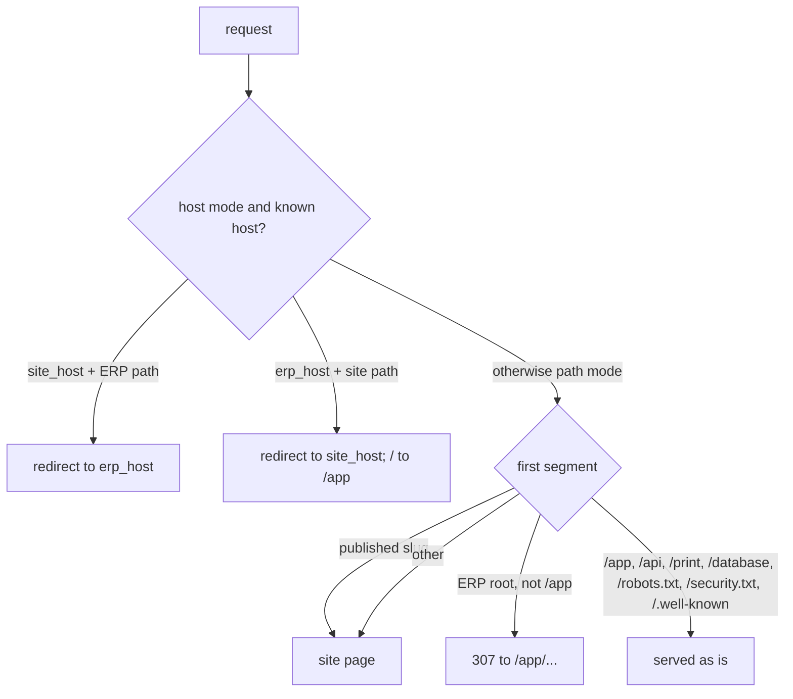

# ADR-026: Website routing and the ERP `/app` base path

**Status**: Accepted — see the [website core spec](https://github.com/noiia/EERP/blob/dev/docs/superpowers/specs/2026-09-29-website-2-core-design.md). Builds on [ADR-025](025-public-access-and-website-identities.md).
**Date**: 2026-09-29

---

## Problem
The public website needs `/` (and `/<slug>`), but the ERP already owns `/`, `/crm`, `/settings`…
The two must coexist on one Next app and one gateway, optionally on two hostnames
(`www.example.com` for the site, `erp.example.com` for staff) — without an admin being able to
lock themselves out of the ERP by saving a wrong setting.

## Decision
1. **Site at `/`, ERP under `/app`.** The ERP route tree moved to `apps/shell/app/app/`.
   `/api`, `/print` (pdf-service renders `frontend_base_url` + `/print/...`) and `/database`
   stay at the root: they are machine or pre-login endpoints, not ERP pages.
2. **The base is added at link time, by `erpPath()`.** Module routes, descriptors, `formPath`s
   and settings sections stay **module-relative** (`/crm/:id`); every emitted link, push and
   redirect goes through one idempotent helper. Alternative rejected: rewriting registry and
   descriptor paths to include `/app` — it touches every module and extension, and a missed
   prefix would silently break a descriptor instead of costing one redirect.
3. **Legacy bare ERP paths 307 to `/app/...`** (old bookmarks, hard-coded links) — unless a
   **published** site page owns that first segment. Temporary, not 308: the answer depends on
   the published-slug set, which changes, and a browser caches a 308 forever. The proxy fetches
   the published slugs (`?distinct=slug`, ≤ 500) plus the routing setting, forwarding the
   client IP (Go rate-limits `/public` per IP), and caches both 60 s in-process (2 s timeout,
   one in-flight fetch shared by concurrent requests). A failed fetch (outage, 429) keeps the
   last good value and retries after the TTL; with none yet it falls back to path mode, no
   slugs. So a slug such as `contacts` can win over the ERP root of the same name. Go
   additionally refuses reserved slugs and registered module names as a first line.
4. **Host mode is redirects, not rewrites.** `website.routing` = `{mode, site_host, erp_host}`.
   On `site_host` an ERP path redirects to `erp_host`; on `erp_host` a site path redirects to
   `site_host`, `/` goes to `/app`, and the ERP **keeps** its `/app` prefix. Redirects keep one
   canonical URL per page and let the same `erpPath` links work in both modes. Unknown hosts
   (IP, `localhost`) behave like path mode.
5. **Lockout guard.** `PUT` with `mode: "host"` is refused unless the request itself arrived
   through `erp_host`. Recovery override: `EERP_SITE_ROUTING=path` on `core-front`.
6. **The edge owns forwarding headers.** nginx sets `X-Forwarded-For $remote_addr` (never
   appends a client-supplied chain) and `X-Forwarded-Host`; the proxy still reads `Host`, which
   nginx passes through, never the client-controllable `X-Forwarded-Host`.

7. **Crawler and security files answer on every host.** `/robots.txt`, `/security.txt` and
   `/.well-known/security.txt` are never redirected: they are Next route handlers relaying Go's
   `/api/v1/public/{robots,security}.txt`, built from Settings → Website. robots.txt is computed
   for the requesting host — the ERP host in host mode gets `Disallow: /`, every other host the
   site rules (ERP, API, print, database and visitor pages disallowed, then the admin's extra
   lines). security.txt (RFC 9116) is served only while it has a contact and has not expired.

## Consequences and pitfalls
- A navigation site that forgets `erpPath` still works (through the 307) but costs a round trip.
- Old ERP `/login` bookmarks now open the **visitor** login (`/login`, beside `/signup`,
  `/account`, a separate website session); it carries a "Staff sign-in" link to the ERP login
  at `/app/login`.
- An upgraded ERP-only install has no home page yet: `/` then redirects to the ERP (`/app`)
  instead of a 404, until a home page (empty slug) is published.
- A published site page shadows an old ERP bookmark of the same first segment — the site owner's choice.
- Both sessions (ERP and site) are cleared only on a Go 401, never on 429/5xx.
- Cookies stay host-only: each hostname keeps its own sessions.
- Certificates: see [infra/nginx/README.md](https://github.com/noiia/EERP/blob/dev/infra/nginx/README.md).
