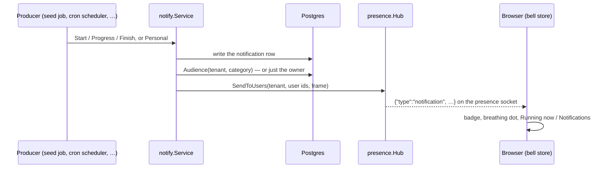

# ADR-032: Notifications and live activity

**Status**: Accepted · extends [ADR-020](020-user-presence-websocket.md)
**Date**: 2026-10-13

---

## Context

Long background work was invisible. A full demo-data seed was one ~40 s request with no sign of
progress; a cron ran in the background and only its own history row knew. Users also had no place
to be told about something that concerns them personally ("your seed finished", "your scheduled
action failed").

Two kinds of information had to reach the browser live:

- **Global activities** — a cron run, a seed — that every user *allowed to see that kind of
  activity* should follow, with progress while they run and a short history after.
- **Personal notifications** — addressed to exactly one user, and never visible to anyone else.

## Decision

Notifications are a **core** facility, `core/internal/notify`, used by core code and modules alike.



- **Storage.** `notification` (one row per personal message or global activity; `user_id` NULL =
  global), `notification_read` (per-user read marks), a per-tenant `notification_category` catalog
  synced from the Go registry at boot, and `role_notification_category` (which roles see which
  categories). Retention: finished global activities 7 days, personal notifications 30 days.
- **API.** `notify.RegisterCategory` at `init()`; `Personal(...)` for one-off messages;
  `Start(...)` → `Run.Progress(pct, label)` → `Run.Finish(err, body, data)` for activities.
  Progress is throttled (one live frame per 500 ms per activity, a row write only when the step
  label changes). At a real server start (`App.Run`, not `Build` — tests build against shared databases),
  activities a previous process left `running` (created before the start) are marked failed; the
  catalog syncs again after the default admin is seeded (boot and `dbmanage` provisioning), since on
  a fresh database that admin is the first user. A final write that fails is retried and the end
  state is published anyway.
- **Visibility is decided once, server-side, per publish.** A personal notification goes to its
  owner; a global one to `Audience(tenant, category)` — every user whose role closure (direct roles
  plus every role they transitively belong to) holds the category. The hub gets an explicit list of
  user ids and only routes; it never decides who may see what, and a role change applies on the
  next publish without hooks or re-login.
- **Delivery reuses the presence socket** (ADR-020). It already carries the session cookie on the
  one direct browser→Go connection; new frame types `notification` and `notification_read` are
  additive and ignored by older clients. On every (re)connect the browser re-reads
  `GET /api/v1/notifications`, since frames sent while it was down are not replayed.
- **Roles** pick categories on the role form's *Notifications* tab, a stock many2many over the
  generic-CRUD junction — the same pattern as role rights. Admin roles — technical name `admin`, or any role holding the `*:*:*` full-access permission —
  receive each category the first time it appears in a tenant's catalog (never again, so removing
  one sticks).

### Privacy invariant

Every read and write path filters on

```
tenant_id = caller.tenant AND (user_id = caller.user OR (user_id IS NULL AND (category = ANY(caller.categories) OR actor_id = caller.user)))
```

The initiator of an activity always sees it (and is always in its audience), so whoever starts a
seed can follow it whatever their roles. No route takes another user's id; mark-read silently ignores ids outside the filter (no existence
oracle); the wire shape never carries user, actor or tenant ids; live frames are only ever sent to
the computed audience.

## Consequences

- One `core-back` process: the hub is in memory (ADR-020's NATS fan-out remains the upgrade path).
- The full seed now answers `202 {notification_id}` and runs in the background — one per tenant at
  a time — and the Developer page follows it through the same live frames. Its result rows ride in
  the activity's opaque `data`.
- A notification `link` must be an ERP path (`/…`, never `//host`, a scheme or a backslash):
  `notify` refuses anything else and the bell re-checks before navigating.

## Alternatives rejected

- **A separate notifications WebSocket** — same filtering, but two sockets per tab and duplicated
  reconnect logic.
- **Polling through the BFF** — no new direct traffic, but progress updates in jumps and every open
  tab polls forever.
- **Caching each connection's categories and refreshing them on role changes** — needs a hook on
  every role, membership and belongs write, and gets it wrong the day one is forgotten; the
  per-publish audience query is always current.
