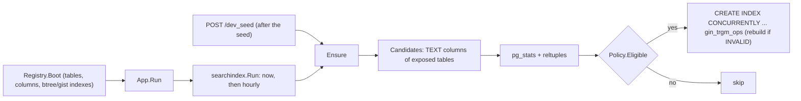

# ADR-033: List read performance: bounded totals and automatic trigram indexes

**Status**: Accepted. Builds on [ADR-015](015-search-filter-bar.md) (the `search[<col>]` filter) and
**Date**: 2026-10-13

---

[ADR-023](023-optional-redis-query-cache.md) (the read cache).

## Context
At 100k rows per table the generic list (`GET /api/v1/{table}`) was slow for two reasons, both
measured on the dev stack (cold, Go bridge IP, 2026-10-13):

| Request | Before | Cause |
|---|---|---|
| `GET /contact?page=N&page_size=50` | 46 ms | `count(*)` scans all 100k rows (~22 ms); the page itself is cheap |
| `GET /crm?page=N&page_size=50` | 54 ms | same |
| `GET /contact?search[name]=x` | 131 ms (p90 236) | `name::text ILIKE '%x%'` is a seq scan, run twice (count + page) |
| JSON encode/decode of a 50-row page | ~0.4 ms | negligible |

A REST to gRPC migration was evaluated and rejected: serialization is at most 0.4 ms of a 40-130 ms
request, and a generic protobuf `Struct` measured 4x slower than the current JSON.

## Decision
### 1. Bounded totals
The list counts exactly only up to `crud.ExactCountLimit` (10 000) rows (`SelectBuilder.CountUpTo`,
a capped `count(*)` over a `LIMIT n+1` subquery). Beyond it the total is the planner's estimate
(`SelectBuilder.EstimateRows`, from `EXPLAIN`), raised to the counted lower bound when the estimate
comes in below it, and the envelope carries `"total_estimated": true`. Redis cache entries written
before this change (no flag) decode as exact. The frontend's `formatTotal` renders such a total as
an estimate ("≈ 82718") in the list, Kanban, Calendar and record navigator. An estimate is displayed,
never trusted as a bound: the list grid pages with an unknown row count and offers a next page while
the current one is full, and the record navigator never disables "next" on it. Tables under the cap
behave exactly as before. The rule lives once, in `SelectBuilder.BoundedTotal`, which hand-written
list endpoints call too (`orm.ExactCountLimit`). The `mail_outbox` admin list does, since the outbox
keeps every email ever sent.

### 2. Automatic trigram indexes
`internal/searchindex` makes the framework index the columns the search bar queries, so a module
author does nothing.

- **Candidates:** every TEXT column of a table exposed on the generic CRUD surface, the columns
  `search[<col>]` can target.
- **`Policy.Eligible`** (`DefaultPolicy`) keeps a column only when an index pays for its write cost:
  table of at least 10 000 rows (below it a seq scan is about 1 ms), average width 4 to 1024 bytes
  (shorter values hold no useful trigrams, long blobs make a huge index), at least 100 distinct values
  (a 3-value `status` is better served by an equality filter).
- **`CREATE INDEX CONCURRENTLY`**, so writes are never blocked. An interrupted build leaves an
  INVALID index that `IF NOT EXISTS` would skip forever; the pass drops and rebuilds it.
- **Names** are `trgm_<8 hex>_<table>_<column>` (at most 63 bytes): the hash prefix keeps names unique
  per table/column even when truncated.
- **Never auto-drop:** a column that stops qualifying keeps its index; dropping is a manual decision.
- **Own advisory lock** (`7311990002`, distinct from the schema lock `7311990001`) so a long build does
  not stall schema migration, and several processes do not build the same index. The lock is only
  tried (`pg_try_advisory_lock`): when another pass holds it, the pass is skipped and the next hourly
  one catches up. Waiting would deadlock: a session blocked on the lock holds a snapshot that the
  holder's `CREATE INDEX CONCURRENTLY` waits out, and Postgres can't detect the cycle.
- **No DDL when idle:** the pass reads extension and index state first and issues no `Exec` when
  nothing is to do, because any DDL bumps the whole database's Redis cache generation (ADR-023).
  `pg_trgm` is checked (and installed if absent) at most once per pass, only when an index must be
  built, so a role refused `CREATE EXTENSION` yields one error, not one per column.
- **Cadence:** `searchindex.Run` runs right after boot (off the boot path: a first build can take
  minutes) and hourly, from `App.Run`. Dev seeding calls `Ensure` itself once the seed succeeds, inside
  the background job, under a "Building search indexes" progress step (a failure is logged, never a
  seed failure; it is skipped if the maintainer is mid-pass). Only tables with fresh statistics
  qualify then: the seed ANALYZEs some of the tables it loads, the rest wait for autovacuum and the
  hourly pass.

## Consequences and pitfalls
- A new table is indexed within an hour of crossing 10 000 rows and being analyzed by autovacuum (or
  at once after dev seeding).
- Searches shorter than 3 characters can't use trigrams and still scan, but are bounded by `LIMIT`
  plus the bounded count.
- Estimated totals can be off by the statistics' error (82 718 estimated for 100 019 live rows
  before an ANALYZE), and by far more for a filter the planner can't estimate (a text-cast
  `filter[]` estimated 376 rows where 100 020 matched, so the total is the 10 001 floor): page until
  an empty page instead of trusting the last page number.
- A pass skipped because another holds the lock is not retried until the next tick (an hour later).
- `CREATE EXTENSION pg_trgm` needs privileges; on a managed database an admin must run it once.
- Indexes are not dropped automatically. Don't hand-write a trigram index in a module's `Migrate()`.

## Rejected
Keyset pagination (the grid uses numbered pages, and a shallow `OFFSET` costs about 5 ms once the
count is bounded), a custom JSON encoder (saves at most 0.2 ms), gRPC (measurements above), and
hand-written per-module indexes (every module would have to remember, and nothing would adapt to
table size).

## Measured result
Cold, 20 requests each, p50, 100k contacts, after rebuilding `core-back`:

| Request | Before | After |
|---|---|---|
| `GET /contact?search[name]=<random>` | 110 ms (index dropped, measured) / 131 ms (initial) | 2.0 ms |
| `GET /contact?page=<random>&page_size=50` | 46 ms | 8.0 ms, `total_estimated: true` |
| `GET /company?page=1&page_size=50` (4 rows) | n/a | 0.9 ms, exact total, no `total_estimated` key |

Dropping `trgm_9d48f467_contact_name` and restarting the backend logged
`searchindex: built trigram indexes` and the index was valid again.
