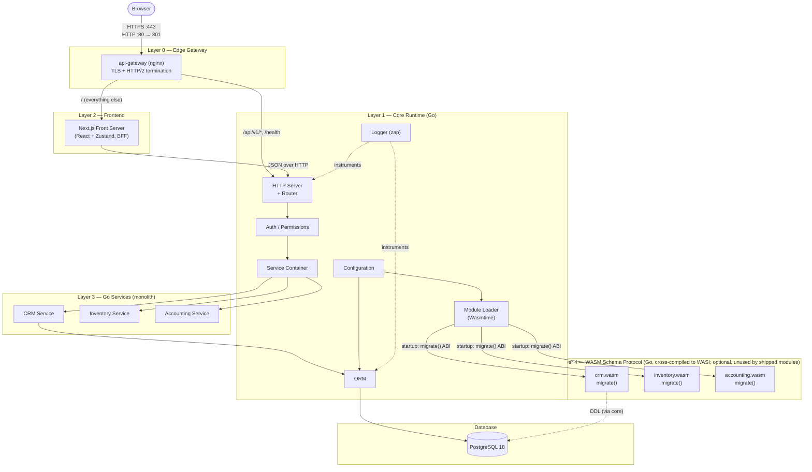
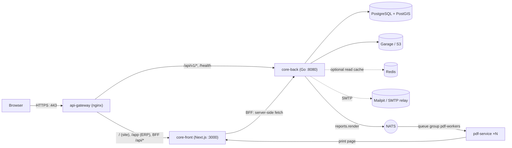
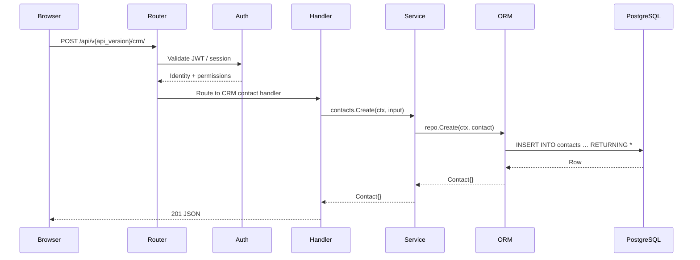
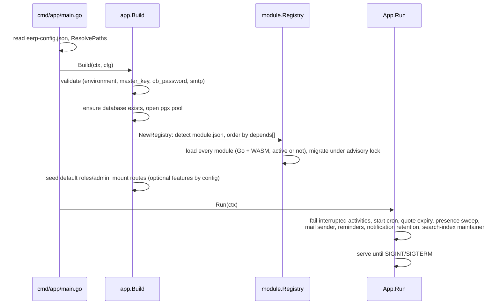
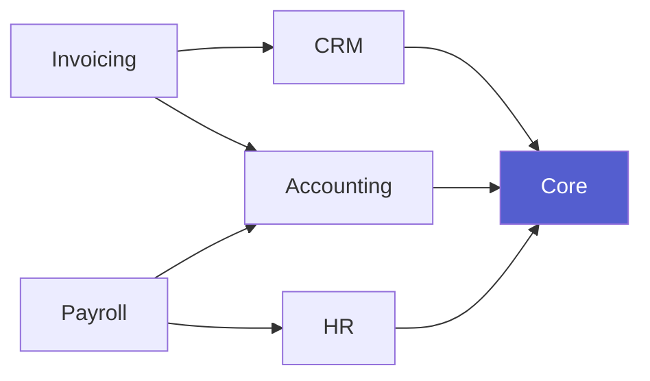
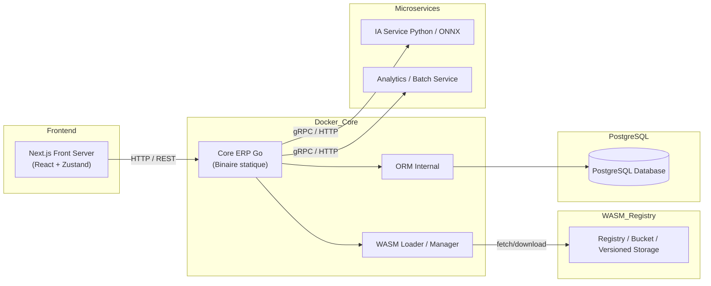
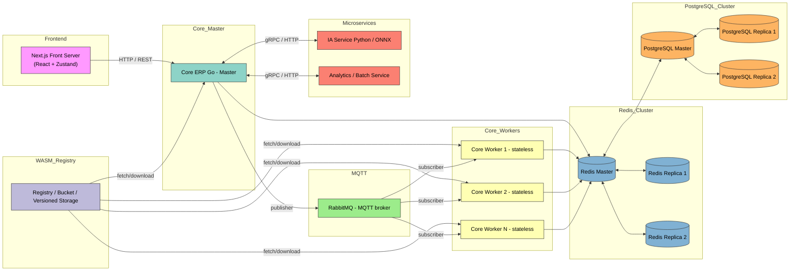

# Architecture Overview

EERP is built as a **pluggable runtime for ERP business logic**. The core handles infrastructure concerns (database, module loading, HTTP, configuration); business domains live inside a two-part module system: a WASM binary for schema declaration and a Go service for business logic.

---

## The Hybrid Module Model

EERP modules have two components with different responsibilities:

| Component | Language | When it runs | What it does |
|---|---|---|---|
| WASM binary (optional) | Go, cross-compiled to WASI (`GOOS=wasip1 GOARCH=wasm`) | Startup only | Declares the module's DB schema via `migrate()` ABI, when a module sets `"type": "wasm"` |
| Go service | Go (compiled into the monolith) | Every request | Implements business logic, exposes HTTP handlers |

This split gives sandboxed schema ownership without the IPC cost of routing every request through WASM.

!!! danger "This is Go, not Rust"
    Earlier documentation (and the ADR-002 decision record before its correction) described the
    WASM path as a Rust toolchain. That subsystem never existed — no `Cargo.toml`, no `.rs`
    source, anywhere in the repository. `make build` cross-compiles each module's own **Go**
    source to WASI. See [ADR-002](../adrs/002-wasm-modules.md).

> **Current state**: every shipped module sets `"type": "go"` in its `module.json` and compiles directly into the core binary via `module.RegisterGoModule` (see `core/modules/crm/`, `core/modules/all/all.go`). Its schema is derived automatically by the ORM's `orm.Register[T]` auto-migration diffing — no `migrate()` call involved. The Wasmtime/WASI loader is fully implemented and active for the `"type": "wasm"` path (`core/internal/module/load.go`), but no shipped module currently uses it.

---

## The Layers

Each layer has a strict contract with the one below it. Modules never talk to each other directly — all inter-module communication flows through the core. The gateway is the one layer that sits *outside* this chain of contracts rather than inside it: it terminates TLS and routes by path, but never inspects or participates in the application protocol above it (no auth, no business logic) — see [Edge Gateway](#edge-gateway-api-gateway) below.

### Runtime topology

The layers above run as these Compose services. The browser only ever talks to the gateway;
`pdf-service` is reachable from neither the gateway nor the browser.

| Service | Role | Optional? |
|---|---|---|
| `api-gateway` | TLS, HTTP/2, routing; the only published port | no |
| `core-front` | public site at `/`, ERP at `/app`, BFF | no |
| `core-back` | the Go core and every compiled-in module | no |
| `db` | PostgreSQL 18 + PostGIS (+ `pg_trgm`) | no |
| `garage` | S3-compatible object storage (pictures, attachments, PDFs) | features need it |
| `nats` + `pdf-service` | PDF rendering pool ([Reports](../core/reports.md)) | reports need it |
| `redis` | [read cache](../core/query-cache.md) | yes |
| `mailpit` | dev mail catcher; a real SMTP relay in production ([Mail](../core/mail.md)) | yes |

See [Deployment & Bootstrap](../developer-guide/deployment.md) for how each environment starts them.

---

## Why This Architecture

### Schema ownership without IPC

Classic ERP systems suffer from tight coupling between business logic and framework code. EERP inverts this: each module owns its database schema, while business logic runs as a compiled Go service with direct ORM access and no serialization overhead per request. Schema ownership has two mechanisms today: the ORM's own auto-migration diffing (`orm.Register[T]`, used by every shipped `"type": "go"` module) and, optionally, the sandboxed WASM `migrate()` ABI for a module that sets `"type": "wasm"`.

The WASM boundary, when used, is intentionally narrow: it is only crossed once per module per startup, not on every HTTP request.

### Schema ownership per module

Each module owns its database schema. For the standard `"type": "go"` path, `module.LoadGoModules` snapshots the schema registry before and after a module's `Register()` call and applies the diff as idempotent DDL (`CREATE TABLE IF NOT EXISTS`, `ADD COLUMN IF NOT EXISTS`) — see [Server Integration → Startup migration flow](../development/server-integration.md#startup-migration-flow). For the optional `"type": "wasm"` path, the WASM loader instead calls `migrate()` on the module's cross-compiled binary, reads the returned JSON from WASM linear memory, and applies the DDL operations directly. Either way:

- A module can be deployed to any EERP instance without manual schema setup.
- Modules evolve their schemas independently.
- The core never contains domain-specific table definitions.

### Type safety without reflection overhead

The ORM uses Go generics and compile-time struct inspection to build all metadata once at startup. Every subsequent query operates on pre-computed field maps with zero reflection. This is critical for ERP workloads where a single request can trigger dozens of queries.

---

## Layer Responsibilities

### Edge Gateway (api-gateway)

`api-gateway` (nginx, `infra/nginx/nginx.conf`) is the **only** thing the browser ever talks to in
a Compose deployment — neither `core-front` nor `core-back` publish a host port of their own
(`compose.yml`'s `expose:`, not `ports:`, on both). It is a thin, stateless routing/TLS layer: it
holds no session state, makes no authorization decisions, and never touches application data.

**Flows** — routed by path, not by host or method:

| Path | Routed to | Notes |
|---|---|---|
| `/api/v1/*`, `/health` | `core-back :8080` | The Go API, straight through |
| `/healthz` | itself | Gateway's own liveness probe; the one path exempt from the HTTPS redirect |
| everything else | `core-front :3000` | the public website (`/`), the ERP (`/app/…` — see [Website → Routing](../core/website.md#routing-path-or-host-mode)), static assets, and the BFF's own `/api/*` routes (auth, pictures, attachments, reports — see [Object Storage Across Layers](../architecture/object-storage-topology.md)) |
| `/.well-known/acme-challenge/` | the `acme-webroot` volume | Let's Encrypt HTTP-01 challenges, production only |

Plain `http://` (port 80) 301-redirects to `https://` (port 443) for every path except `/healthz`.
HTTP/2 is negotiated only on the TLS listener — see [HTTP Pipeline → TLS/HTTP2 Edge
Gateway](../core/http-pipeline.md#tlshttp2-edge-gateway) for why (browsers, and Node's `undici`
client, don't reliably speak cleartext h2c) and for the ADR behind it
([ADR-018](../adrs/018-http2-edge-rest-batching.md)).

**Dependencies** — the gateway is deliberately the *last* thing to become ready:

- `gateway-certs` (a one-shot container) must complete successfully first — it provisions a
  self-signed TLS certificate into a shared volume (`infra/nginx/gen-certs.sh`, idempotent). The
  gateway has nothing to terminate TLS with until this has run once.
- `core-front` must have started (`condition: service_started` — not `service_healthy`; the
  gateway doesn't block on the frontend being fully warmed up, just running).
- It has **no** direct dependency on `core-back`, `db`, `garage`, `nats`, or `pdf-service` — those
  are `core-back`'s dependencies, one layer further in. A gateway that's up with a backend that
  isn't simply returns upstream errors for `/api/v1/*`, rather than failing to start.

See [Deployment → Docker Compose](../developer-guide/deployment.md#the-deployed-stack) for
the full service topology this sits in front of.

### Core Runtime (Go)

| Component | Responsibility |
|---|---|
| `cmd/app/main.go` | Flags and config loading only; hands off to `internal/app` |
| `internal/app` | `Build` validates config, opens the pool, boots the module registry, mounts every route (testable — returns errors, never exits); `Run` starts background jobs and serves |
| `orm/` | Type-safe database access via generics |
| `internal/module/detector.go` | Filesystem scan, `module.json` parsing, dependency resolution, priority assignment |
| `internal/module/load.go` | Wasmtime instantiation, `migrate()` call, DDL execution |
| `internal/module/migration.go` | `applyMigration` — version-gated DDL via pgx |
| `internal/types/` | Shared data contracts (Config, Module, Migration, Operation) |
| `internal/common/` | Logger (zap), JSON utilities, dependency graph |

The core is deliberately minimal. It provides infrastructure; it contains no business logic.

### WASM Modules (Schema Protocol) — optional path

Only relevant to a module that sets `"type": "wasm"`; every shipped module today uses `"type": "go"` instead and skips this entirely. Each module's WASM binary:

1. Declares its identity and dependencies in `module.json`
2. Exports `migrate() → *u8` and `migrate_len() → usize` — the schema ABI
3. Returns a Migration JSON describing the tables and columns it needs

The binary is sandboxed by Wasmtime: a panic or infinite loop cannot crash the Go process.

### Go Services (Business Logic)

Each module's Go service:

1. Defines entity structs (embedding `model.BaseModel`)
2. Instantiates a typed `orm.Repository[T]` for each entity
3. Implements business operations using the ORM's query builder and transaction API
4. Gets generic CRUD routes for every registered table automatically, and mounts hand-written handlers only where a rule needs one (see [Automatic Router](../core/router.md))

### Frontend (Next.js + Zustand)

The frontend is a **React application running on a dedicated Next.js front server**. The browser talks only to the Next.js server, which acts as a Backend-for-Frontend (BFF): it owns the `HttpOnly` session cookie, performs token refresh server-side, and proxies authenticated requests to the core's HTTP API. The Go core is never exposed directly to the browser. The front server has no knowledge of module internals — it only calls routes exposed by the core.

Shared client state (current user, resolved permissions, active tenant, UI flags) lives in **Zustand** stores, whose selector-based subscriptions keep a data-dense ERP UI from suffering the re-render cascades that React Context causes.

The earlier "no front-end server, static CDN" stance was deliberately reversed to give the frontend a server tier for session handling and server-side rendering. See [ADR-004](../adrs/004-csr-frontend.md).

---

## Data Flow: A Typical Request

---

## Startup Sequence

Every error in `Build` is returned rather than fatal, so `internal/app/app_test.go` boots the whole
wiring against the test database and drives real routes. Background jobs start only in `Run`, so
tests never spawn them.

---

## Module Dependency Graph

Modules declare dependencies in `module.json` via the `depends` array. The detector performs a topological sort and assigns a numeric priority. Modules at the same priority level load concurrently; different priority levels are sequential. This guarantees that a module's dependencies are always loaded before it.

In this example, `Core` (priority 0) loads first, `CRM`, `Accounting`, and `HR` load concurrently at priority 1, then `Invoicing` and `Payroll` load concurrently at priority 2.

---

## Key Design Constraints

1. **Modules never import core packages.** The contract is the WASM ABI and the HTTP API, not Go types.
2. **The ORM never interpolates values.** All user-supplied data is passed as parameters (`$1`, `$2`, …). SQL injection is structurally impossible.
3. **Soft delete is the default.** Hard delete is explicit and audited. ERP systems require audit trails.
4. **Configuration is a single JSON file.** No environment variable soup, no multi-file inheritance. One file, one source of truth.
5. **The core has no business logic.** If you find yourself adding domain-specific code to the core, it belongs in a module.

---

## Goal

The main objective is to finish the project with the following architecture.

### First version (V1.0.0)

This first version is a MVP, it includes only the main elements of the ERP in order to develop on to custom it as much as possible. On this architecture, both relations between modules/plugins and external services are included but the system isn't yet design to scale. The caching, scaling and architecture improvements are dedicated to the second version of the ERP as readable on the second diagram under.

### Second version (V2.0.0)

This version of the architecture is mainly turned around the high capacity and scaling. The first version should act as an entire worker and accept any connexion. The second version accept a master comportement that get connected to the mqtt and stay the backend entrypoint. Its comportement looks more like an API gateway but accepts workload to reduce useless server creation. 