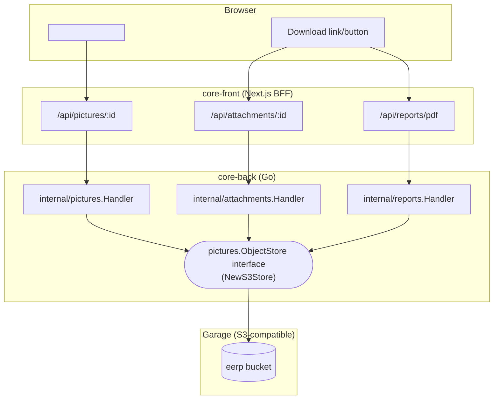

# Object Storage Across Layers

Three backend services — pictures, attachments, and reports — all store binary content in the
same S3-compatible bucket, through the same Go abstraction, but each relates to that shared store
differently. This page is the cross-cutting view: not what each service does on its own (see
[Object Storage](../core/object-storage.md) and [Reports & PDF
Generation](../core/reports.md) for that), but how the frontend, the BFF, the Go core, and Garage
line up as one topology, and where the three services deliberately diverge.

---

## One store, one interface, three consumers

All three handlers are constructed with the **same** `pictures.ObjectStore` interface and the
**same** `pictures.NewS3Store(cfg)` client (`core/cmd/app/main.go`) — `internal/attachments` and
`internal/reports` don't have their own S3 client type, they're handed the pictures package's one.
There is exactly one `s3_*` configuration block (`s3_endpoint`, `s3_region`, `s3_bucket`,
`s3_access_key`, `s3_secret_key` — see [Configuration](../core/configuration.md#field-reference))
and, in the shipped dev/Compose setup, exactly one bucket. The three services share it by
convention on **key prefix**, not by separate buckets or separate credentials.

**The browser never talks to Garage.** In every path, the flow is browser → gateway → `core-front`
BFF route → `core-back` handler → Garage. Garage's S3 API is `expose`d internally only in
`compose.yml` (never `ports:`); the host-mapped `3910:3900` you'll see in a local `docker compose
up` is a deliberate exception purely for native dev tooling (`make run-back-tests`, a bare `go
run`) to reach it directly via `eerp-config.json`'s `s3_endpoint` — not a path the browser or the
Next.js BFF ever takes. See [Edge Gateway](index.md#edge-gateway-api-gateway) for the layer this
all sits behind.

---

## Where the three services diverge

| | [Pictures](../core/object-storage.md) | [Attachments](../core/object-storage.md#attachments-generic-files) | [Reports](../core/reports.md) |
|---|---|---|---|
| Object key | `{tenant}/{table}/{record}/{field}/{uuid}` | `{tenant}/{table}/{record}/{field}/{uuid}` | `reports/{tenant}/{report_name}/{record}/{unix_timestamp}.pdf` |
| Postgres metadata row? | Yes — `picture` table, one per anchor | Yes — `attachment` table, one per anchor | **No** — nothing tracks a report object at all |
| Identity model | DB row id, looked up by anchor `(table, record, field)` | Same as pictures | **The key itself is the capability** — handed back in the generation response, never looked up |
| On re-generate/re-upload | Replaces in place at the same anchor (old object best-effort deleted) | Same as pictures | Writes a **new** key every time (the timestamp suffix) — nothing is ever replaced |
| Delete path | Hard delete: row removed, then object best-effort deleted | Same as pictures | **None.** Old report objects accumulate in the bucket indefinitely |
| Tenant isolation check | SQL: `WHERE tenant_id = $1` on the metadata row | Same as pictures | String prefix check: the requested key must start with `reports/{caller's tenant}/` |
| MIME restriction | Whitelisted (`image/png`, `image/jpeg`, `image/webp`) | None — any file type | Fixed to `application/pdf` |
| Consumed as | `` inline (picture) or canvas-drawn (signature) | Named download (`Content-Disposition`) | Named download |

The pictures/attachments shape (metadata row, fixed anchor, replace-in-place, hard delete) is the
[record-anchored services](../core/record-anchored-services.md) pattern applied to binary content.
Reports deliberately **does not** follow it — it's a simpler, one-way "generate and hand back a
capability" shape, chosen because a report is disposable derived output regenerated on demand, not
a field value a record owns long-term. Don't take one as a template for the other; picking the
wrong shape for a new binary-content feature is the most likely way this page goes stale — check
which of these two shapes actually fits before copying either handler.

!!! warning "Reports have no cleanup path"
    Every `POST /api/v1/reports/:name/:id/pdf` writes a brand new object and nothing ever removes
    old ones. This is a known, accepted gap for now (see [ADR-011 →
    Consequences](../adrs/011-pdf-report-generation.md)), not a bug — a future retention sweep
    (mirroring [Cron](../core/cron.md)'s own `SweepHistory` pattern) is the natural fix if bucket
    growth ever becomes a real problem.

---

## Why one interface instead of three

`pictures.ObjectStore` is a three-method interface (`Put`/`Get`/`Delete`) wrapping `minio-go/v7`,
provider-agnostic by construction — the same client works against Garage (dev), AWS S3, or MinIO
without a code change, only a config change. Once that abstraction existed for pictures, giving
attachments and reports their own S3 client would have meant re-solving connection setup,
credential handling, and provider-agnosticism twice for no benefit — they simply take the same
constructed `ObjectStore` value pictures already builds. This is the same "an existing
provider-agnostic layer gets reused, not re-invented" reasoning [ADR-011 →
Context](../adrs/011-pdf-report-generation.md) gives for reports specifically.

## Related

- [Object Storage](../core/object-storage.md) — pictures and attachments in depth
- [Reports & PDF Generation](../core/reports.md) — the reports delivery model in depth
- [Record-Anchored Services](../core/record-anchored-services.md) — the anchor pattern pictures/attachments follow (and reports doesn't)
- [Edge Gateway](index.md#edge-gateway-api-gateway) — why the browser never reaches Garage directly
- [Configuration → Field Reference](../core/configuration.md#field-reference) — the `s3_*` fields all three services share
