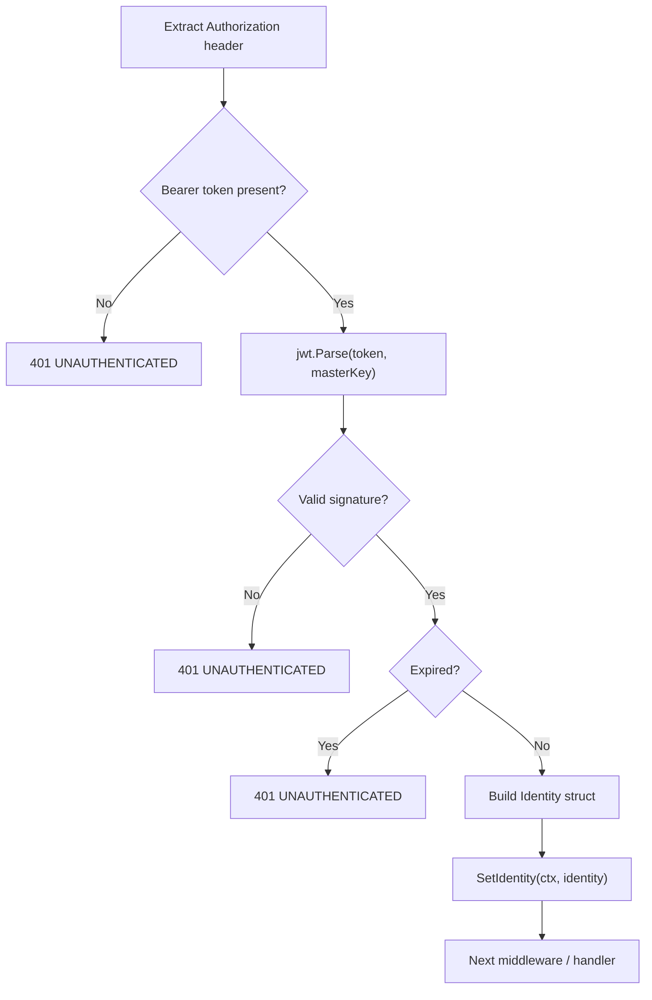
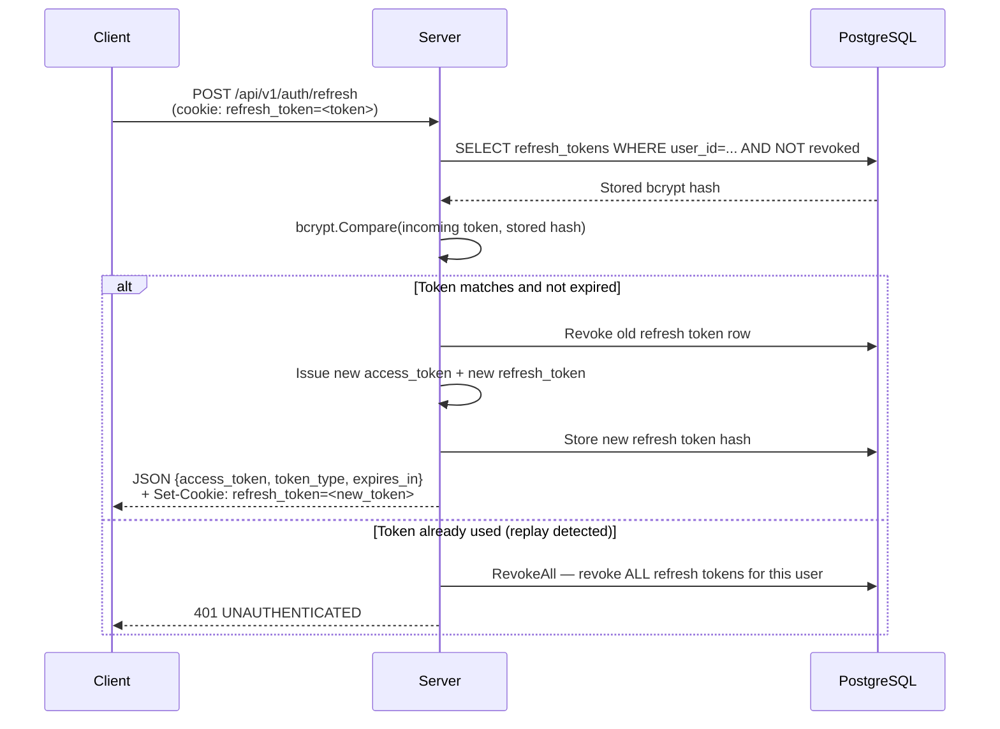
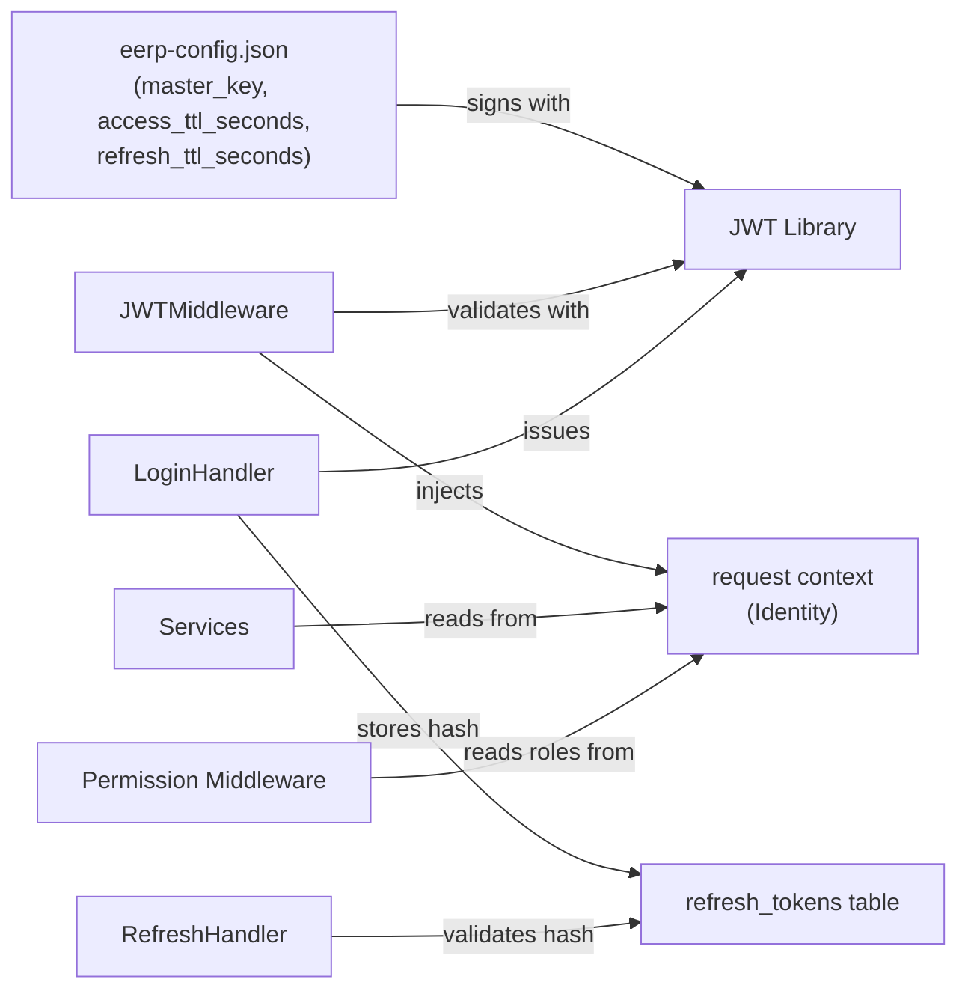

# Authentication

## Purpose

Authentication answers the question: **who is making this request?** Every non-public endpoint must establish an identity before allowing the request to proceed.

---

## Responsibilities

- Issue signed tokens on successful login
- Validate tokens on every protected request
- Inject the authenticated identity into the request context
- Refresh tokens before they expire
- Revoke sessions on logout and on token replay detection

---

## JWT with `master_key`

EERP uses stateless JWT authentication. The `master_key` from `eerp-config.json` is the HMAC-SHA256 signing key. No external identity provider is required for basic deployments.

Token TTLs are configurable via `eerp-config.json`:

| Config field | Default | Purpose |
|---|---|---|
| `master_key` | — | HMAC-SHA256 signing secret (required, must not be empty) |
| `access_ttl_seconds` | 3600 (1 h) | Access token lifetime |
| `refresh_ttl_seconds` | 604800 (7 d) | Refresh token lifetime |

---

## Login Flow

```mermaid
sequenceDiagram
    participant Client
    participant AuthHandler
    participant DB as PostgreSQL
    participant JWT as JWT Library

    Client->>AuthHandler: POST /api/v1/auth/login {email, password}
    AuthHandler->>DB: SELECT user WHERE email=$1
    DB-->>AuthHandler: User row (or not found)
    note over AuthHandler: If user not found, run dummy bcrypt<br/>to prevent timing attacks
    AuthHandler->>AuthHandler: bcrypt.CompareHashAndPassword
    AuthHandler->>JWT: Sign({sub, tenant, roles, iat, exp=now+access_ttl})
    JWT-->>AuthHandler: access_token
    AuthHandler->>AuthHandler: Generate refresh token, store bcrypt hash in DB
    AuthHandler-->>Client: JSON body {access_token, token_type: "Bearer", expires_in}<br/>+ Set-Cookie: refresh_token=<token>; HttpOnly; Secure; SameSite=Strict
```

!!! important "Refresh token transport"
    The refresh token is **never returned in the response body**. It is delivered exclusively as an `HttpOnly; Secure; SameSite=Strict` cookie named `refresh_token`. This prevents JavaScript access and CSRF abuse.

### Login Response Body

```json
{
    "access_token": "eyJ...",
    "token_type": "Bearer",
    "expires_in": 3600
}
```

---

## Access Token Payload

```json
{
    "sub": "01J...",
    "tenant": "01J...",
    "roles": ["admin", "crm_user"],
    "iat": 1705312200,
    "exp": 1705315800
}
```

| Claim | Type | Description |
|---|---|---|
| `sub` | UUID string | User ID |
| `tenant` | UUID string | Tenant/organisation ID |
| `roles` | `[]string` | Effective role names for permission checks |
| `iat` | Unix timestamp | Issued at |
| `exp` | Unix timestamp | Expiry |

---

## JWT Validation Middleware

On every protected request the JWT middleware:



Authentication errors use a uniform error envelope — see [HTTP Pipeline](http-pipeline.md#error-envelope).

---

## Identity in Context

The JWT middleware injects the authenticated identity into the Echo context. Downstream handlers retrieve it via two accessors:

```go
// Safe retrieval — returns false if identity is missing (e.g. on public routes)
identity, ok := auth.IdentityFromContext(ctx)

// Strict retrieval — panics if identity is missing
// Use only inside handlers that are guaranteed to be behind JWTMiddleware.
// A panic here indicates a middleware wiring bug, not a user error.
identity := auth.MustIdentity(ctx)
```

The `Identity` struct:

```go
type Identity struct {
    UserID   uuid.UUID
    TenantID uuid.UUID
    Roles    []string
}
```

Services use `IdentityFromContext` to filter by tenant or scope business logic:

```go
func (s *Service) ListContacts(ctx context.Context) ([]Contact, error) {
    identity, ok := auth.IdentityFromContext(ctx)
    if !ok {
        return nil, errors.New("unauthenticated")
    }
    return s.contacts.Query().
        Where(orm.Cond("tenant_id = $1", identity.TenantID)).
        All(ctx, s.db)
}
```

---

## Token Refresh

The refresh endpoint accepts the refresh token from the `refresh_token` cookie, falling back to a `{"refresh_token": "..."}` JSON body if the cookie is absent.



!!! warning "Replay detection"
    If a refresh token that has already been used is presented again, the server calls `RevokeAll`, invalidating every active session for that user. This indicates a token was stolen and used by an attacker after the legitimate client already consumed it.

Refresh tokens are stored as **bcrypt hashes** in the `refresh_tokens` table. The raw token is never persisted; a database breach does not expose live tokens.

---

## Logout

`POST /api/v1/auth/logout` revokes all refresh tokens for the authenticated user and clears the `refresh_token` cookie by setting `MaxAge=-1`. The short-lived access token remains technically valid until its natural expiry — handlers requiring immediate revocation must check the `revoked` flag separately.

---

## Multi-Tenancy

Every entity that belongs to a tenant has a `tenant_id` column. The authentication middleware injects the tenant ID from the token; services filter by it. The ORM provides no automatic tenant filter — services are responsible for applying `WHERE tenant_id = $1` with the value from the identity context.

---

## Data Models

```go
// Users — tenant-scoped accounts
type Users struct {
    model.BaseModel          // uuid PK, created_at, updated_at, deleted_at
    TenantID     uuid.UUID `db:"tenant_id"`
    Email        string    `db:"email"`
    PasswordHash string    `db:"password_hash"`
}

// RefreshTokens — one row per active session
type RefreshTokens struct {
    model.BaseModel
    UserID    uuid.UUID `db:"user_id"`
    TokenHash string    `db:"token_hash"` // bcrypt hash, never raw
    ExpiresAt time.Time `db:"expires_at"`
    Revoked   bool      `db:"revoked"`
}
```

---

## Interactions



See also: [Permissions](permissions.md), [HTTP Pipeline](http-pipeline.md).

---

## Extension Points

| Extension | How |
|---|---|
| External IdP (OAuth2/OIDC) | Replace `LoginHandler` with OIDC callback; map claims to `Identity` |
| Session-based auth | Replace JWT with server-side session store; keep the `Identity` context contract |
| API keys | Issue long-lived tokens with restricted roles; validate via same middleware |
| MFA | Add a second factor check between password validation and token issuance |
