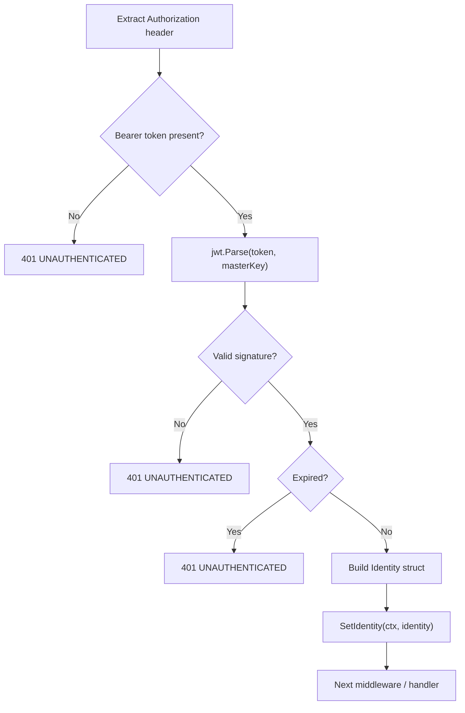
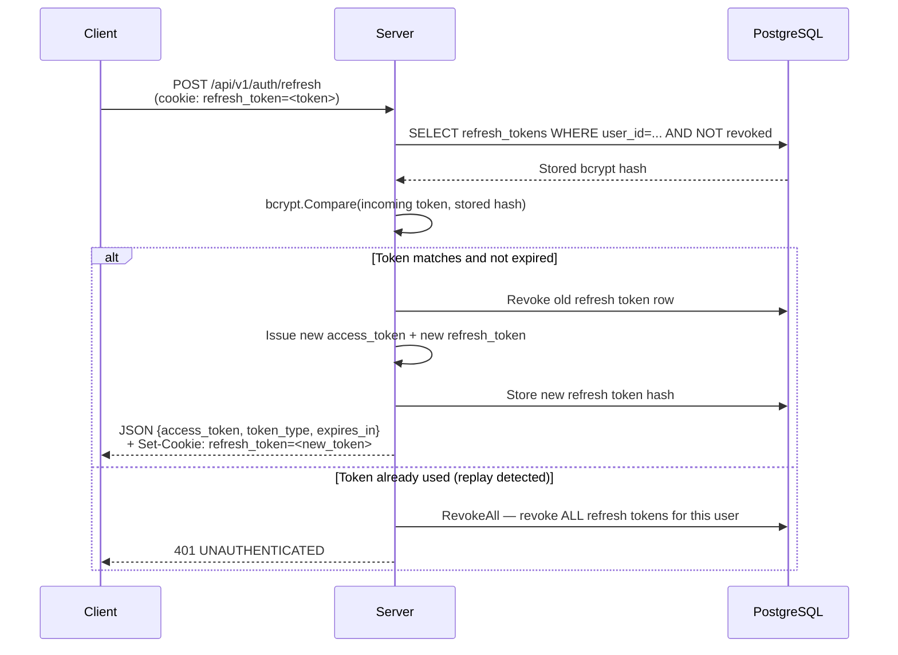
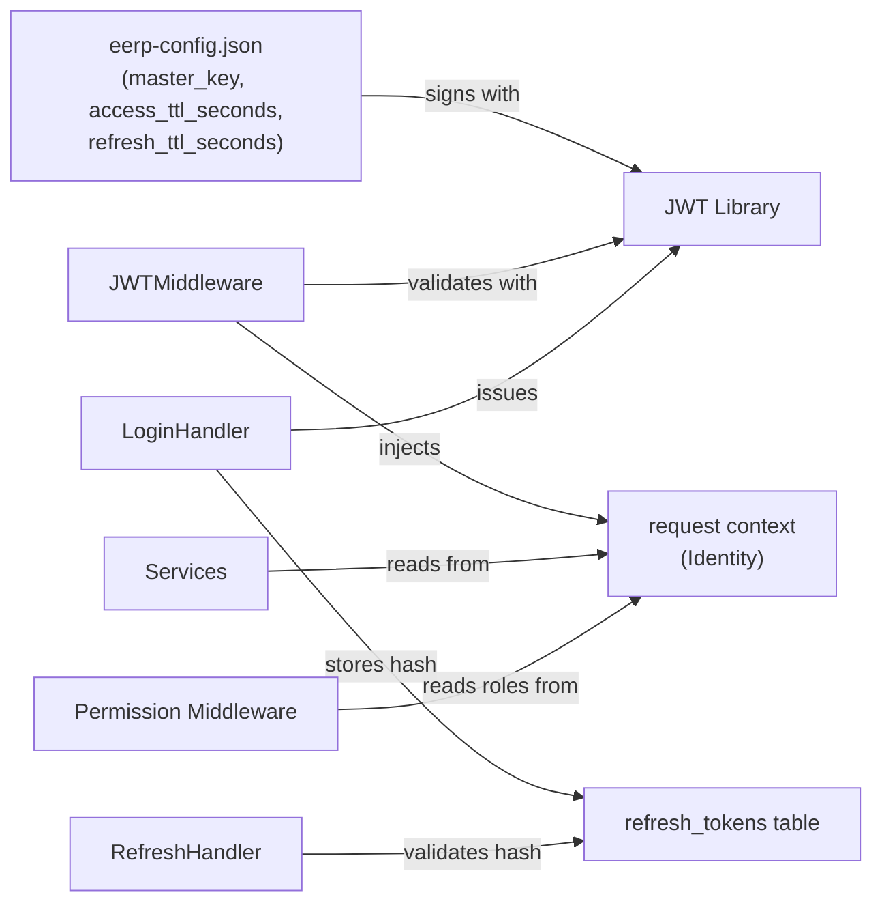

# Authentication

## Purpose

Authentication answers the question: **who is making this request?** Every non-public endpoint must establish an identity before allowing the request to proceed.

---

## Responsibilities

- Issue signed tokens on successful login
- Validate tokens on every protected request
- Inject the authenticated identity into the request context
- Refresh tokens before they expire
- Revoke sessions on logout and on token replay detection

---

## JWT with `master_key`

EERP uses stateless JWT authentication. The `master_key` from `eerp-config.json` is the HMAC-SHA256 signing key. No external identity provider is required for basic deployments.

Token TTLs are configurable via `eerp-config.json`:

| Config field | Default | Purpose |
|---|---|---|
| `master_key` | — | HMAC-SHA256 signing secret (required, must not be empty) |
| `access_ttl_seconds` | 3600 (1 h) | Access token lifetime |
| `refresh_ttl_seconds` | 604800 (7 d) | Refresh token lifetime |

---

## Login Flow

```mermaid
sequenceDiagram
    participant Client
    participant AuthHandler
    participant DB as PostgreSQL
    participant JWT as JWT Library

    Client->>AuthHandler: POST /api/v1/auth/login {email, password}
    AuthHandler->>DB: SELECT user WHERE email=$1
    DB-->>AuthHandler: User row (or not found)
    note over AuthHandler: If user not found, run dummy bcrypt<br/>to prevent timing attacks
    AuthHandler->>AuthHandler: bcrypt.CompareHashAndPassword
    AuthHandler->>JWT: Sign({sub, tenant, roles, iat, exp=now+access_ttl})
    JWT-->>AuthHandler: access_token
    AuthHandler->>AuthHandler: Generate refresh token, store bcrypt hash in DB
    AuthHandler-->>Client: JSON body {access_token, token_type: "Bearer", expires_in}<br/>+ Set-Cookie: refresh_token=<token>; HttpOnly; Secure; SameSite=Strict
```

!!! important "Refresh token transport"
    The refresh token is **never returned in the response body**. It is delivered exclusively as an `HttpOnly; Secure; SameSite=Strict` cookie named `refresh_token`. This prevents JavaScript access and CSRF abuse.

!!! note "Constant-time login"
    When the email is unknown, the handler still runs a full bcrypt comparison against a **real** dummy hash generated once at startup at `bcrypt.DefaultCost` (the same cost as stored passwords). This equalises response time between "no such user" and "wrong password", so timing cannot be used to enumerate valid accounts. (An earlier placeholder string was not a valid hash and returned instantly, leaving the side-channel open.)

!!! tip "Brute-force protection"
    The public `/api/v1/auth/*` endpoints are rate-limited per client IP (default 20 requests/min, configurable via `auth_rate_limit_per_minute`). Exceeding the limit returns `429 Too Many Requests`. See [HTTP Pipeline](http-pipeline.md#rate-limiting).

### Login Response Body

```json
{
    "access_token": "eyJ...",
    "token_type": "Bearer",
    "expires_in": 3600
}
```

---

## Access Token Payload

```json
{
    "sub": "01J...",
    "tenant": "01J...",
    "roles": ["admin", "crm_user"],
    "iat": 1705312200,
    "exp": 1705315800
}
```

| Claim | Type | Description |
|---|---|---|
| `sub` | UUID string | User ID |
| `tenant` | UUID string | Tenant/organisation ID |
| `roles` | `[]string` | Effective role names for permission checks |
| `iat` | Unix timestamp | Issued at |
| `exp` | Unix timestamp | Expiry |

---

## JWT Validation Middleware

On every protected request the JWT middleware:



Authentication errors use a uniform error envelope — see [HTTP Pipeline](http-pipeline.md#error-envelope).

---

## Identity in Context

The JWT middleware injects the authenticated identity into the Echo context. Downstream handlers retrieve it via two accessors:

```go
// Safe retrieval — returns false if identity is missing (e.g. on public routes)
identity, ok := auth.IdentityFromContext(ctx)

// Strict retrieval — panics if identity is missing
// Use only inside handlers that are guaranteed to be behind JWTMiddleware.
// A panic here indicates a middleware wiring bug, not a user error.
identity := auth.MustIdentity(ctx)
```

The `Identity` struct:

```go
type Identity struct {
    UserID   uuid.UUID
    TenantID uuid.UUID
    Roles    []string
}
```

Services use `IdentityFromContext` to filter by tenant or scope business logic:

```go
func (s *Service) ListContacts(ctx context.Context) ([]Contact, error) {
    identity, ok := auth.IdentityFromContext(ctx)
    if !ok {
        return nil, errors.New("unauthenticated")
    }
    return s.contacts.Query().
        Where(orm.Cond("tenant_id = $1", identity.TenantID)).
        All(ctx, s.db)
}
```

---

## Token Refresh

The refresh endpoint accepts the refresh token from the `refresh_token` cookie, falling back to a `{"refresh_token": "..."}` JSON body if the cookie is absent.



!!! warning "Replay detection"
    If a refresh token that has already been used is presented again, the server calls `RevokeAll`, invalidating every active session for that user. This indicates a token was stolen and used by an attacker after the legitimate client already consumed it.

Refresh tokens are stored as **bcrypt hashes** in the `refresh_tokens` table. The raw token is never persisted; a database breach does not expose live tokens.

!!! note "Atomic rotation"
    Rotation revokes the previous tokens and inserts the new one inside a **single transaction** (`orm.Transact`). A failure part-way can never leave a user with every token revoked and no replacement, which would strand their session.

---

## Logout

`POST /api/v1/auth/logout` revokes all refresh tokens for the authenticated user and clears the `refresh_token` cookie by setting `MaxAge=-1`. The short-lived access token remains technically valid until its natural expiry — handlers requiring immediate revocation must check the `revoked` flag separately.

---

## User & Role Administration

Accounts and roles are managed through dedicated, audited endpoints — never through the generic CRUD surface (see [ORM → API exposure](orm.md#api-exposure-vs-registration) for why `users`/`roles` are `WithExcluded()`).

| Method | Route | Permission |
|---|---|---|
| `GET` | `/api/v1/users` | `users:users:read` |
| `POST` | `/api/v1/users` | `users:users:write` |
| `GET` | `/api/v1/users/:id` | `users:users:read` |
| `PUT` | `/api/v1/users/:id` | `users:users:write` |
| `GET` | `/api/v1/roles` | `roles:roles:read` |
| `POST` | `/api/v1/roles` | `roles:roles:write` |
| `GET` | `/api/v1/roles/:id` | `roles:roles:read` |
| `PUT` | `/api/v1/roles/:id` | `roles:roles:write` |

Permissions follow the same route-derived `module:resource:action` convention as every other handler — see [Permissions](permissions.md).

- **Creating a user** (`POST /api/v1/users {email}`) starts the account **locked**: no `password_hash` is set, so login is impossible until a separate credential-setting flow runs. Only `email` is writable via `PUT`. `password_hash` is never present in any request or response body.
- **Creating a role** (`POST /api/v1/roles {name, description}`) starts with **no grants** — permissions are assigned through their own flow, not at creation time.
- List responses use the same `{ data, total }` envelope as generic CRUD, so the frontend's `ApiClient` (see [View Engine](../frontend/view-engine.md)) consumes both uniformly.
- There is deliberately no `DELETE` yet, and no permission-grant endpoint — both are left to their own purpose-built, audited flows rather than being folded into this API.

---

## Multi-Company (Within a Tenant)

A tenant can host several **Companies** (legal entities) — a settings-scoping concept, not a second
tenancy dimension. `Users.ActiveCompanyID` is a per-user preference (mirroring `preferred_locale`
exactly), read and written through the existing `GET/PUT /api/v1/me/preferences` endpoint rather
than a new one — switching company is instant, with no token re-issue. Business tables (contacts,
invoices, CRM records) carry no `company_id` and are unaffected by which company is active; only
workspace *settings* (locale, number format, view configuration, report page formats) and a shared
company name/address/phone/email profile are company-scoped. See
[ADR-013](../adrs/013-multi-company.md) and [Settings & Workspace
Configuration](settings.md#multi-company-scoping) for the full mechanism.

---

## Multi-Tenancy

Every entity that belongs to a tenant has a `tenant_id` column. The JWT middleware reads the `tenant` claim from the token and stamps it onto the request context (`orm/access.WithTenant`).

The **generic CRUD layer isolates tenant-owned tables automatically**: any registered table with a `tenant_id` column has every read and write scoped to the caller's tenant, `tenant_id` is forced server-side on create and is immutable on update, and a missing tenant fails closed rather than running unscoped. See [ORM → Tenant isolation](orm.md#tenant-isolation) for the full contract.

Code that bypasses the generic layer and drops to the query builder (the `ListContacts` example above) is **not** auto-scoped and must apply `WHERE tenant_id = $1` from the identity context itself.

---

## Data Models

```go
// Users — tenant-scoped accounts
type Users struct {
    model.BaseModel          // uuid PK, created_at, updated_at, deleted_at
    TenantID     uuid.UUID `db:"tenant_id"`
    Email        string    `db:"email"`
    PasswordHash string    `db:"password_hash"`
}

// RefreshTokens — one row per active session
type RefreshTokens struct {
    model.BaseModel
    UserID    uuid.UUID `db:"user_id"`
    TokenHash string    `db:"token_hash"` // bcrypt hash, never raw
    ExpiresAt time.Time `db:"expires_at"`
    Revoked   bool      `db:"revoked"`
}
```

!!! warning "Auth tables are not exposed via generic CRUD"
    `users`, `roles`, `permissions` and `refresh_tokens` are registered with the ORM (so their schemas migrate and the typed repos work) but are **excluded from the generic HTTP CRUD surface** with `orm.WithExcluded()`. Auto-generated CRUD on them would be a privilege-escalation and cross-tenant integrity risk (mutating the global permission catalog, creating password-less users, listing token hashes). Account, role and permission management must go through dedicated, audited endpoints. `password_hash` is additionally excluded from all API input and output. See [ORM → API exposure](orm.md#api-exposure-vs-registration).

---

## Interactions



See also: [Permissions](permissions.md), [HTTP Pipeline](http-pipeline.md).

---

## Extension Points

| Extension | How |
|---|---|
| External IdP (OAuth2/OIDC) | Replace `LoginHandler` with OIDC callback; map claims to `Identity` |
| Session-based auth | Replace JWT with server-side session store; keep the `Identity` context contract |
| API keys | Issue long-lived tokens with restricted roles; validate via same middleware |
| MFA | Add a second factor check between password validation and token issuance |
