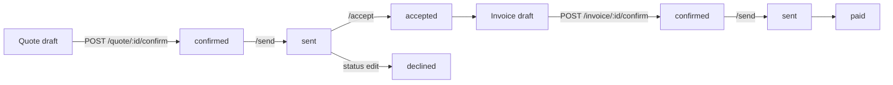

# Business Apps

The business modules under `core/modules/` are ordinary Go modules (`type: go`) built on the core
services. This page records the rules each one enforces beyond plain generic CRUD. The
[Project App](project.md) and [Teams](teams.md) have their own pages; events are in
[Events & Booking](events.md).

---

## Contact

`core/modules/contact`: the people and companies every other app points at (CRM, sale customers and
recipients, event bookings, website accounts).

- A contact's `kind` is `company` (a parent) or `contact` (a person), picked with radio buttons on the
  form. Rows from before kinds existed are backfilled as `contact`; code creating a contact sets
  `contact.KindContact`.
- Companies and people link **many-to-many** through `contact_company` (`contact_id` the person,
  `company_id` the company; unique live pair): a person belongs to 0..n companies, a company has 0..n
  contacts. The form's first notebook page shows the other side: *Contacts* on a company, *Companies*
  on a person (the hidden page drops its tab).
- A contact carries `surname`, `phone` and the seven `address_*` columns (same names as `users`, so the
  address widget works), copied from the account at website signup, and is a website
  [form target](website.md#forms).

!!! warning "Pitfall"
    The older free-text `company` column predates the link and isn't synced with it.

## Warehouse

`core/modules/warehouse`: the product catalog (`product`, `product_variant`, `product_uoms`).

- A product has a unit price excluding tax, a picture (shown on top of the form) and an optional unit
  of measure `uom_id`. It has **no tax rate of its own** any more: its taxes are sale's `product_tax`
  links. A variant may override the price and add an extra tax rate.
- **Automatic references**: with the app setting `auto_reference` on (Settings → Apps → Warehouse,
  `warehouse.settings`, `GET|PUT /api/v1/settings/warehouse`, `settings:warehouse:*`, default on), a
  new product takes the next number of the tenant's sequence (`PRD-00001`, starting after existing
  `PRD-<n>` references) and keeps it on edit; the form reads the setting as its
  [form context](../frontend/views-and-components/form-view.md#form-context) and shows the field
  read-only. Off, the reference is typed.

## Sale

`core/modules/sale` (`depends: [warehouse]`): quotes and invoices.

### Numbers are never typed

A create (`POST /api/v1/quote`, `POST /api/v1/invoice`) takes the next number of the creator's active
company's **yearly sequence** (`Q-2026-0001`, `INV-2026-0001`, one atomic upsert on `sale_sequence`;
a sequence's first use starts after any number of that year already present), and an edit can't change
it. A deleted draft leaves a gap.

### Workflow

Each step is server-side, one transaction, and needs `<table>:<table>:write`:

- Confirm needs at least one line; a document with no line stays a draft on a plain PUT too.
- **Send** renders the document's PDF (no PDF renderer configured ⇒ no attachment; a failed render
  sends nothing) and queues one email per recipient (the customer and every `quote_recipient` /
  `invoice_recipient` contact), with the templates `sale.quote_sent` / `sale.invoice_sent`
  ([Mail](mail.md)).
- **Accept** converts the quote into a draft invoice with its own number, the quote's lines at their
  quoted prices, the recipients and `invoice.quote_id`.
- In the UI these are [header buttons](../frontend/views-and-components/form-chrome.md#header-buttons)
  calling `runAction`; a refusal shows Go's message beside them.

The quote form keeps only the contact (bill-to fields are filled from it); quotes and invoices print
the billing address left and the customer details right. Reports `sale.quote` / `sale.invoice` extend
`core.default` (the letterhead, see [Reports](reports.md)).

### Product taxes and units

- `product_tax` links a product to its `sale_tax` rows; sale adds a *Taxes* tags field to the product
  form by a view extension. An invoice line created from a variant gets one `sale_line_tax` link per
  product tax (relinked when the variant changes); a quote line gets the percentage taxes folded into
  its `tax_rate`. A variant's own rate adds on top. Line tables show taxes as tags.
- A line's unit is the one it picks, else its product's; its symbol (else name) fills the line's `unit`
  column, which the line tables and the PDF print. A unit the line names must exist (422).
- At boot, a database's former `product.tax_rate` values are turned into tax links once.

## CRM

The lead form's status is an **editable status bar** (`statusBar: { field: 'status', editable: true }`):
clicking a step sets and saves it. Which field and which steps show can be overridden per workspace
(see [Form Chrome → Status bar](../frontend/views-and-components/form-chrome.md#status-bar)). CRM is a
website [form target](website.md#forms) (a message lands in a lead's `notes`).

## Property management

- The property form is two-column and locates the property from its address (the map widget's
  `autoLocate`, see [Geographic Widgets](../frontend/views-and-components/geo-widgets.md)).
- Settings → Apps → Property management → **Display taxes on report** (`propertymanagement.settings`,
  `GET|PUT /api/v1/settings/propertymanagement`, off by default) prints the rent receipt PDF's Tax
  column; the report column's `display` condition reads `display_taxes`, which the receipt GET adds.
- Every handler override is scoped to the caller's tenant.

## Related

- [Project App](project.md) · [Teams](teams.md) · [Events & Booking](events.md)
- [Settings](settings.md) · [Reports](reports.md) · [Mail](mail.md)
