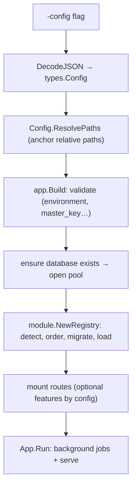

# Configuration

EERP reads one JSON file at boot. No environment-variable overrides, no layered files, no
runtime mutation: the effective configuration is exactly what the file says, validated before
anything starts. The **frontend build reads the same file** (its `module_root`) to discover
modules, so one file describes the deployment for both sides.

## Which file

| File | Used by | Created by |
|---|---|---|
| `eerp-config.json` | host-native dev (`make run-back`), tests, frontend build | `make bootstrap`, from `eerp-config.example.json` |
| `eerp-config.docker.json` | the dev Compose stack | `make bootstrap`, from `eerp-config.docker.example.json` |
| `eerp-config.prod.json` | production Compose | `make bootstrap-prod` |

All three are **gitignored** — they hold secrets. Only the `*.example.json` templates are
committed. The bootstrap scripts fill `master_key`, `db_password` and the `s3_*` keys with
generated secrets ([Deployment](../developer-guide/deployment.md)).

The backend takes the path with `-config`:

```bash
go run ./cmd/app -config="../../eerp-config.json"
```

**Relative paths** (`module_root`, `api_config_path`, `cron_log_dir`) are anchored to the
**config file's directory**, not the process's working directory — the app (run from
`core/cmd/app`), the tests (from `core`) and the frontend build (from `core-front`) all resolve
`core/modules` to the same place. Prefer repo-relative paths.

## Reference

### Core

| Key | Default | Meaning |
|---|---|---|
| `environment` | **required** | exactly `development` or `production`; anything else refuses to boot. `development` enables demo seeding; `production` forces the seeded default admin to change its password at first login |
| `module_root` | **required** | directories scanned for `module.json` |
| `master_key` | **required** | signs every JWT, encrypts stored secrets, gates [database management](database-management.md). Boot refuses an empty/default value, a value once committed to the repo, or fewer than 32 bytes (`openssl rand -base64 48`) |
| `public_address`, `backend_port` | **required** | bind address and port |
| `backend_host`, `backend_version` | `public_address`, `v1` | how clients reach the API (the frontend derives `API_BASE` from them) |
| `api_config_path` | — | optional `api.yaml` (cosmetic API overrides); set but missing/malformed = fatal |
| `seed_demo_data` | `false` | dev-only sample data at boot (ignored outside `development`) |

### Database

| Key | Default | Meaning |
|---|---|---|
| `db_host`, `db_port`, `db_user`, `db_password` | **required** | PostgreSQL connection (PostGIS image; `pg_trgm` expected). Boot refuses an empty/default `db_password` or `postgres` |
| `db_name` | `poc` in shipped configs | database; created at boot if missing. Rewritten by a [database switch](database-management.md) when the file is writable |
| `max_connection`, `min_connection` | 10, 2 | pool size |

!!! note "Pool timing keys are not wired"
    `max_conn_idle_time`, `max_conn_life_time`, `health_check_period` and `connect_timeout`
    appear in the example configs but are **not passed to the pool** today: the pool always
    uses its defaults (30 min idle, 1 h lifetime, 1 min health check, 10 s connect timeout).

### HTTP & sessions

| Key | Default | Meaning |
|---|---|---|
| `allowed_origins` | empty = `*` (dev only, warned) | CORS allow-list — set it in production |
| `access_ttl_seconds` | 3600 (shipped configs: 21600 = 6 h) | access JWT lifetime; also the BFF cookie's `maxAge` |
| `refresh_ttl_seconds` | 604800 (7 days) | how long a session can be silently renewed |
| `request_body_limit` | `1M` | every request body except uploads |
| `upload_body_limit` | `20M` | `/api/v1/pictures`, `/api/v1/attachments` (exempt from the limit above) |
| `auth_rate_limit_per_minute` | 20 | per client IP on `/api/v1/auth/*`, website signup/login, database management |

A long access TTL delays role/permission changes and user disabling: they apply at the next
refresh. A new upload route must be added to `BodyLimitExempt` and given the upload limit, or
it stays at 1 MB. Bodies over the limit get `413`. See [HTTP Pipeline](http-pipeline.md).

### Website

| Key | Default | Meaning |
|---|---|---|
| `website_tenant_id` | the single tenant | tenant the public site serves ([Website](website.md)) |
| `site_url` | — | public origin used in email links |
| `public_rate_limit_per_minute` | 300 | per client IP on `/api/v1/public` and `/api/v1/website` |

### Optional services

Each feature mounts only when its keys are set; leaving them empty is valid, not broken.

| Keys | Enables |
|---|---|
| `s3_endpoint`, `s3_region`, `s3_bucket`, `s3_access_key`, `s3_secret_key` | pictures, attachments, report storage ([Object Storage](object-storage.md)) |
| `pdf_service_url` **or** `nats_url`, plus `frontend_base_url` and S3 | PDF reports ([Reports](reports.md)); NATS wins when both are set |
| `nats_url` | also NATS version probes ([Versioning](versioning.md)) |
| `redis_url`, `redis_ttl_seconds` (60) | the [Redis read cache](query-cache.md) |
| `smtp_host`, `smtp_port`, `smtp_user`, `smtp_password`, `smtp_from`, `smtp_tls` | outgoing email ([Mail](mail.md)); boot refuses a password over `smtp_tls: none` to a remote host |
| `cron_log_dir` (`cron_logs`) | where [cron](cron.md) run logs go |

## Loading sequence



Errors in `app.Build` are returned, never `Fatal`ed, so the whole wiring is testable
(`internal/app/app_test.go` boots it against the test database).

## Security notes

- `master_key` is the most sensitive value in the system. Rotating it ends every session and
  makes stored secrets (LDAP/OIDC) unreadable until re-entered.
- Keep the file `0600`, owned by the process user; in Compose it is mounted read-only.
- Never reuse dev secrets in production, and never commit a filled config.

## Adding a key

1. Add the field and its JSON tag to `core/internal/types/config.go`, with a comment saying what
   it does and its default.
2. Wire it in `internal/app`; if it's optional, make the feature mount only when it's set.
3. Add it to the example configs and to this page.
