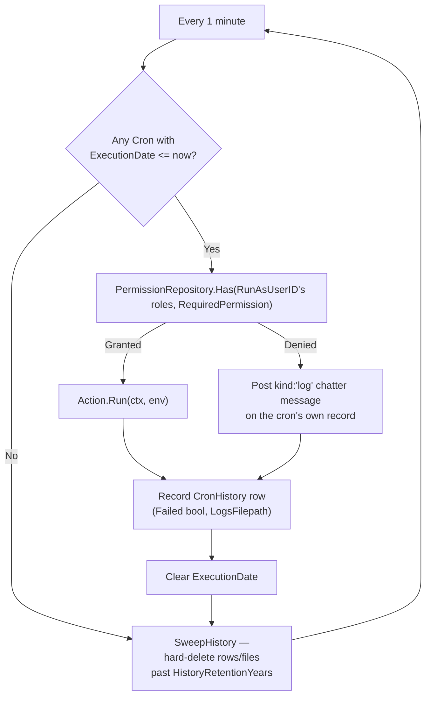

# Background Cron Scheduler

`core/internal/cron` runs one-shot, permission-checked background actions as a chosen user, with a
downloadable execution history and a sliding retention window. Unlike the record-anchored services
in [Record-Anchored Services](record-anchored-services.md), `Cron` and `CronHistory` ride the
**generic CRUD surface** — that's a deliberate choice, and the reason this module gets List,
Kanban, Calendar, *and* Graph views for free with no bespoke frontend code. See
[ADR-017](../adrs/017-cron-scheduler.md) for the full design rationale and the alternatives it
weighed.

---

## Model

```go
// core/modules/cron — table: cron
type Cron struct {
    model.BaseModel
    TenantID              uuid.UUID  `db:"tenant_id"`
    Name                  string     `db:"name"`
    ActionID              string     `db:"action_id"`   // matches a registered Action.ID; not validated at write time
    ActionCode            string     `db:"action_code"`  // resolved from the registry on POST/PUT, read-only otherwise
    RunAsUserID           uuid.UUID  `db:"run_as_user_id"`
    ExecutionDate         *time.Time `db:"execution_date"` // one-shot; cleared to nil after a run
    HistoryRetentionYears int        `db:"history_retention_years"` // 0/unset = 1-year default
    Status                string     `db:"status"` // selection field; Kanban's status column
}

// table: cron_history
type CronHistory struct {
    model.BaseModel
    TenantID     uuid.UUID `db:"tenant_id"`
    CronID       uuid.UUID `db:"cron_id"`
    Failed       bool      `db:"failed"`
    LogsFilepath string    `db:"logs_filepath"` // local disk, not S3 — see ADR-016
}
```

`Cron` is intentionally **one-shot**, not a recurring interval expression: `ExecutionDate` is
cleared back to `nil` the moment the scheduler runs it. An action wanting to reschedule itself sets
a new `ExecutionDate` as an ordinary side effect of its own `Run`.

## Registering an action

An action is Go code registered from a module's own `cron.go` file, mirroring
`module.RegisterGoModule`'s established shape — a package-level registry populated by an `init()`
side effect:

```go
// core/modules/<yourmodule>/cron.go
package yourmodule

import _ "embed"

//go:embed cron.go
var source string

func init() {
    cron.Register(cron.Action{
        ID:                 "yourmodule.do_thing",
        RequiredPermission: "yourmodule:things:write",
        Source:             source, // the form's read-only "Code" page always shows the REAL source
        Run: func(ctx context.Context, env cron.Env) error {
            // env carries the run-as identity, tenant, and a *orm.DB
            return nil
        },
    })
}
```

`core/modules/cron/cron.go` is the reference implementation of this pattern, and doubles as the
concrete answer to "prune old history": it registers `cron.history_retention`, which re-invokes
the exact sweep the scheduler already performs automatically every tick — so an admin can *also*
trigger it manually.

!!! warning "ActionID is not validated against the registry at write time"
    An unknown or mistyped `action_id` isn't caught at create/edit time — there's no per-field
    validation hook on the generic CRUD surface for it. It fails the first time the scheduler tries
    to run it: a `CronHistory` row is recorded as `Failed`, visible immediately in the Calendar view
    (colored via `calendarColorField`, see below) and in the run's own log.

## The scheduler

`Scheduler.Run` (`core/internal/cron/scheduler.go`) polls once a minute — cron's traditional
granularity — and, each tick:



- **Permission-checked, not just authenticated.** A background scheduler has no live HTTP caller to
  return an error to, so a missing-permission run posts a `kind: "log"` message on the cron's own
  [chatter](record-anchored-services.md#chatter) feed instead — naming the run-as user, the action,
  and the missing permission.
- **Retention is a hard delete.** `SweepHistory` runs on the same ticker as scheduling and actually
  removes rows and log files past the cron's own `HistoryRetentionYears` (a soft-deleted row would
  still count as "history" for any measure that matters for reclaiming space).
- **Logs live on local disk**, under `Config.CronLogDir` — a cron's log is small, workspace-internal
  text, not user data worth S3's durability guarantees. A multi-instance deployment needs a shared
  volume for downloads to work from every instance.

## Routes

Almost everything is fully generic (`/api/v1/cron`, `/api/v1/cron_history`) — permissions
`cron:cron:*` / `cron_history:cron_history:*` auto-derived. Two hand-mounted exceptions, mirroring
`crminheritdemo`'s "override only the verb that needs it" posture:

| Method | Route | Why it's not generic |
|---|---|---|
| `POST`/`PUT` | `/api/v1/cron` | Resolves `action_code` from the registry — the generic handler has no before-write hook for that |
| `GET` | `/api/v1/cron_history/:id/log` | Streams a run's log file; its permission still derives automatically from the route's existing `:id/action` shape |

## Frontend: Calendar coloring

"Show a failed cron as red on the Calendar" needed the engine to tint a card from a boolean field's
value — a capability that didn't exist. Rather than special-case cron inside the Calendar renderer,
`ViewModeDefaults.calendarColorField?: string` was added as a generic, module-declared hint any
future entity can reuse (a `true`-valued named boolean field renders its card with a red accent). It
has no runtime admin-override path, unlike the Kanban/Calendar field pickers in
[Settings](settings.md) — it's a fixed semantic a module states once.

## Related

- [ADR-017: Background Cron Scheduler](../adrs/017-cron-scheduler.md)
- [Record-Anchored Services](record-anchored-services.md) — the pattern cron deliberately *doesn't* follow, and why
- [Views & Components → Calendar View](../frontend/views-and-components/calendar-view.md)
