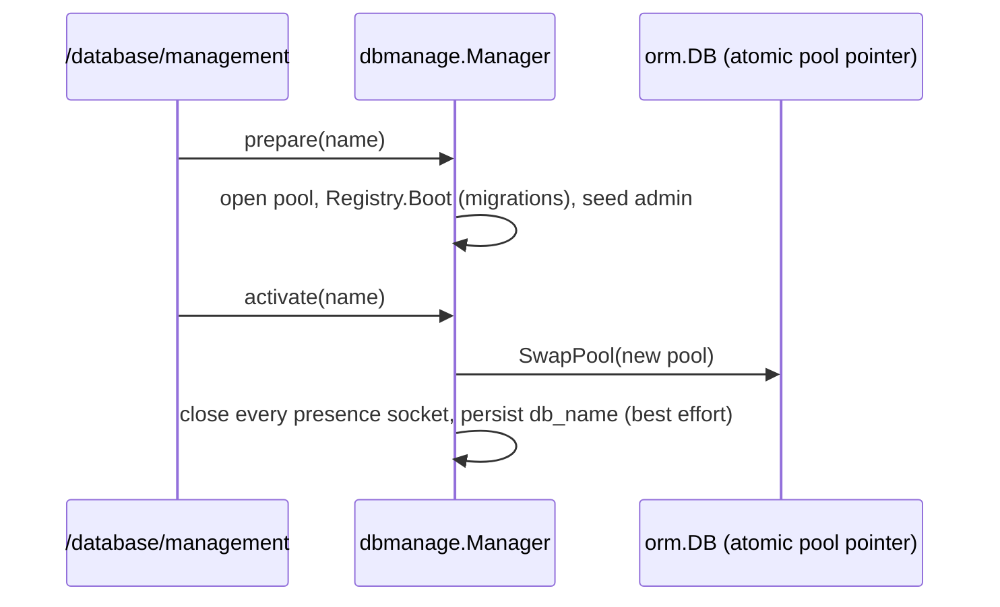

# Database Management

`/database/management` is a small console to **list, create, switch, delete, extract and
restore** the Postgres databases on the server one EERP instance points at — useful for demo,
staging and per-customer databases on a single stack. Implementation `core/internal/dbmanage`;
design [ADR-022](../adrs/022-database-management.md).

## Access: the master key, not a login

The page lives outside any session (you may be switching *to* a database with no users yet).
Every handler instead checks an `X-Master-Key` header against **the same `master_key` that
signs every JWT**. The group is rate-limited like `/api/v1/auth`.

!!! danger "The master key is a full-compromise secret"
    Whoever holds it can sign tokens *and* drop or download every database. Keep it out of
    shells' history and chat; rotate it with `ROTATE=1 make bootstrap` (dev) or a fresh
    `make bootstrap-prod` secret. Consider blocking `/database/` at your reverse proxy in
    production when you don't use it.

## Routes (`/api/v1/database-management`)

| Route | Purpose |
|---|---|
| `GET /databases` | list databases, the active one, prepare state |
| `POST /databases` | create one (schema + default admin) |
| `POST /databases/:name/prepare` | warm a standby: migrate it and open its pool, in the background |
| `POST /databases/:name/activate` | swap to a prepared database (near-instant) |
| `DELETE /databases/:name/prepare` | discard a prepared standby |
| `POST /databases/:name/switch` | prepare + activate in one blocking call |
| `DELETE /databases/:name` | drop a database (never the active one) |
| `GET /databases/:name/extract` | download a zip: `pg_dump`, optionally with its S3 objects |
| `POST /databases/restore` | upload such a zip into a new database (up to 2 GB) |

## Switching is a live hot-swap

No restart: `db.DB.SwapPool` repoints the **same** `*orm.DB` every repository, handler and
background ticker already holds. The live module registry is re-booted on the target so
activation state stays correct. Prepared state is in memory only — a restart requires a fresh
prepare, which is intended (new code may bring new migrations).

`db_name` is written back to the config file when it is writable; under Docker's read-only
config mount it silently isn't, and the next restart returns to the configured database.

!!! note "Site tenant"
    The website's tenant is resolved at boot; after a switch it stays the old one until restart.

## Extract and restore

- The dump is `pg_dump` / `pg_restore` (installed in the `core` image, matched to the server's
  major version).
- S3 content is **manifest-driven**: the zip holds exactly the `picture` / `attachment` objects
  the extracted database references, even in a bucket shared by several databases. Generated
  report PDFs are not included — they are regenerated from the data.
- The restore upload is exempt from `request_body_limit` and capped at 2 GB, matching nginx's
  `client_max_body_size` on that location.

## Related

- [Deployment](../developer-guide/deployment.md) · [Object Storage](object-storage.md) · [Configuration](configuration.md)
