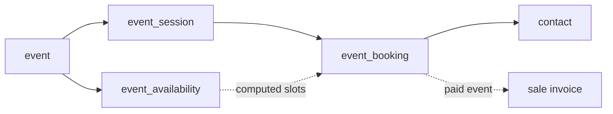

# Events & Booking

`core/modules/event` is the **Event app**: events managed in the ERP (`/app/event…`) and booked
from the public website. It is the reference for a module that sells limited capacity to
anonymous visitors without ever overbooking. Design: [ADR-027](../adrs/027-booking-capacity.md)
(capacity) and [ADR-029](../adrs/029-payment-providers.md) (payment).

`depends: [website, sale]`.

## Data model

| Table | Holds |
|---|---|
| `event` | `kind` (`sessions` \| `appointment`), IANA `timezone`, appointment settings (`slot_minutes`, `slot_capacity`, `buffer_minutes`, `booking_horizon_days`, `min_notice_hours`), `max_seats_per_booking`, optional `product_variant_id` (makes it paid), `published` |
| `event_session` | `starts_at` / `ends_at`, `capacity`, read-only `seats_taken`, optional `price` |
| `event_availability` | weekday + local `HH:MM` window (appointment events) |
| `event_booking` | a session **xor** a slot, contact, seats, `status`, check-in, invoice link; `cancel_token` never serialized |

Everything rides the generic CRUD surface, so the ERP lists, kanban, calendars and graphs are
descriptors only. Overrides exist **only where seats must stay consistent**:

- `POST /event_booking` books through the booking service.
- `PUT /event_booking/:id` changes name/phone, cancels, records check-in (`attended` /
  `no_show`, from 1 h before the start) or marks paid — a checked-in booking keeps its seats
  and can't be cancelled.
- `DELETE /event_booking/:id` (and restore) → 409: a booking is cancelled, never deleted.
- A session can't change event, shrink below its booked seats, or be deleted with bookings;
  moving it re-syncs its bookings' denormalized `starts_at` (the bookings calendar's date).

Statuses holding seats: `confirmed`, `attended`, `no_show`, `pending_payment`.

## Capacity without overbooking

The booking service (`booking.go`) captures seats in one transaction:

- **Sessions** — a guarded `UPDATE event_session SET seats_taken = seats_taken + n WHERE … seats_taken + n <= capacity`.
  Zero rows updated = full → 409.
- **Appointment slots** — slots are *computed* from availability windows (`slots.go`), never
  stored; a slot booking takes an advisory lock on `(event, slot)` and recounts.

Every booking is linked to a native **contact** — the signed-in visitor's own, else one found
or created by email (`contact.FindOrCreate`, serialized per email by an advisory lock). Staff
bookings follow the same rule. The contact form shows them on a *Bookings* tab, added by an
`extends` from the event views.

!!! warning "Never write `seats_taken` or bookings outside the service"
    The counter is only correct because every write goes through the guarded update.

## Booking flow for visitors

| Route | Purpose |
|---|---|
| `GET /api/v1/public/event/:id/sessions` | a published event's sessions + seats left |
| `GET /api/v1/public/event/:id/slots?from=&to=` | computed free slots (≤ 31 days) |
| `GET /api/v1/public/events/upcoming?limit=` | published events with their next session (feeds the `event_list` block) |
| `GET /api/v1/public/event/:id/calendar.ics` | the event's public iCal feed |
| `POST /api/v1/website/bookings` | book (anonymous or with a visitor token) |
| `POST /api/v1/website/bookings/cancel` | `{token}` — idempotent |
| `POST /api/v1/website/bookings/claim` | `{token}` — claim a waiting-list offer |
| `GET /api/v1/website/me/bookings`, `POST …/:id/cancel`, `GET …/:id/calendar.ics` | the visitor's own bookings |

Emailed links (cancel, claim, verify) are spent by a button click on the site, never by a GET,
so link scanners can't cancel bookings.

### Waiting list

On a full **session**, `POST /website/bookings` with `waitlist: true` stores a seatless
`waitlisted` booking. Freed seats (a cancel, a capacity increase, an expired offer) go as a
claim offer to the oldest entries that fit, valid `waitlist_claim_hours` (default 12). The
claim goes through the normal seat capture — 409 if someone was faster — and an unclaimed
offer expires and moves on.

### Payment

When an event has a `product_variant_id`, each confirmed booking gets a one-line sale
invoice (`sale.CreateInvoice`; a session `price` overrides the unit price). Cancelling cancels
an unpaid invoice; staff **Mark paid** sets `paid_at`.

A visitor's priced booking, with a payment provider available, is held `pending_payment` for
30 minutes and confirmed by the provider's webhook; with none available it is confirmed at
once, to pay at the event. See [Payments](payments.md).

## Emails, reminders and calendars

- Confirmation, reminder and cancellation are [mail templates](mail.md)
  (`event.booking_confirmed` / `_reminder` / `_cancelled`) in the booker's language, enqueued in
  the booking's transaction. Confirmation and cancellation carry an `.ics` (stable UID
  `booking-<id>`, `PUBLISH` / `CANCEL`).
- `Service.SendReminders` runs every 5 minutes and queues one reminder (`reminder_sent_at`) for
  confirmed bookings starting within `reminder_hours` (default 24, 0 = off). A booking made
  inside that window gets none.
- Staff calendar feed: `GET|POST|DELETE /api/v1/me/event_feed` manages a private token (stored
  sha256); `GET /api/v1/calendar/<token>.ics` serves it, re-checking the owner's
  `event_session:event_session:read` on every fetch.

## Settings

`GET|PUT /api/v1/settings/events` (`settings:events:*`, tenant-wide):
`{reminder_hours, waitlist_claim_hours}`. `Migrate` seeds the app's Graph layouts and the
`calc_fill_rate` calculated field per company where absent.

## Related

- [Website & Public Access](website.md) · [Mail](mail.md) · [Payments](payments.md)
- [Website Builder](../frontend/website-builder.md) — the `event_booking`, `appointment_booking` and `event_list` blocks
