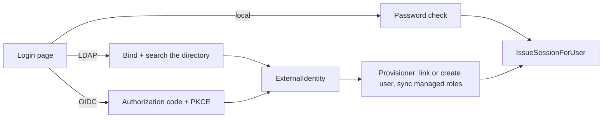

# External Sign-In (LDAP & OIDC)

Staff can sign in with their company directory (**LDAP**, e.g. Active Directory) or an
identity provider (**OIDC**: Keycloak, Microsoft Entra, Google…) next to the local password.
Whatever the method, the result is the **same EERP session** as a password login — JWT access
token, single-use refresh token, the same permissions — so nothing downstream knows how the
user signed in. Implementation: `core/internal/auth/providers`; design:
[ADR-031](../adrs/031-external-authentication.md).



## How a sign-in is provisioned

1. The method authenticates the user into an `ExternalIdentity` (subject, email, verified
   flag, name, groups).
2. The **Provisioner** finds the user by its existing link (`auth_identity`), else links by
   email, else creates the account. Linking and creating both need a **verified** email.
3. It syncs only the roles **that method manages**: the `role_mapping` rows targeting it
   (`method` empty = every method, else `ldap` or `oidc:<id>`) and its own `default_role_id`.
   Mapped roles are granted, managed roles the user lost are removed, and **manually assigned
   roles are never touched**. A sync that would leave no live role is refused.
4. `IssueSessionForUser` mints the usual session.

## Routes

| Route | Auth | Purpose |
|---|---|---|
| `GET /api/v1/auth/methods` | none | methods the login page offers, default first |
| `POST /api/v1/auth/ldap/login` | none | `{username, password}` |
| `GET /api/v1/auth/oidc/providers/:id/authorize` | none | the provider's authorization URL |
| `POST /api/v1/auth/oidc/providers/:id/exchange` | none | code → session |
| `GET\|PUT /api/v1/settings/auth` | `settings:auth:*` | the configuration |
| `POST /api/v1/settings/auth/test` | `settings:auth:write` | try a configuration before saving it |

The frontend's BFF owns the browser side of OIDC (state, nonce and PKCE verifier in a
10-minute httpOnly cookie; the redirect URI built from `erp_url`, never the `Host` header).

## Configuration (`app_settings` `auth.methods`)

```json
{
  "default": "oidc:entra",
  "enabled": ["local", "ldap", "oidc:entra"],
  "erp_url": "https://erp.example.com",
  "ldap": {
    "url": "ldaps://dc.example.com", "bind_dn": "cn=eerp,ou=svc,dc=example,dc=com",
    "base_dn": "ou=people,dc=example,dc=com", "user_filter": "(sAMAccountName={username})",
    "email_attr": "mail", "groups_attr": "memberOf", "default_role_id": null
  },
  "oidc": [{
    "id": "entra", "label": "Microsoft", "issuer": "https://login.microsoftonline.com/<tenant>/v2.0",
    "client_id": "…", "scopes": "openid email profile", "groups_claim": "groups",
    "allowed_domains": ["example.com"], "default_role_id": null
  }],
  "role_mapping": [{ "group": "CN=Sales,OU=Groups,DC=example,DC=com", "role_id": "…", "method": "ldap" }]
}
```

Secrets (`bind_password`, `client_secret`) are AES-GCM encrypted under `master_key` and
write-only: an empty value on save keeps the stored one, but only while the LDAP url and bind
DN / the OIDC issuer are unchanged — pointing a secret at a new server requires re-entering it.
Edited in Settings → Authentication.

## Security pitfalls

!!! danger "Read before enabling"
    - **LDAP: users must not be able to write their own `mail` attribute.** Otherwise a first
      LDAP login could link to an ERP admin's account by email.
    - **Public IdPs** (Google, Microsoft personal accounts): a `default_role_id` admits every
      account of the provider. Set `allowed_domains` (a verified-email domain allowlist).
    - **Removal is not instant.** Roles sync only at sign-in, and refresh tokens slide for
      7 days — removing someone from the directory doesn't end ERP access. Disable the ERP user too.
    - `settings:auth:write` is super-admin-equivalent: whoever holds it can map any group to any role.
    - Changing a provider's issuer unlinks its `auth_identity` rows; a renamed LDAP DN needs its
      stale link soft-deleted by SQL.
    - LDAP needs `bind_dn` and a bind password (no anonymous search).

Optional live LDAP test: set `LDAP_TEST_URL` (+ `_BIND_DN`, `_BIND_PASSWORD`, `_BASE_DN`,
`_USER`, `_PASSWORD`) before `make run-back-tests`.

## Related

- [Authentication](authentication.md) · [Permissions](permissions.md) · [Frontend authentication](../frontend/authentication.md)
