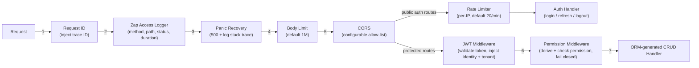
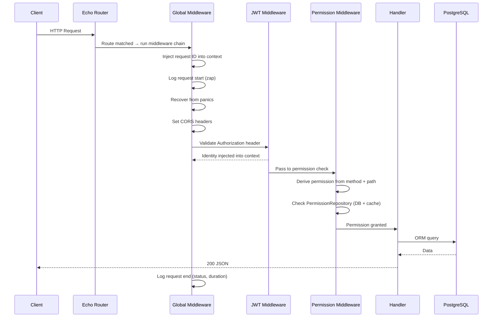
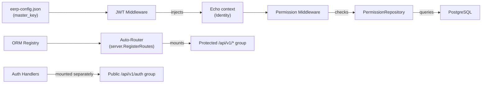
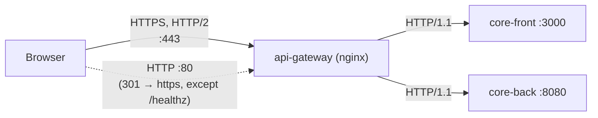

# HTTP Pipeline

## Purpose

The HTTP pipeline is the boundary between the outside world and the core runtime. It translates HTTP requests into typed Go function calls, applies cross-cutting concerns (auth, logging, recovery), and translates return values back into HTTP responses.

EERP uses **Echo v4** as the HTTP framework. Middleware is composed at startup and applied to route groups rather than individual handlers.

---

## Responsibilities

- Accept and parse incoming HTTP requests
- Execute middleware in a defined order
- Route requests to the correct ORM-generated or auth handler
- Serialize responses to JSON
- Return uniform error envelopes for auth failures
- Provide observability (request ID, structured access logs)

---

## Middleware Chain



The global middleware (RequestID, Logger, Recover, Body Limit, CORS) applies to all routes. The public auth group additionally has a **rate limiter**; the protected group additionally has the JWT and Permission middleware.

| Middleware | Scope | Notes |
|---|---|---|
| Body Limit | global | Caps request bodies; default `1M`, set via `request_body_limit` |
| CORS | global | Allow-list from `allowed_origins`; falls back to `*` only when unset (dev). Set it in production |
| Rate Limiter | public auth group | Per client IP, default 20/min (`auth_rate_limit_per_minute`); returns `429` when exceeded |
| JWT | protected group | Validates the Bearer token, injects `Identity` **and stamps the tenant** on the context |
| Permission | protected group | Derives the required permission from the matched route pattern; **fails closed** (403) if it can't |

---

## Route Groups

Every route lives under `/api/v1`. Groups differ only in which middleware guards them:

| Group | Middleware | Examples |
|---|---|---|
| **Public auth** | auth rate limit | `/auth/login`, `/auth/refresh`, `/auth/logout`, `/auth/methods`, `/auth/ldap/login`, `/auth/oidc/...` ([External Sign-In](external-auth.md)) |
| **Protected** | JWT → permission → (generic CRUD) active gate | every generic CRUD table ([Automatic Router](router.md)), `/settings/*`, `/users`, `/roles`, `/pictures`, `/notebook_pages`, `/mail_outbox`… |
| **Self-service** | JWT only | `/me/preferences`, `/me/event_feed`, `/notifications`, `/versions` — they act on the caller's own data, so a permission would only lock users out of it |
| **Live channel** | `JWTOrCookieMiddleware` | `/presence` (REST + WebSocket upgrade, [Presence & the Live Channel](live-channel.md)) |
| **Public website** | public rate limit + site tenant | `/public/*` — published data, site files, booking reads, payment webhooks ([Website](website.md)) |
| **Website visitors** | public rate limit + visitor token (`aud: website`) | `/website/auth/*`, `/website/me`, `/website/bookings` |
| **Database management** | auth rate limit; each handler checks `X-Master-Key` | `/database-management/*` ([Database Management](database-management.md)) |
| **Calendar feed** | auth rate limit; the token in the URL is the credential | `/calendar/<token>.ics` |

Tables excluded with `orm.WithExcluded()` (e.g. the auth tables) get **no** generic routes.
Every server built on `core/orm/server` also answers `GET /health` (outside `/api/v1`): 200 once
it serves **and** its pool pings Postgres within 2 s, else 503 — the Compose healthcheck and the
gateway's `/health` use it.

### Request body limits

`request_body_limit` (default `1M`) caps every body. The upload routes (`/api/v1/pictures`,
`/api/v1/attachments`) are exempt (`ormserver.Config.BodyLimitExempt`) and capped by
`upload_body_limit` (default `20M`) instead; the database restore upload has a fixed 2 GB cap.
Over the limit → `413`. The gateway allows 50 MB; the frontend proxy skips the upload BFF
routes because Next buffers proxied bodies only up to 10 MB.

!!! warning "Adding an upload route"
    Add it to `BodyLimitExempt` and give it the upload limit, or it stays at 1 MB.

---

## Rate Limiting

In-memory, per-client-IP token buckets (`ormserver.AuthRateLimiter`, Echo's `RateLimiter`):

| Limiter | Default | Config field | Applies to |
|---|---|---|---|
| Auth | 20/min | `auth_rate_limit_per_minute` | auth group, website signup/login, database management, calendar feed |
| Public | 300/min | `public_rate_limit_per_minute` | `/api/v1/public`, `/api/v1/website` |

Exceeding a limit returns `429 Too Many Requests`; the burst equals the per-minute value.

The client IP is read from `X-Forwarded-For`, **trusting only loopback, link-local and private
hops** (`echo.ExtractIPFromXFFHeader(echo.TrustPrivateNet(true))`). Behind the bundled gateway
this is automatic; behind another reverse proxy, the gateway must be told to trust it, or every
visitor shares one bucket ([Deployment](../developer-guide/deployment.md)).

!!! note "Per-process, in-memory"
    The limiter state is per server instance. For a horizontally-scaled deployment — or for
    account-level lockout rather than per-IP — back it with a shared store (e.g. Redis).

---

## Lifecycle of a Request



---

## Error Envelope

All authentication and authorisation errors follow a uniform JSON envelope:

```json
{
    "error": {
        "code": "UNAUTHENTICATED",
        "message": "missing or invalid token",
        "request_id": "01J...",
        "fields": ["name"]
    }
}
```

`fields` is present only on a `VALIDATION_ERROR` naming columns.

| `code` value | HTTP status | Condition |
|---|---|---|
| `UNAUTHENTICATED` | 401 | Missing token, invalid signature, expired token |
| `FORBIDDEN` | 403 | Valid identity but insufficient permissions, an underivable permission (fail-closed), or the wrong token audience |
| `PASSWORD_CHANGE_REQUIRED` | 403 | The account must change its password first ([Authentication](authentication.md#forced-password-change)) |
| `MODULE_INACTIVE` | 403 | The table belongs to a deactivated module ([Module System](module-system.md#live-activation-no-restart)) |
| `VALIDATION_ERROR` | 400 | Bad input; on a generic create, `fields` lists the missing required columns |
| `NOT_FOUND` | 404 | Unknown id, other tenant's id, or unpublished public table |
| `CONFLICT` | 409 | Unique violation, a booking seat already taken, a seed already running… |
| — | 413 | Body over its limit |
| — | 429 | Rate limit exceeded (see [Rate Limiting](#rate-limiting)) |

The `request_id` field is the value injected by the RequestID middleware, allowing correlation with access logs.

!!! note "Success envelope"
    A generic list returns `{data, total}` (plus `total_estimated: true` past 10 000 rows — see
    [List Read Performance](list-performance.md)); a single record is returned directly. Hand-written
    list endpoints mimic the same envelope so the frontend's `ApiClient` needs no special case.

---

## Request Context Keys

Each middleware enriches the Echo context passed down the chain:

| Key | Added by | Contents |
|---|---|---|
| Request ID | RequestID middleware | UUID for this request (also set as `X-Request-ID` response header) |
| Identity | JWT middleware | Authenticated `auth.Identity{UserID, TenantID, Roles, Groups, MustChangePassword}` |
| Groups | JWT middleware | The caller's role-group closure (`orm/access.WithGroups`), read by field group gating |
| Public scope | public group | `access.PublicScope` — the published fields and forced filter of the table being read |
| Tenant | JWT middleware | The caller's tenant ID (`orm/access.WithTenant`), read by the CRUD layer for row-level isolation |

Handlers retrieve the identity via typed accessors (see [Authentication](authentication.md#identity-in-context)):

```go
identity, ok := auth.IdentityFromContext(c.Request().Context())
// or, inside a guaranteed-protected handler:
identity := auth.MustIdentity(c.Request().Context())
```

---

## Interactions



See also: [Authentication](authentication.md), [Permissions](permissions.md), [Automatic Router](router.md).

---

## TLS/HTTP2 Edge Gateway

In Docker Compose deployments, an `api-gateway` (nginx, `infra/nginx/nginx.conf`) sits in front of
both `core-front` and `core-back` — the Echo pipeline above still applies unchanged behind it, but
the browser never reaches Echo directly.



- Plain `http://` (port 80) 301-redirects everything except `/healthz` to `https://` (port 443,
  self-signed cert in dev) — HTTP/2 only works over TLS in practice (browsers, and Node's `undici`
  client, don't negotiate cleartext h2c reliably), so :443 is the only HTTP/2 endpoint.
- A one-shot `gateway-certs` compose service provisions the self-signed dev certificate into a
  shared volume before nginx starts (`infra/nginx/gen-certs.sh`, idempotent). Swap in a real
  certificate for a public-facing deployment.
- **Next↔Go stays plain HTTP/1.1 internally, untouched.** Only the browser↔gateway hop benefits
  from HTTP/2 multiplexing — it's the hop with many small parallel requests (relation-widget
  lookups, field autocompletes), not the single BFF↔backend hop.
- HTTP/2 was chosen over adopting GraphQL to solve the same N+1 relation-fetch problem; see
  [ADR-018](../adrs/018-http2-edge-rest-batching.md) for the full reasoning, including the
  companion fix (batching many-to-many resolution via the `in[column]` filter — see [ORM → Query
  Parameters](orm.md#query-parameters-generic-crud)).

---

## Extension Points

| Extension | How |
|---|---|
| Rate limiting | Built-in per-IP limiter on the auth group (`ormserver.AuthRateLimiter`); swap the memory store for a shared one (Redis) to scale horizontally |
| Custom middleware | Use `e.Use()` for global or `g.Use()` for group-scoped Echo middleware |
| WebSocket support | Reuse the live channel ([Presence & the Live Channel](live-channel.md)) — add a frame type rather than a second socket |
| Request tracing | Enrich the RequestID middleware to propagate W3C Trace Context headers |
