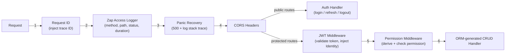
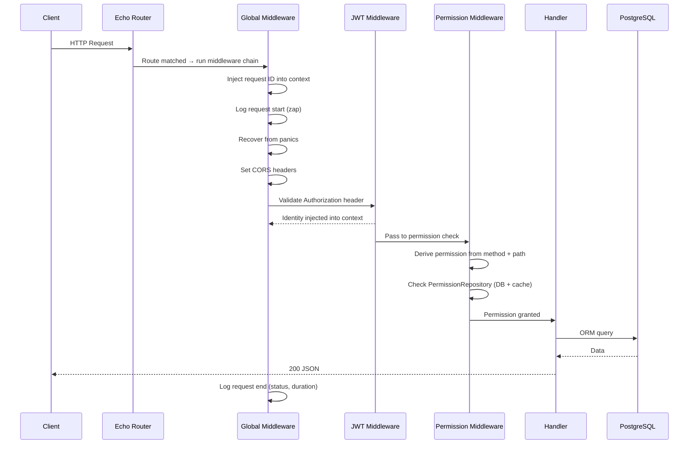
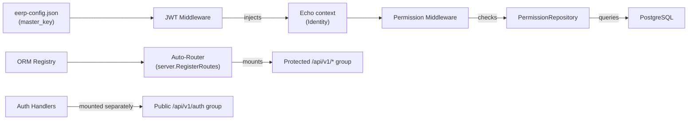

# HTTP Pipeline

## Purpose

The HTTP pipeline is the boundary between the outside world and the core runtime. It translates HTTP requests into typed Go function calls, applies cross-cutting concerns (auth, logging, recovery), and translates return values back into HTTP responses.

EERP uses **Echo v4** as the HTTP framework. Middleware is composed at startup and applied to route groups rather than individual handlers.

---

## Responsibilities

- Accept and parse incoming HTTP requests
- Execute middleware in a defined order
- Route requests to the correct ORM-generated or auth handler
- Serialize responses to JSON
- Return uniform error envelopes for auth failures
- Provide observability (request ID, structured access logs)

---

## Middleware Chain



The first four middleware (RequestID, Logger, Recover, CORS) are applied globally to all routes. The JWT and Permission middleware are applied only to the protected group.

---

## Route Groups

Routes are divided into two groups mounted under `/api/v1`:

### Public auth group

Mounted at `/api/v1/auth` with **no authentication middleware**:

| Method | Path | Purpose |
|---|---|---|
| `POST` | `/api/v1/auth/login` | Validate credentials, issue access + refresh tokens |
| `POST` | `/api/v1/auth/refresh` | Exchange a valid refresh token for a new pair |
| `POST` | `/api/v1/auth/logout` | Revoke all refresh tokens for the user, clear cookie |

### Protected API group

All other `/api/v1/*` routes are mounted with JWT middleware → Permission middleware applied as Echo group middleware. Every registered ORM table gets CRUD routes in this group — see [Automatic Router](router.md).

---

## Lifecycle of a Request



---

## Error Envelope

All authentication and authorisation errors follow a uniform JSON envelope:

```json
{
    "error": {
        "code": "UNAUTHENTICATED",
        "message": "missing or invalid token",
        "request_id": "01J..."
    }
}
```

| `code` value | HTTP status | Condition |
|---|---|---|
| `UNAUTHENTICATED` | 401 | Missing token, invalid signature, expired token |
| `FORBIDDEN` | 403 | Valid identity but insufficient permissions |

The `request_id` field is the value injected by the RequestID middleware, allowing correlation with access logs.

!!! note "Response envelope"
    The error envelope above is used for auth errors. Successful ORM CRUD responses return the entity or list directly as JSON — there is no outer `{data, meta}` wrapper.

---

## Request Context Keys

Each middleware enriches the Echo context passed down the chain:

| Key | Added by | Contents |
|---|---|---|
| Request ID | RequestID middleware | UUID for this request (also set as `X-Request-ID` response header) |
| Identity | JWT middleware | Authenticated `auth.Identity{UserID, TenantID, Roles}` |

Handlers retrieve the identity via typed accessors (see [Authentication](authentication.md#identity-in-context)):

```go
identity, ok := auth.IdentityFromContext(c.Request().Context())
// or, inside a guaranteed-protected handler:
identity := auth.MustIdentity(c.Request().Context())
```

---

## Interactions



See also: [Authentication](authentication.md), [Permissions](permissions.md), [Automatic Router](router.md).

---

## Extension Points

| Extension | How |
|---|---|
| Rate limiting | Add a rate-limit middleware before JWT in the protected group |
| Custom middleware | Use `e.Use()` for global or `g.Use()` for group-scoped Echo middleware |
| WebSocket support | Register a dedicated WS handler on a separate Echo group before the protected group |
| Request tracing | Enrich the RequestID middleware to propagate W3C Trace Context headers |
