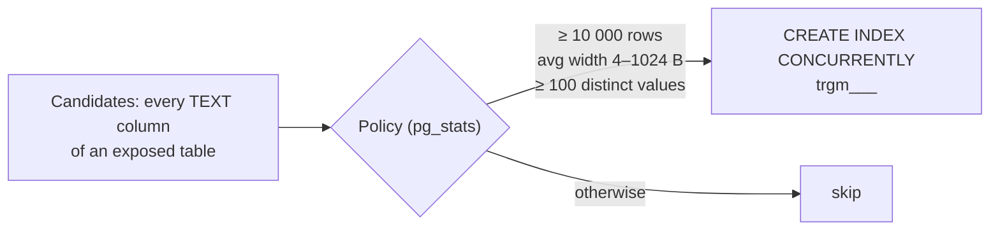

# List Read Performance

EERP is expected to hold hundreds of thousands of rows per table (the full demo seed writes
~100 000 per business table). Two list costs grow with a table and were removed by
[ADR-033](../adrs/033-list-read-performance.md): **exact counting** and **unindexed text
search**.

## Bounded totals

The list envelope's `total` is exact up to **10 000** matching rows (`orm.ExactCountLimit`).
Beyond that, it is the planner's estimate and the envelope says so:

```json
{ "data": [ … ], "total": 182344, "total_estimated": true }
```

Exact counting scans every matching row; the estimate is free. Users can't tell 182 344 from
"about 182 000", and the frontend renders such totals as approximate (`formatTotal`).

A hand-written list endpoint gets the same behaviour from the query builder:

```go
total, estimated, err := query.Select[Order](meta).Where(cond).BoundedTotal(ctx, db, orm.ExactCountLimit)
```

!!! warning "Never use an estimated total as a loop bound"
    The estimate can be off in both directions. Page until a page comes back empty (or short).
    Never write a bare `count(*)` over a growing table.

## Stable paging: `order=`

`order=<column>` / `order=-<column>` sorts the list, the primary key breaking ties. Without it
rows come back in no defined order, so **anything paging through a list must pass one** — or
rows can repeat or vanish between pages. The column is whitelisted like any filter (and
checked against group gating and the public scope).

## Automatic search indexes

`search[<col>]=text` is `col::text ILIKE '%text%'`, which no btree index serves. Rather than
asking module authors to guess, `core/internal/searchindex` builds **trigram (GIN pg_trgm)
indexes** where the data says they pay off:



- Runs right after boot, then hourly (`App.Run`), and at the end of a full demo seed.
- Built `CONCURRENTLY` (no write lock); INVALID leftovers are rebuilt.
- Guarded by an advisory lock that is only *tried*: a pass finding it held is skipped, the next
  hourly pass catches up (waiting would deadlock against the holder's concurrent build).
- A pass with nothing to do only reads, so it never flushes the [Redis cache](query-cache.md).

!!! tip "Module authors"
    Never hand-write a trigram index in `Migrate()`. Make the column a TEXT field and let the
    policy decide. Indexes are never dropped automatically.

`pg_trgm` must exist: `make bootstrap` / `make bootstrap-prod` install it; on a managed database
an admin must run `CREATE EXTENSION pg_trgm` once.

## Related

- [ORM](orm.md) · [List View](../frontend/views-and-components/list-view.md) · [Demo Data](demo-data.md)
