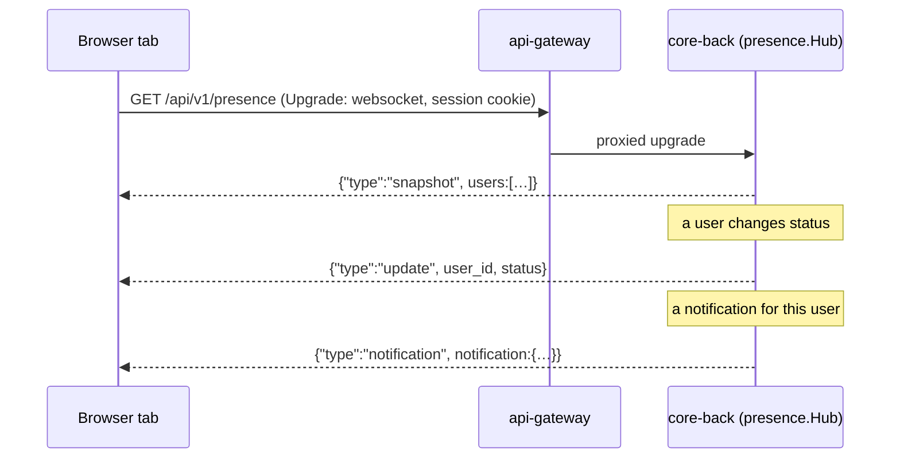

# Presence & the Live Channel

EERP keeps one WebSocket open per ERP tab: the **live channel**. It carries two things —
users' presence (online, absent, offline, busy, do not disturb) and
[notifications](notifications.md) — so the browser learns about changes the moment they
happen instead of polling.

## Why a direct browser → Go connection

Everywhere else the browser talks only to the Next.js BFF, which holds the session and calls
Go with a Bearer token the browser never sees. A live socket needs a persistent connection
that request/response model doesn't have, and a native browser `WebSocket` can't send a
custom `Authorization` header. So this one route group uses
`JWTOrCookieMiddleware`: with no Bearer header it reads the **same access token** from the
BFF's httpOnly session cookie, which the browser sends automatically on the same-origin
request. No token ever reaches client JavaScript. See
[ADR-020](../adrs/020-user-presence-websocket.md).

## Presence

| Status | How it's reached |
|---|---|
| `online` | the user has at least one connected tab |
| `absent` | disconnected for less than 30 minutes |
| `offline` | disconnected for 30 minutes or more |
| `busy`, `do_not_disturb` | chosen by the user; wins even while disconnected |

`status.go`'s `Effective(manual, connected, lastSeen)` is the single place the status is
decided — for the REST snapshot, the socket snapshot, every broadcast and the sweep. One row
per user (`user_presence`, unique `(tenant_id, user_id)`, written with `Upsert` so a
connection change never clobbers a manual status).

| Route | Purpose |
|---|---|
| `GET /api/v1/presence` | the tenant's statuses — or, with an `Upgrade` header, the live socket |
| `PUT /api/v1/presence` | `{"status": "busy" \| "do_not_disturb" \| ""}` — set or clear your own override |

Both are open to every signed-in staff user: presence is app chrome, not gated data, and
`PUT` only touches the caller's own row. A minute-ticker (`SweepAbsentToOffline`) pushes the
absent → offline transition, since no request happens at the 30-minute mark.

Frontend: `AvatarWithPresence` draws the coloured bubble wherever an avatar appears (the top
bar's account menu, chatter authors, the Users list); the account menu offers Online / Busy /
Do not disturb.

## Frames on the channel

| `type` | Payload | Sent to |
|---|---|---|
| `snapshot` | every user's status | the connecting tab |
| `update` | one user's new status | every tab of the tenant (`Hub.Broadcast`) |
| `notification` | one notification | exactly the users allowed to see it (`Hub.SendToUsers`) |
| `notification_read` | ids (or `all`) the user marked read | that user's other tabs |

Older clients ignore types they don't know, so new frame types are additive.

!!! warning "Never broadcast a notification"
    `Hub.Broadcast` fans out to the whole tenant. Notifications go through
    `Hub.SendToUsers` with an audience computed server-side — see
    [Notifications](notifications.md).

## Limits

The hub is in memory: it covers one `core-back` process (Compose runs one). Several replicas
would need a fan-out between them (NATS, as `pdf-service` already uses) — the documented
upgrade path. A tab that reconnects re-reads its snapshot and its notification feed, since
frames sent while it was offline aren't replayed. Behind a reverse proxy, WebSocket upgrades
must be allowed ([Deployment](../developer-guide/deployment.md)).

## Related

- [Notifications](notifications.md) · [Authentication](authentication.md)
- [ADR-020: presence over a WebSocket](../adrs/020-user-presence-websocket.md) · [ADR-032: notifications](../adrs/032-notifications.md)
