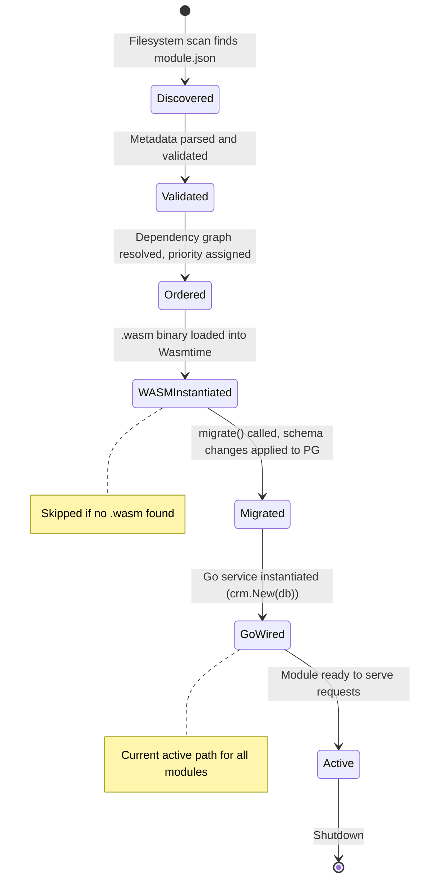
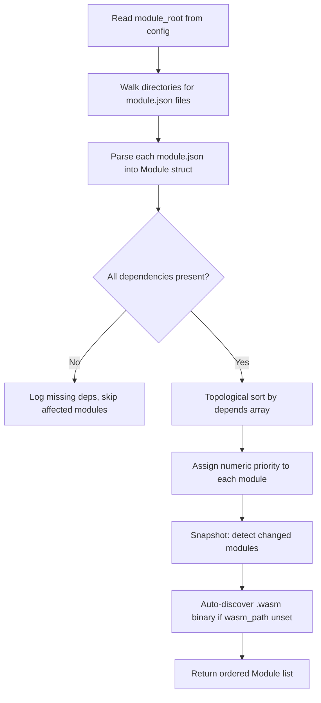
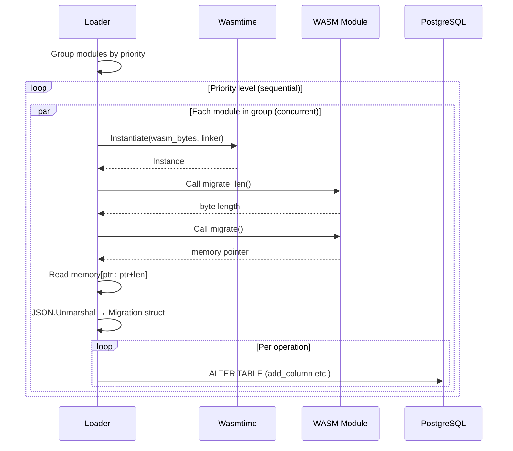
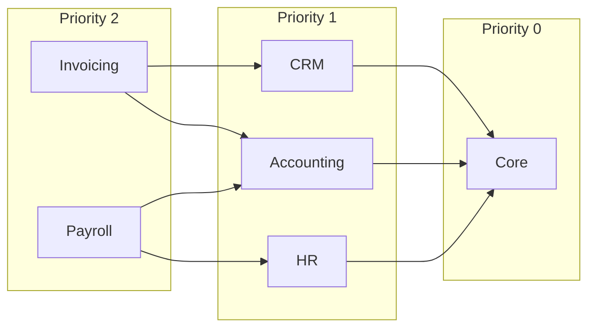
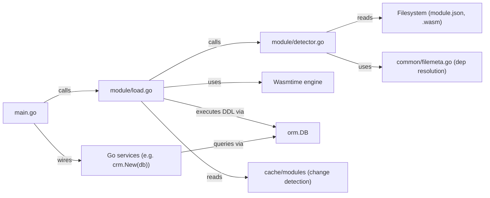
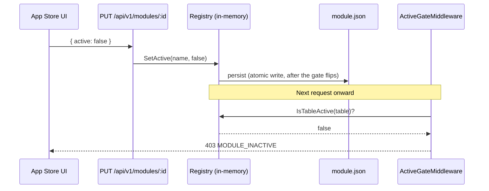

# Module System

The module system is the core extension mechanism of EERP. It allows independent business domains (CRM, Inventory, Accounting) to be developed and wired into the runtime without modifying the core.

---

## Purpose

In a traditional monolithic ERP, adding a new feature means modifying the core. EERP inverts this: the core is a stable runtime; business features are pluggable modules.

EERP uses a **hybrid module model** with two distinct components per module:

| Component | Runs when | Responsibility |
|---|---|---|
| WASM binary (optional) | Startup only | Schema declaration via `migrate()` ABI, for a module that sets `"type": "wasm"` |
| Go service (monolith) | Every request | Business logic, ORM queries, HTTP handlers |

The WASM boundary, when used, is crossed once per module per startup — not on each request. This gives sandboxed schema ownership without any per-request serialization cost.

!!! danger "The WASM binary is Go, not Rust"
    Every module directory in this codebase is Go source. `make build` cross-compiles a module
    that opts in (`"type": "wasm"` in its `module.json`) to WebAssembly System Interface (WASI)
    via `GOOS=wasip1 GOARCH=wasm go build` — there is no Rust anywhere in this repository, despite
    what earlier revisions of this page and [ADR-002](../adrs/002-wasm-modules.md) said. See [Module
    Anatomy](#module-anatomy) below for what the two module shapes actually look like on disk.

> **Current state**: every shipped module sets `"type": "go"` and is a pure Go service, self-registering via `module.RegisterGoModule` — the Wasmtime/WASI loader is live and fully exercised by the detector/loader/runtime code, but no shipped module currently uses the `"type": "wasm"` path. `core/modules/` currently ships `crm`, `contact`, `company`, `warehouse`, `sale`, `propertymanagement`, `reportlayout`, and `cron` (business entities and services), `appstore` (the module-management UI, see [Live Activation](#live-activation-no-restart)), `crminheritdemo` (a worked example of [extending another module's table](orm.md#extending-another-modules-table)), and several infrastructure-only modules with no `module.json` of their own — `auth`, `settings`, `pictures`/`attachments` (see [Object Storage](object-storage.md)), and `chatter`/`notebook`/`savedfilter` (see [Record-Anchored Services](record-anchored-services.md)) — all registered with the ORM but excluded from generic CRUD.

!!! note "How a Go module gets wired in"
    `core/modules/all` is a small `//go:build !wasip1` package that blank-imports every other Go module so each one's `init()` fires and self-registers via `module.RegisterGoModule`. It is the one file that changes when a new Go-only module is added to the tree — everything else (discovery, dependency ordering, HTTP wiring) proceeds from that registration exactly as it does for a WASM module.

---

## Responsibilities

- Discover modules by scanning the filesystem (`module_root` in config)
- Validate module metadata (`module.json`) and resolve the dependency graph
- Load and instantiate WASM binaries in a sandboxed Wasmtime environment
- Call `migrate()` / `migrate_len()`, read linear memory, apply DDL
- Define the ABI contract between modules and the core
- Wire Go services into the application at startup

---

## Module Anatomy

A full hybrid module (`"type": "wasm"`) contains:

```
modules/crm/
├── module.json           # Module metadata and dependency declaration
├── build/
│   └── crm.wasm          # Go source cross-compiled to WASI (GOOS=wasip1 GOARCH=wasm)
├── migrate_wasm.go        # migrate() + migrate_len() exports (built into build/crm.wasm)
└── internal/             # Go source (compiled into the native core binary)
    ├── crm.go            # Contact entity + Service (business logic)
    └── handlers.go       # HTTP handlers (future)
```

A Go-only module (the current, standard approach — `"type": "go"`) omits the WASM build entirely:

```
modules/crm/
├── module.json
├── module.go             # init() → module.RegisterGoModule; Register() → orm.Register[T]
└── internal/
    └── crm.go
```

### module.json

```json
{
    "active": true,
    "name": "crm",
    "display_name": "CRM",
    "version": "0.0.1",
    "author": "Edwin Lecomte",
    "description": "CRM core module",
    "depends": [],
    "priority": 0,
    "static_files": {},
    "is_service": true,
    "auto_install": true
}
```

| Field | Type | Description |
|---|---|---|
| `active` | bool | Whether the module should be loaded |
| `name` | string | Unique identifier (used in dependency resolution) |
| `display_name` | string | Human-readable name |
| `version` | semver | Module version |
| `depends` | []string | Names of modules that must be loaded first |
| `priority` | int | Manual priority hint (rarely needed; dependency resolver assigns priorities) |
| `is_service` | bool | Whether the module registers HTTP handlers |
| `auto_install` | bool | Whether to apply migrations automatically on load |
| `app_mode` | bool | Whether the module gets a navigable tile in the frontend landing menu (see below) |

`app_mode` is deliberately **not** a field on the Go `types.Module` struct — the App Store's management API round-trips `module.json` as a raw map precisely so keys like this one (display-only, frontend-consumed) survive untouched without every one needing a matching Go field. The frontend's build-time discovery reads `app_mode === true` straight off each module's JSON to decide whether it appears as an app tile; a module without one (or without a `module.json` at all — the infrastructure-only modules above) is simply never offered as an app to open. See [ADR-009: Module Lifecycle via API](../adrs/009-module-lifecycle-api.md#4-app_mode-stopped-being-writable) for why it's readable but not writable through that API.

---

## Lifecycle



---

## Detection Flow

`core/internal/module/detector.go`



### Snapshot-based Change Detection

The detector maintains a cache of the previous scan in `./cache/modules`. On each startup, it compares the current filesystem state with the cached state:

- **New module**: load and migrate
- **Changed module** (different hash): reload
- **Unchanged module**: skip migration (idempotent operations still safe)
- **Removed module**: mark inactive

### Priority Assignment

Modules in the same dependency tier get the same priority number. The algorithm:

1. Assign priority 0 to all modules with no dependencies.
2. For each remaining module, assign `max(dependencies' priorities) + 1`.
3. Repeat until all modules have a priority.

Modules at priority _N_ load concurrently; priority _N+1_ waits for all of _N_ to complete.

---

## Loading Flow

`core/internal/module/load.go`



---

## Migration Protocol

Modules communicate schema requirements through a simple memory-based protocol. Only relevant to a
`"type": "wasm"` module — the only shared contract between the WASI binary and the core is the JSON
shape below, not a Go package dependency.

### Module side (Go, cross-compiled to WASI)

This file is only included in the `GOOS=wasip1 GOARCH=wasm go build` that produces the module's
`.wasm` artifact — it is never compiled into the native core binary.

```go
//go:build wasip1

package main

// The migration definition, returned as JSON in linear memory.
const migration = `{
    "entity": "contacts",
    "version": 1,
    "operations": [
        {
            "type": "add_column",
            "table": "contacts",
            "column": "crm_segment",
            "sql_type": "VARCHAR(64)",
            "nullable": true
        }
    ]
}`

//export migrate
func migrate() *byte {
    return &[]byte(migration)[0]
}

//export migrate_len
func migrateLen() uint32 {
    return uint32(len(migration))
}

func main() {} // required by GOOS=wasip1, unused
```

### Core side (native Go binary)

```go
// core/internal/types/modules.go
type Migration struct {
    Entity     string      `json:"entity"`
    Version    int         `json:"version"`
    Operations []Operation `json:"operations"`
}

type Operation struct {
    Type     string `json:"type"`     // currently: "add_column"
    Table    string `json:"table"`
    Column   string `json:"column"`
    SQLType  string `json:"sql_type"`
    Nullable bool   `json:"nullable"`
}
```

The core reads the WASM linear memory region indicated by the pointer and length, deserializes the JSON, and applies each operation using parameterized DDL statements.

### Supported Operations

| Operation | DDL Generated |
|---|---|
| `add_column` | `ALTER TABLE t ADD COLUMN IF NOT EXISTS col TYPE` (optionally with `"index": true`/`"index_type"` — see [ORM → Indexes](orm.md#indexes)) |
| `create_index` | `CREATE INDEX IF NOT EXISTS idx_<table>_<column> ON t USING <method> (col)` |

Future operations planned: `drop_column`, `create_table`, `rename_column`. Note this table describes the WASM/JSON migration protocol specifically — the standard `"type": "go"` path doesn't go through it at all; see [Server Integration → Startup migration flow](../development/server-integration.md#startup-migration-flow) for how a Go module's schema is actually derived.

---

## Dependency Resolution

`core/internal/common/filemeta.go`



The resolver also validates that all declared dependencies are present:

```go
ok, missing := fmMap.CheckDependencies()
// missing = map[depName][]modulesThatNeedIt
```

Missing dependencies cause the dependent module to be skipped, not the entire system.

---

## Interactions



---

## Extension Points

| Extension | Mechanism |
|---|---|
| New operation type | Add case to `Operation.Type` handler in `load.go` |
| New WASM export | Export function from the module's own Go source (built with `GOOS=wasip1`), call from `load.go` |
| Hot reload | **Shipped** — see [Live Activation](#live-activation-no-restart) below |
| Module isolation | Per-module Wasmtime `Store` (shipped, see below); resource limits remain future work |
| Module API | Future: Go functions linked into the WASM linker, called from a module's WASI-side Go code via imports |

---

## Live Activation (no restart)

`active: false` in `module.json` no longer means "skip loading" — it means "load, but gate access." `Registry.Boot` (`core/internal/module/runtime.go`) loads **every** discovered module at startup regardless of `active`, and tracks each one's flag in an in-memory map. `ActiveGateMiddleware` checks that map on every generic-CRUD request and returns `403 MODULE_INACTIVE` for a deactivated module's table; the route itself stays mounted for the process's life, since the router has no safe way to add or remove a route while serving traffic.



Consequences worth knowing when working in this area:

- A deactivated module's table still exists and is still migrated at boot — "deactivated" means inaccessible via the generic CRUD surface, not unloaded. Data written before deactivation reappears the moment the module is reactivated.
- Table ownership (which module's flag gates which table) is **attributed, not declared**: the first module whose migration creates a table is recorded as its owner. A module that only adds columns to another module's table (`ExtendSchema`/`orm.WithTableName` inheritance) never claims ownership of it — deactivating it has no effect on the table it extends.
- `POST /api/v1/modules/:id/reload` re-reads a WASM module's `.wasm` file from disk into a fresh Wasmtime `Store` and re-runs its migration — a real hot-swap. For a Go module (statically compiled into the backend binary) there is nothing to hot-swap; `Reload` re-validates schema registration as a no-op and says so in the log, rather than pretending a reload occurred.
- `GET /api/v1/modules/:id/logs` returns every activate / deactivate / reload run's backend and database log lines, grouped by operation — the App Store's *Logs* button.
- The website's public API and payment providers check the same live state: a deactivated module's tables read as unpublished (404) on `/api/v1/public`, and its payment provider is never offered.
- A module may run `Boot()` more than once in one process ([database switch](database-management.md)), so a Go module's table creation is decided from the **target database's real state**, never from an in-memory "already done" flag — otherwise a second boot against an empty database creates nothing.
- This only reaches modules already known at the **last build** — a module folder that didn't exist at that build has no mounted route at all yet, on either side. Truly unseen-code hot-install remains deferred, larger infrastructure.

The management API this backs (`PUT /api/v1/modules/:id`, the App Store UI) and the reasoning behind each constraint are recorded in [ADR-009: Module Lifecycle via API](../adrs/009-module-lifecycle-api.md) and [ADR-010: Live Module Lifecycle](../adrs/010-live-module-lifecycle.md).

---

## Concurrent migrations

All schema DDL — at boot, and in `EnsureSchema` / `MigrateModules` for tests — runs under a
Postgres **advisory lock** (`withSchemaLock`). `CREATE TABLE IF NOT EXISTS` is not safe when
several processes migrate one database at once (two `core-back` replicas starting together, or
parallel test packages), and the lock serializes them.

---

## Security Considerations

WASM modules run inside a Wasmtime sandbox. They cannot:

- Access the host filesystem directly
- Open network connections
- Crash the Go process on panic

They can only communicate with the core through the defined ABI (exported functions + linear memory) and through imported host functions that the core explicitly exposes via the Wasmtime linker.

---

## Related

- [Module Discovery (frontend)](../frontend/module-discovery.md) — the build-time mirror of this loader on the Next.js side.
- [ADR-009: Module Lifecycle via API](../adrs/009-module-lifecycle-api.md) · [ADR-010: Live Module Lifecycle](../adrs/010-live-module-lifecycle.md) — the App Store management API and the live activate/deactivate/reload design.
