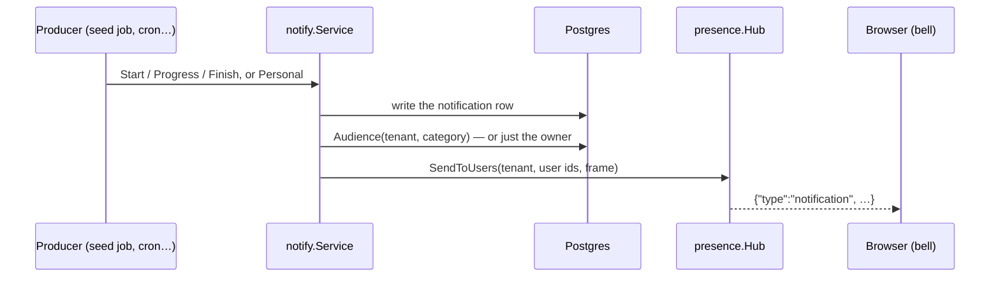

# Notifications

`core/internal/notify` gives every user a live view of what concerns them:

- **Global activities** — a cron run, a demo-data seed, any long job — with live progress
  while they run and a 7-day history once finished, visible to the roles allowed their
  **category**.
- **Personal notifications** — addressed to one user ("your seed finished"), never visible to
  anyone else, kept 30 days.

They appear under the bell in the top bar; clicking one opens the page it links to. See
[ADR-032](../adrs/032-notifications.md) for the full design.



## Raising notifications from code

Core code and modules use one API. Register a category once, at `init()`:

```go
func init() {
    notify.RegisterCategory(notify.Category{Key: "imports", Label: "Data imports"})
}
```

A personal message:

```go
svc.Personal(ctx, tenantID, userID, notify.Message{
    Category: "imports",
    Title:    "Your import finished",
    Link:     "/contacts",          // an ERP path; it opens on click
})
```

A global activity with progress:

```go
run, err := svc.Start(ctx, tenantID, notify.Activity{
    Category: "imports", Title: "Importing contacts", Link: "/contacts", ActorID: &userID,
})
for i, batch := range batches {
    // … work …
    run.Progress(i*100/len(batches), fmt.Sprintf("Batch %d/%d", i+1, len(batches)))
}
run.Finish(err, "", nil) // done, or failed with err's message
```

- `Progress` is throttled: at most one live frame every 500 ms per activity, and a row
  write only when the label changes — a tight loop can't flood browsers or the database.
- `Finish` always publishes. A failed final write is retried, then the end state is still
  sent, so a progress bar never spins forever.
- `Activity{Indeterminate: true}` for jobs with no percentage (a cron run).
- `Finish(err, body, data)`: `data` is opaque JSON for the linked page (the seed stores its
  per-table results there).
- Built-in categories: `cron` ("Scheduled actions"), `dev_seed` ("Demo data seeding").
  Add each category's label to the shell's `.po` files.

## Who sees what

```
tenant = caller AND (
  user_id = caller                                   -- personal: the owner only
  OR (user_id IS NULL AND (category ∈ caller's categories OR actor_id = caller))
)
```

- A user's **categories** are those held by their roles, including roles they inherit
  through *belongs* (the same closure as group gating). They're chosen on the role form's
  **Notifications** tab (Settings → Users → Roles).
- The **initiator** of an activity always follows it, whatever their roles.
- Every publish computes its audience from the database at that moment, so a role change
  applies to the next notification — no re-login, no cache.
- No route takes another user's id; ids outside the filter are silently ignored by
  mark-read (no existence oracle); the wire shape (`notify.Wire`) never carries user,
  actor or tenant ids.

New categories go once to each tenant's admin roles (technical name `admin`, or any role
holding `*:*:*`) the first time they appear; removing one from a role sticks.

## Routes

| Route | Purpose |
|---|---|
| `GET /api/v1/notifications` | the caller's feed: running activities first, then newest; `{data, unread}` |
| `POST /api/v1/notifications/read` | `{ids: […]}` or `{all: true}`; the caller's other tabs are told |

Both need only a signed-in staff user: they act on the caller's own feed.

## Lifecycle and retention

- At a real server start (`App.Run`, never a test's `Build`), activities a previous process
  left `running` are marked failed ("Interrupted by a restart").
- Hourly sweep: finished global activities after 7 days, personal ones after 30.
- The category catalog (`notification_category`, per tenant) is synced from the Go registry
  at every boot, and again right after the default admin is seeded on a fresh database.

## Frontend

- **The bell** sits just left of the company switcher: an unread badge, a breathing red dot
  while a new arrival is unseen, and a panel with *Running now* (progress bars) then the
  rest. Resting the pointer on an item for 0.6 s marks it read; clicking opens its page. On
  phones the panel opens as a centred dialog over 90% of the screen.
- `useNotificationStore` (engine, not persisted) is loaded once through the BFF and kept
  live by the [live channel](live-channel.md); it re-reads the feed on every reconnect.

!!! warning "Pitfalls"
    - A `link` must be an ERP path (`/…`; no `//host`, scheme or backslash) — `notify`
      refuses anything else, and the bell re-checks before navigating.
    - Never push a notification frame through `Hub.Broadcast`.

## Related

- [Presence & the live channel](live-channel.md) · [Cron scheduler](cron.md) · [Demo data](demo-data.md)
