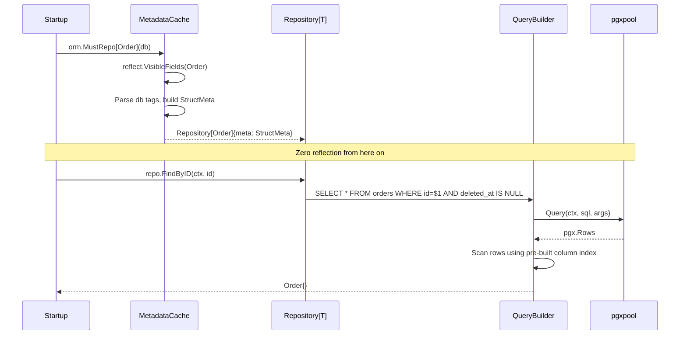
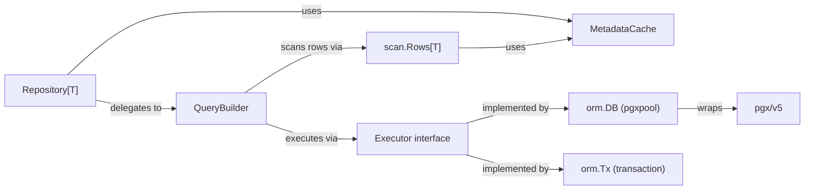

# ORM

The EERP ORM is a custom data access layer built on top of [pgx v5](https://github.com/jackc/pgx). It provides type-safe CRUD operations, composable query builders, transactions with savepoints, and soft-delete — all without reflection at query time.

---

## Purpose

Standard Go ORMs (GORM, ent) solve the general case. EERP's ORM solves a more specific case: an ERP system where:

- Every entity needs audit fields (created/updated/deleted timestamps, UUID primary key)
- Soft-delete is the norm, hard delete is the exception
- Transactions frequently need partial rollback via savepoints
- Startup cost is acceptable; per-query reflection is not
- The query layer must be composable but never hide what SQL it generates

See [ADR-001](../adrs/001-custom-orm.md) for the full rationale.

---

## Responsibilities

- Map Go structs to database rows and back
- Build parameterized SQL from a fluent builder API
- Manage connection pool lifecycle
- Provide transactional boundaries (including savepoints)
- Log all queries (optionally)
- Cache all struct metadata at startup

---

## Lifecycle



---

## Core Concepts

### Entity and BaseModel

Every ORM-managed struct embeds `model.BaseModel`:

```go
import "eerp/core/orm/model"

type Order struct {
    model.BaseModel          // (1)
    CustomerID uuid.UUID `db:"customer_id"`
    Status     string    `db:"status"`
    TotalCents int64     `db:"total_cents"`
}

func (Order) TableName() string { return "orders" } // (2)
```

1. `BaseModel` contributes four columns: `id` (UUID, PK), `created_at`, `updated_at`, `deleted_at`.
2. If `TableName()` is not implemented, the table name is derived as `snake_case(TypeName)`.

`BaseModel` provides:

| Field | Type | DB Column | Behaviour |
|---|---|---|---|
| `ID` | `uuid.UUID` | `id` | Auto-generated on INSERT |
| `CreatedAt` | `time.Time` | `created_at` | Set on INSERT |
| `UpdatedAt` | `time.Time` | `updated_at` | Set on INSERT and UPDATE |
| `DeletedAt` | `*time.Time` | `deleted_at` | nil = active; non-nil = soft-deleted |

### Struct Tags

| Tag | Meaning |
|---|---|
| `db:"col"` | Explicit column name |
| `db:"col,pk"` | Primary key |
| `db:"col,omitempty"` | Skip field when value is the zero value |
| `db:"col,softdelete"` | Marks the soft-delete timestamp column |
| `db:"col,index"` | Secondary index on the column (btree) |
| `db:"col,index=hash"` | Secondary index with an explicit access method |
| `db:"-"` | Exclude from all queries |

If no `db` tag is present, the column name is the snake_case conversion of the field name.

### Indexes

Tag a column with `index` to have an index created during auto-migration. The optional `index=<method>` selects the PostgreSQL access method — valid methods are `btree` (default), `hash`, `gist`, `spgist`, `gin`, and `brin`. An unknown method **fails fast at startup** with a metadata error, so a typo never silently ships an unindexed column.

```go
type Session struct {
    model.BaseModel
    Token  string         `db:"token,index=hash"`  // exact-match lookups
    UserID uuid.UUID      `db:"user_id,index"`     // foreign-key style lookups (btree)
    Tags   map[string]any `db:"tags,index=gin"`    // jsonb / array containment
}
```

Indexes are created as `idx_<table>_<column>` with `CREATE INDEX IF NOT EXISTS`, so migration is **idempotent**: adding an `index` tag to an existing column creates the index on the next startup without touching the data. Removing the tag does **not** drop the index — drop it manually if it is no longer wanted (the migration path is additive by design; see [Module System](module-system.md)).

The WASM/JSON migration path exposes the same capability via an operation: set `"index": true` (optionally `"index_type"`) on an `add_column` op, or emit a standalone `{"type": "create_index", "table": "...", "column": "...", "index_type": "gin"}`. This keeps the Go-tag path and the WASM-ABI path at feature parity — a module declares an index the same way regardless of which loader path it uses.

### MetadataCache

`orm/internal/cache/cache.go` holds a global `sync.Map` keyed by `reflect.Type`. The first call to `MustRepo[T]` computes a `StructMeta` for `T` and stores it. All subsequent calls return the cached value.

`StructMeta` contains:
- Table name
- Ordered list of `FieldMeta` (field pointer, column name, flags)
- A `columnIndex` map for O(1) lookup during scanning

After startup, zero reflection occurs in the hot path.

---

## Repository

`orm/repo/repository.go`

The `Repository[T]` is the primary interface for CRUD operations. Construct one per entity at application startup:

```go
orders := orm.MustRepo[Order](db)   // panics on misconfigured tags
```

`MustRepo` is appropriate at startup because misconfigured repositories are programming errors, not runtime conditions.

### Read Operations

All reads exclude soft-deleted rows (`deleted_at IS NULL`) automatically.

```go
// Single row by primary key
order, err := orders.FindByID(ctx, id)

// First row matching a condition
open, err := orders.FindOne(ctx, orm.Cond("status = $1", "open"))

// All rows
all, err := orders.FindAll(ctx)

// All rows matching a condition
pending, err := orders.FindAll(ctx, orm.Cond("status = $1", "pending"))

// Count
n, err := orders.Count(ctx)
n, err := orders.Count(ctx, orm.Cond("status = $1", "open"))
```

### Write Operations

```go
// INSERT … RETURNING *
created, err := orders.Create(ctx, order)

// UPDATE … WHERE id=$1 RETURNING *
updated, err := orders.Update(ctx, order, id)

// Soft-delete: sets deleted_at = NOW()
n, err := orders.Delete(ctx, id)

// Hard delete: DELETE FROM orders WHERE id=$1
n, err := orders.HardDelete(ctx, id)

// Restore: clears deleted_at
err = orders.Restore(ctx, id)
```

### Batch Operations

```go
// Single INSERT with multiple rows, one round-trip
created, err := orders.CreateBatch(ctx, []Order{o1, o2, o3})
```

### Scoping to a Transaction

```go
err = orm.Transact(ctx, db, func(tx *orm.Tx) error {
    txOrders := orders.WithTx(tx)   // shallow copy, same meta, different executor
    _, err := txOrders.Create(ctx, order)
    return err
})
```

---

## Tenant Isolation

EERP is multi-tenant: rows belong to a tenant, and a caller must never see or touch another tenant's rows. The **generic CRUD layer enforces this automatically** so that every auto-generated endpoint is safe by default.

Any registered table that has a **`tenant_id` column** is treated as tenant-owned. For those tables the generic `crud.Repository` (the map-based repository behind the auto-generated HTTP handlers):

- **Reads** (`FindAll` incl. its count, `FindByID`) add `WHERE tenant_id = $tenant`.
- **Updates**, **soft/hard deletes** and **restore** add the same predicate, so a cross-tenant id affects zero rows → `404`.
- **Create** forces `tenant_id` to the caller's tenant, ignoring any value in the request body.
- **Update** treats `tenant_id` as **immutable** — a client cannot move a row into another tenant.

The tenant comes from the request context, where the JWT middleware stamps it via `orm/access.WithTenant`. The repository reads it with `access.TenantFromContext`.

!!! danger "Fail closed"
    If a tenant-scoped table is accessed with **no tenant in the context**, the repository returns `crud.ErrTenantMissing` rather than running an unscoped, all-tenants query. A wiring or authentication gap can never silently widen access.

Tables **without** a `tenant_id` column are global by design (for example the shared permission catalog). To make a business entity tenant-owned, simply add a `tenant_id` column to its struct — isolation then applies automatically, with no handler changes:

```go
type Contact struct {
    model.BaseModel
    TenantID uuid.UUID `db:"tenant_id"` // set server-side; makes the table tenant-scoped
    Name     string    `db:"name"`
}
```

!!! warning "Only the generic CRUD layer is auto-scoped"
    The typed `Repository[T]` and the query builders below are **not** tenant-aware. Custom service code that uses them must apply `WHERE tenant_id = $1` from the identity context itself (see [Authentication → Multi-Tenancy](authentication.md#multi-tenancy)).

`tenant_id` is treated as a server-generated field by request validation, so clients are never asked to supply it on create — it is injected from the token, exactly like `id` and the timestamps.

---

## API Exposure vs. Registration

Registering a struct with the ORM does two independent things: it makes the schema **migrate** and, by default, mounts a full **HTTP CRUD surface** for it. These are decoupled:

| Option | Effect |
|---|---|
| `orm.Register[T]()` | Registered, migrated, **and** exposed via generic CRUD |
| `orm.Register[T](orm.WithExcluded())` | Registered and migrated, but **no HTTP routes** |
| `orm.WithExcludeFields("col")` | Column removed from the API entirely (input and output) |
| `orm.WithReadOnlyFields("col")` | Column stripped from write bodies |
| `orm.WithTableName("existing_table")` | Registers under another module's table instead of deriving one from the struct name — see [Extending another module's table](#extending-another-modules-table) |

`WithExcluded()` is the fail-closed way to keep a table off the API while still letting the ORM own its schema. The auth tables (`users`, `roles`, `permissions`, `refresh_tokens`) use it: they must not be listable or mutable through unaudited generic CRUD, but their schemas must still migrate. Internally, `registry.All()` (the HTTP surface) omits excluded tables while `registry.AllRegistered()` (the migration set) includes them.

!!! note "Security controls belong in code, not `api.yaml`"
    Exclusions can also be expressed in `api.yaml`, but that file loads at startup and only shapes the API surface — a missing or malformed file must never *widen* it. Security-load-bearing exclusions (hiding `password_hash`, withholding `refresh_tokens`) are therefore enforced in code via the options above, so the guarantee is fail-closed. `api.yaml` is reserved for cosmetic overrides (route prefixes, field renames), and a configured-but-broken file is a **fatal** startup error.

### Extending Another Module's Table

`orm.WithTableName("existing_table")` lets one module register its **own** struct under a table another module already owns — the mechanism behind [module isolation without patching](../adrs/006-view-inheritance.md#context). A module embeds the base module's struct, adds its own fields, and re-registers:

```go
// core/modules/crminheritdemo/module.go
type CRM struct {
    crm.CRM                    // embed the base module's struct
    Date    *time.Time `db:"date"`
    Comment *string    `db:"comment"`
}

func (m *crminheritdemoModule) Register() error {
    return orm.Register[CRM](orm.WithTableName("crm"))
}
```

The `crm` table gains `date`/`comment` columns and they appear on the generic CRUD surface for `/api/v1/crm` — without a single line of `core/modules/crm` changing.

!!! danger "Extension columns must be nullable"
    An extension field **must** be a pointer type (`*time.Time`, `*string`, …), never a bare value type. A non-pointer field migrates as `NOT NULL`, which makes the extension column mandatory on **every** create against the base table — including from the base module's own form, which has no idea the extension exists. This shipped as a real bug once (a non-pointer `Comment string` 422'd every plain `crm` write) and is now pinned by a regression test asserting every column an extension adds reports `Nullable: true`. The WASM/JSON schema-extension path (`orm.ExtendSchema`) carries the identical rule.

For registration ordering (why the base module must load first) and the frontend's mirror of this same "extend, don't patch" pattern, see [ADR-006: Frontend View Inheritance](../adrs/006-view-inheritance.md).

---

## Relations

A `relation` field on the frontend descriptor (many-to-one, one-to-many, many-to-many — see [View Engine → Descriptors](../frontend/view-engine.md#descriptors)) has **no special representation in the ORM**. Each kind maps to an ordinary registered entity:

| Kind | Go shape | Example |
|---|---|---|
| many-to-one (m2o) | A nullable FK column on the owning struct | `ContactID *uuid.UUID `db:"contact_id"`` on `Crm` |
| one-to-many (o2m) | The inverse side of an m2o — no extra column, just a query scoped by the FK | Every `Crm` row where `contact_id = <this contact>` |
| many-to-many (m2m) | A plain **junction entity**, registered like any other table | `CrmTag{ CrmID uuid.UUID, TagID uuid.UUID }` → `crm_tag` |

```go
// core/modules/crm/internal/tags.go
type Tag struct {
    model.BaseModel
    TenantID uuid.UUID `db:"tenant_id"`
    Name     string    `db:"name"`
}

type CrmTag struct {   // junction row — <own>_id / <related>_id by convention
    model.BaseModel
    TenantID uuid.UUID `db:"tenant_id"`
    CrmID    uuid.UUID `db:"crm_id,index"`
    TagID    uuid.UUID `db:"tag_id"`
}
```

Both are registered with plain `orm.Register[T]()` and get their own full generic CRUD surface (`/api/v1/tag`, `/api/v1/crm_tag`). There is **no dedicated m2m handler** — the frontend's tags widget reads links with `GET /api/v1/crm_tag?filter[crm_id]=<id>` and writes/removes them as ordinary rows through the same generic routes. This is a deliberate consequence of the ORM having no relation concept to special-case: a junction table is exactly as auto-generated, tenant-isolated, and soft-deletable as any other entity.

---

## Query Parameters (Generic CRUD)

The generic CRUD list endpoint (`GET /api/v1/{table}`) accepts bracketed query parameters in addition to `page`/`page_size`:

| Parameter | Matching | Example |
|---|---|---|
| `filter[<column>]=<value>` | Exact match (`column::text = $1`) | `?filter[status]=won` |
| `search[<column>]=<text>` | Case-insensitive containment (`column::text ILIKE '%'\|\|$1\|\|'%'`) | `?search[name]=mart` |
| `in[<column>]=<v1>,<v2>,...` | One of several values (`column::text = ANY($1)`) | `?in[id]=<id1>,<id2>` |
| `gt[<column>]=`, `gte[<column>]=`, `lt[<column>]=`, `lte[<column>]=` | Range comparison, type-aware cast (`numeric` or `timestamptz`, derived from `FieldMeta.GoType` — never a lexicographic `::text` compare) | `?gte[created_at]=2026-01-01` |
| `distinct=<column>` (combinable with the above) | Returns that column's distinct values plus per-value row counts (capped at 500), instead of a paginated page | `?distinct=status` |

Every one of these is validated against the table's registered columns before touching SQL — an unknown column is a `400` (`"unknown filter column: …"`), not a silently-ignored parameter or an injection risk, since only known-safe identifiers are ever interpolated. `filter[col]` is what the frontend uses to scope relation reads (an o2m's inverse list, an m2m's junction rows); `search[col]` backs the m2o relation widget's autocomplete; `in[col]` is what the built-in [search/filter bar](../adrs/015-search-filter-bar.md) uses to batch-resolve many-to-many links in one round trip instead of one request per row (see [ADR-018](../adrs/018-http2-edge-rest-batching.md)); `distinct=` backs the search bar's group-by section. See [View Engine → Relation widgets](../frontend/view-engine.md#field-widgets) and [Search & Filter Bar](../frontend/views-and-components/search-filter-bar.md) for the client side.

### Field-Level Group Gating

A column can be restricted to callers whose resolved role-group set intersects a declared list, independent of the `filter`/`search`/`in`/range/`distinct` parameters above:

```go
orm.Register[Employee](orm.WithFieldGroups(map[string][]string{
    "salary_cents": {"hr_manager"},
}))
```

`FieldMeta.Groups` (empty by default = ungated) is checked in exactly one place for *response*
bodies — `crud.BuildResponse` **omits** a gated column's key entirely (never nulls it) when the
caller's groups don't intersect — and in exactly one place for *queries* — `Repository.checkColumn`
rejects a gated column used in `filter`/`search`/`in`/range/`distinct` with the same
`"unknown filter column"` error a nonexistent column gets, so a caller without the group can't
infer a gated value by filtering on it either. A field with no `Groups` declared is completely
unaffected. The caller's groups arrive via `core/orm/access.WithGroups`/`GroupsFromContext` (mirrors
`WithTenant`/`TenantFromContext`), resolved once at login/refresh from the user's roles plus every
role they transitively "belong to." See [ADR-014](../adrs/014-field-level-group-gating.md) and
[ADR-015](../adrs/015-search-filter-bar.md).

!!! note "A UX mirror on the frontend, not the security boundary"
    `FieldDescriptor.groups` on the client only avoids rendering an empty slot for a field the
    caller was never sent — the server-side omission above is what actually keeps the data from
    leaving the backend.

---

## Query Builders

When `Repository` methods are not expressive enough, drop down to the builder API. Builders are **immutable value types** — safe to branch and reuse.

### SELECT

```go
results, err := orm.Select[Order](orders.Meta()).
    Columns("id", "status", "total_cents").   // default: all mapped columns
    Join("JOIN customers c ON c.id = o.customer_id").
    Where(orm.Cond("c.region = $1", "EU")).
    Where(orm.Cond("o.status != $1", "cancelled")).
    OrderBy("created_at DESC").
    Limit(50).
    Offset(page * 50).
    All(ctx, db)

// Single row
one, err := builder.One(ctx, db)

// COUNT(*) — strips ORDER BY, LIMIT, OFFSET automatically
n, err := builder.Count(ctx, db)
```

Multiple `Where()` calls are joined with `AND`. Placeholder numbers (`$1`, `$2`) in each condition are **rebased** automatically so they don't conflict.

### INSERT

```go
// Single row
created, err := orm.Insert[Order](orders.Meta(), order).
    Returning("*").
    One(ctx, db)

// Multiple rows (VALUES (…), (…), …) — one round-trip
all, err := orm.Insert[Order](orders.Meta(), o1, o2, o3).
    Returning("id", "created_at").
    Batch(ctx, db)

// Upsert: on conflict do nothing
err = orm.Insert[Order](orders.Meta(), order).
    OnConflictDoNothing().
    Exec(ctx, db)

// Upsert: on conflict update
updated, err := orm.Insert[Order](orders.Meta(), order).
    OnConflict("id").DoUpdate("status = EXCLUDED.status").
    Returning("*").
    One(ctx, db)
```

### UPDATE

```go
// Explicit column assignment
tag, err := orm.Update[Order](orders.Meta()).
    Set("status", "shipped").
    Set("updated_at", time.Now()).
    Where(orm.Cond("id = $1", id)).
    Exec(ctx, db)

// From a full struct (PK excluded, zero-value fields with omitempty skipped)
updated, err := orm.Update[Order](orders.Meta()).
    FromStruct(order).
    Where(orm.Cond("id = $1", id)).
    Returning("*").
    One(ctx, db)
```

!!! warning "Safety check"
    `Update.ToSQL()` returns an error if no `Where()` has been called. Accidental full-table updates are refused at build time.

### DELETE

```go
// Hard delete with condition
n, err := orm.Delete[Order](orders.Meta()).
    Where(orm.Cond("id = $1", id)).
    Exec(ctx, db)

// With RETURNING for audit
deleted, err := orm.Delete[Order](orders.Meta()).
    Where(orm.Cond("status = $1", "cancelled")).
    Returning("id", "customer_id").
    All(ctx, db)
```

!!! warning "Safety check"
    `Delete.ToSQL()` returns an error if no `Where()` has been called.

---

## Transactions and Savepoints

`orm/pool/tx/tx.go`

```go
err = orm.Transact(ctx, db, func(tx *orm.Tx) error {
    txOrders := orders.WithTx(tx)
    txLines  := lines.WithTx(tx)

    // Savepoint for partial rollback
    if err := tx.Savepoint(ctx, "order_lines"); err != nil {
        return err
    }

    if err := createLines(ctx, txLines, lineItems); err != nil {
        // Roll back only the lines, keep the order
        if rbErr := tx.RollbackTo(ctx, "order_lines"); rbErr != nil {
            return rbErr
        }
        return applyFallback(ctx, txOrders, txLines)
    }

    return tx.Release(ctx, "order_lines")
})
```

Semantics:
- `fn` returns `nil` → `COMMIT`
- `fn` returns error → `ROLLBACK`, error is returned to caller
- Savepoints enable partial rollback within a transaction

---

## Logging

```go
import "eerp/core/orm/log"

// Production: log only errors
db, err := orm.Open(cfg, log.NewNoopLogger())

// Development: log every query
db, err := orm.Open(cfg, log.NewZapLogger(zapLogger))
```

The `Logger` interface is minimal:

```go
type Logger interface {
    Log(ctx context.Context, entry LogEntry)
}

type LogEntry struct {
    SQL      string
    Args     []any
    Duration time.Duration
    Err      error
}
```

!!! tip "Query-caller tracking"
    Every `LogEntry` also carries the call site (`orm/log.Caller()` walks the stack past the ORM's
    own frames) so a slow-query or error log line names the actual repository/service method that
    issued it, not just "somewhere in the ORM." The same change quieted `orm.ErrNoRows` logging
    (a normal, expected outcome for `FindOne`/`FindByID` misses) and trimmed stack traces attached
    to error logs to the caller-relevant frames.

---

## Interactions



---

## Extension Points

| Extension | How |
|---|---|
| Custom query logic | Use `SelectBuilder` / `InsertBuilder` directly instead of `Repository` |
| Custom logger | Implement `orm/log.Logger`, pass to `orm.Open` |
| Custom base model | Implement the `model.Entity` constraint; `BaseModel` is not mandatory |
| Custom table name | Implement `TableName() string` on the struct |
| Hooks before/after writes | Wrap `Repository` in your own service type |
