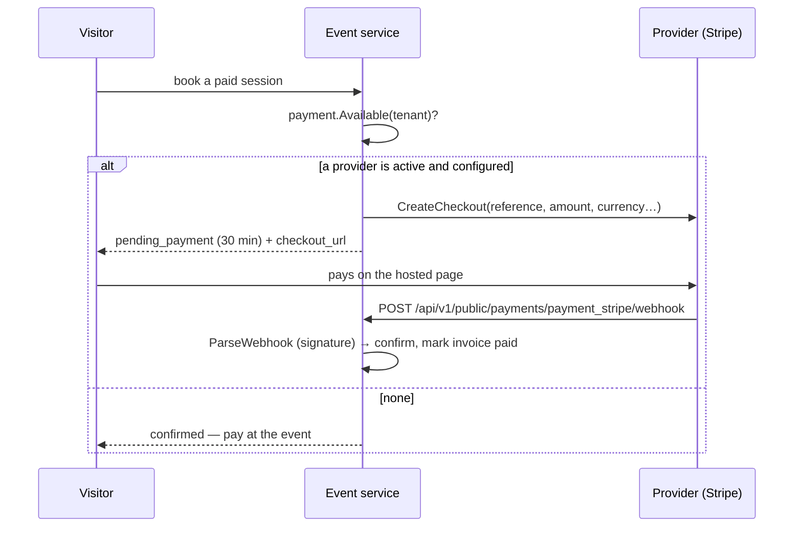

# Payment Providers

`core/internal/payment` is a small registry that lets a feature take an online payment without
knowing which service handles it. Stripe ships as the first provider
(`core/modules/payment_stripe`). See [ADR-029](../adrs/029-payment-providers.md).

The central rule: **no provider available means "pay later", never an error.** A workspace
without Stripe keeps working exactly as before — the [Event app](events.md) confirms the
booking and the customer pays on site.



## The provider contract

```go
type Provider interface {
    Configured(ctx context.Context, tenant uuid.UUID) (bool, error)
    CreateCheckout(ctx context.Context, tenant uuid.UUID, req CheckoutRequest) (Checkout, error)
    // Authenticates (signature) and decodes a notification.
    ParseWebhook(ctx context.Context, tenant uuid.UUID, body []byte, h http.Header) (WebhookEvent, error)
}

func init() { payment.Register("payment_mybank", myProvider{}) } // name = the module's name
```

- `payment.Available(ctx, tenant)` returns the first provider whose **module is active** (live
  App Store state) **and** which is configured for the tenant.
- Amounts are minor units (`payment.MinorUnits` handles zero-decimal currencies such as JPY).
- `WebhookEvent{Reference, Paid, Expired}` — an event needing no action has neither flag.
- Webhooks arrive at `POST /api/v1/public/payments/:provider/webhook` (public group, site tenant);
  the provider authenticates them itself.

## Stripe

`payment_stripe` (`type: go`, no table) uses Stripe Checkout over the REST API (no SDK).

| Route (`settings:integrations:*`) | Purpose |
|---|---|
| `GET\|PUT /api/v1/settings/integrations/stripe` | keys and webhook signing secret (write-only) |

Webhooks are HMAC-verified with the signing secret, with a 5-minute tolerance. Settings →
Global settings → Integrations shows the webhook URL to register in the Stripe dashboard.

!!! warning "Pitfalls"
    - Keys are stored as plain text, like every setting — protect database dumps accordingly.
    - The webhook, not the return page, confirms a payment: a visitor closing the tab after
      paying is still confirmed.

## Related

- [Events & Booking](events.md) · [Settings](settings.md)
