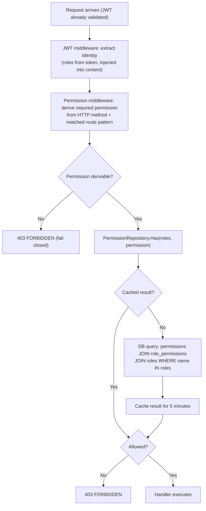
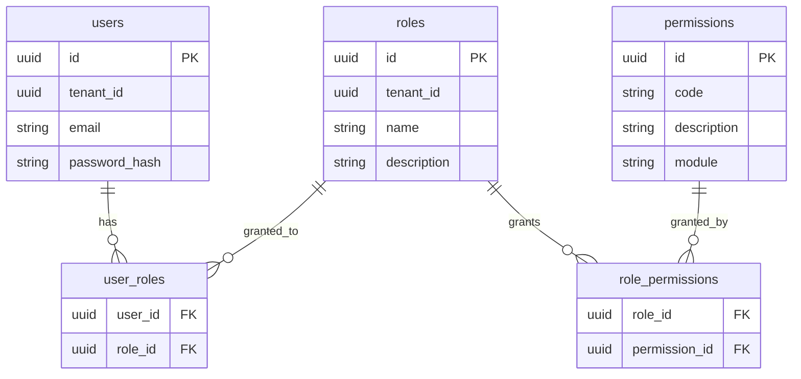
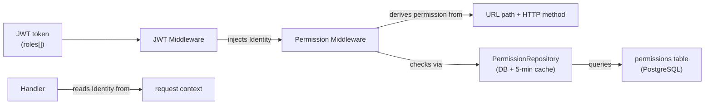

# Permissions

## Purpose

Authentication establishes _who_ is making a request. Permissions answer _what that identity is allowed to do_. The two are distinct layers: authentication is always required first; permissions are applied per endpoint.

See [Authentication](authentication.md) for how identities are established and [HTTP Pipeline](http-pipeline.md) for how the middleware stack is ordered.

---

## Responsibilities

- Define the permission model (roles, resources, actions)
- Derive the required permission automatically from the matched route pattern
- Check permissions before executing handlers, **failing closed** when the requirement can't be determined
- Cache permission lookups to avoid per-request DB queries

Row-level tenant isolation is a separate concern handled by the [ORM's CRUD layer](orm.md#tenant-isolation), not by this middleware. So is **field-level** visibility within a row a caller *can* otherwise reach — see [ORM → Field-Level Group Gating](orm.md#field-level-group-gating) and [ADR-014](../adrs/014-field-level-group-gating.md): a role-based permission decides whether an endpoint is reachable at all, while a field group decides whether one specific column of an otherwise-readable row is included in the response.

---

## Permission DSL

EERP uses **role-based access control (RBAC)** with a three-part permission code:

```
permission = module + ":" + resource + ":" + action
```

Examples:

| Permission | Meaning |
|---|---|
| `crm:contacts:read` | Read contacts in the CRM module |
| `crm:contacts:write` | Create and update contacts |
| `crm:contacts:delete` | Soft-delete contacts |
| `inventory:items:read` | Read inventory items |
| `*:*:*` | Full super-admin access |

Roles are assigned to users at the tenant level. A user may have multiple roles. The effective permission set is the union of all permissions granted by all roles.

---

## Wildcard Matching

The permission check supports wildcards so that broad grants like super-admin or module-admin roles do not require enumerating every permission:

| Pattern | Matches |
|---|---|
| `*:*:*` | Every permission (super-admin) |
| `module:*:*` | All actions on all resources in a module |
| `module:*:action` | A specific action on any resource in a module |
| `*:*:action` | A specific action across all modules |
| `*:resource:action` | A specific action on a named resource in any module |

The middleware evaluates the exact code first, then all applicable wildcard patterns.

---

## Automatic Route-to-Permission Derivation

Permissions are **not** declared per-route in code. The permission middleware derives the required permission from the **matched route pattern** (Echo's `c.Path()`, e.g. `/api/v1/crm/contacts/:id`) and the HTTP method.

Deriving from the route *pattern* rather than the raw URL is deliberate: path parameters such as `:id` are excluded, so the **collection route and the item route for the same table resolve to the same permission**. The resource is taken from the static path segments *before the first path parameter*; anything at or after `:id` — the id value itself, and action suffixes like `restore` — never leaks into the resource. The HTTP method carries the action.

### Path rules

| Route pattern | Example | Derived permission |
|---|---|---|
| Flat collection | `GET /api/v1/crm` | `crm:crm:read` |
| Flat item | `GET /api/v1/crm/:id` | `crm:crm:read` |
| Module + resource collection | `GET /api/v1/crm/contacts` | `crm:contacts:read` |
| Module + resource item | `DELETE /api/v1/crm/contacts/:id` | `crm:contacts:delete` |
| Restore (soft-delete tables) | `POST /api/v1/crm/contacts/:id/restore` | `crm:contacts:write` |

Because item and collection routes derive identically, a grant like `crm:contacts:read` covers **both** listing and reading a single record — a wildcard is no longer needed just to reach the `:id` route.

### HTTP method mapping

| HTTP method | Action |
|---|---|
| `GET` | `read` |
| `POST` | `write` |
| `PUT` / `PATCH` | `write` |
| `DELETE` | `delete` |
| Any other (`HEAD`, `OPTIONS`, …) | `""` |

### Fail-closed

If the required permission cannot be determined — an unknown method, or a route with no static resource segment — the derived string is `""` and the middleware **denies the request with `403 FORBIDDEN`**. It never passes an undetermined request through. Every generic CRUD route yields a permission, so an empty result signals an unexpected shape and must not bypass authorization.

!!! warning "This behaviour changed"
    Earlier versions passed a request through when the permission could not be derived (fail-open) and derived the resource from the raw URL, so `/api/v1/crm/<uuid>` produced `crm:<uuid>:read` — a different permission from the collection route. Both are fixed: derivation now uses the route pattern and an undeterminable permission is denied.

---

## Enforcement Flow



---

## Permission Repository

`PermissionRepository.Has(roles []string, permission string) bool` is the single entry point for permission checks. It:

1. Queries `permissions JOIN role_permissions JOIN roles WHERE r.name IN (roles...)`.
2. Evaluates both the exact permission code and all applicable wildcard patterns.
3. Caches the boolean result in a `sync.Map` keyed by `(sorted_roles, permission)` with a 5-minute TTL.

After any write to the `role_permissions` table, call `InvalidateCache()` to flush stale entries:

```go
permRepo.InvalidateCache()
```

!!! note "Cache scope"
    The cache is in-process and per-server instance. In a multi-instance deployment, each instance caches independently. A role change is reflected within 5 minutes on all instances without explicit coordination.

---

## Permission Storage



`user_roles` and `role_permissions` use composite primary keys and carry no `BaseModel` — they are pure join tables.

### Seeding permissions

Permissions are created by inserting rows into the `permissions` table directly (via API or migration). There is no automatic seeding from `module.json` — permission codes must be created and assigned to roles manually.

---

## Tenant Isolation

Tenant isolation is enforced at two levels:

1. **Token level**: the JWT carries `tenant_id`; the JWT middleware stamps it onto the request context.
2. **Row level**: the generic CRUD layer automatically scopes every read and write on any table with a `tenant_id` column to the caller's tenant — see [ORM → Tenant isolation](orm.md#tenant-isolation). Hand-written services that drop to the query builder are **not** auto-scoped and must add `WHERE tenant_id = $1` themselves.

A user authenticated in tenant A cannot read or mutate tenant B's rows through the generic API: id-based routes add `tenant_id = $tenant` to the `WHERE` clause, so a cross-tenant id simply returns `404`.

Permissions and tenancy are orthogonal: permissions decide *what actions* a role may perform; tenant scoping decides *which rows* those actions can touch. A caller needs both — the permission grant **and** the row's `tenant_id` matching their token.

---

## Interactions



See also: [Authentication](authentication.md), [HTTP Pipeline](http-pipeline.md), [Automatic Router](router.md).

---

## Extension Points

| Extension | How |
|---|---|
| Attribute-based access control (ABAC) | Add resource-attribute evaluation after the RBAC check |
| Shorter cache TTL | Lower the 5-minute TTL in `PermissionRepository` for high-churn role assignments |
| Audit logging | Wrap `Has()` to write `(user, permission, allowed, timestamp)` before returning |
| Dynamic roles | Allow tenants to create custom roles via the permissions API; call `InvalidateCache()` after writes |
