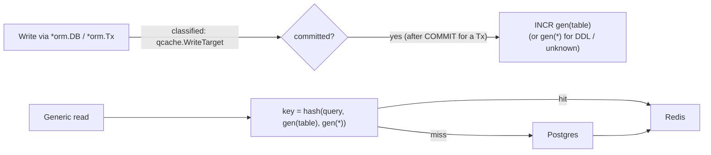

# Redis Read Cache (optional)

Set `redis_url` and the generic CRUD reads — list pages with their total, `?distinct=`,
`/:id` — are served from Redis when warm. Leave it empty, or let Redis go down, and nothing
changes: Postgres answers as before. Package `core/orm/qcache`; design
[ADR-023](../adrs/023-optional-redis-query-cache.md).

| Config | Default | Meaning |
|---|---|---|
| `redis_url` | empty (off) | e.g. `redis://redis:6379/0` |
| `redis_ttl_seconds` | 60 | upper bound on how long an entry lives |

## Invalidation without caller cooperation

Module code never invalidates anything. Correctness comes from **generation counters**:

Every statement the ORM executes is classified; once a write commits, its table's generation
is bumped (the whole database's for DDL or anything unrecognised). Keys embed those
generations, so stale entries simply become unreachable and the TTL collects them. Writers
never scan or delete keys.

## What is never cached

- reads inside a transaction;
- typed `Repository[T]` reads (only the generic HTTP read path is cached);
- reads with a geo `inside[]` filter — their result depends on another table whose writes
  don't bump this one's generation.

## Failure modes

- A `nil` cache is a no-op; Redis errors **fail open** to Postgres and are logged.
- In Compose, `core-back` waits on Redis with `required: false`: removing the `redis` service
  just runs uncached.

!!! warning "Writes that bypass the ORM"
    `psql`, a migration tool, or `DB.Pool()` used directly are invisible to invalidation —
    readers may see the old data for up to `redis_ttl_seconds`. After such a write, flush Redis
    (`redis-cli FLUSHDB`) or wait the TTL.

Redis-backed tests run only when `REDIS_URL` is set (`make test` starts one).

## Related

- [ORM](orm.md) · [List Read Performance](list-performance.md) · [Configuration](configuration.md)
