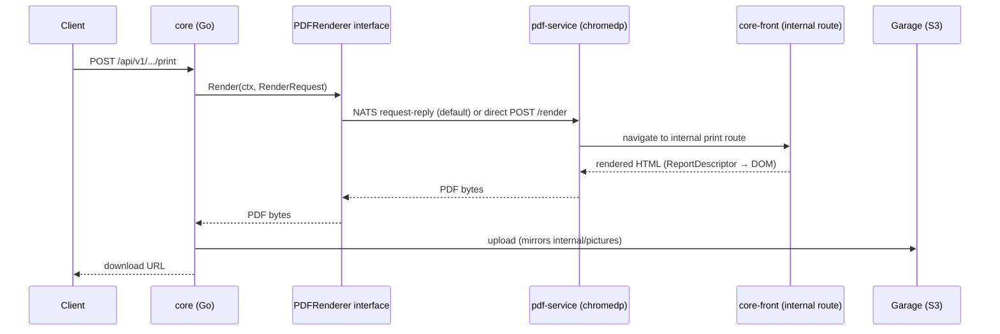

# Reports & PDF Generation

EERP generates PDF reports (invoices, quotes, rent receipts, statements, list exports) the same
way it renders on-screen views: from a declarative descriptor, not a bespoke templating language.
The render engine is headless Chromium, running as a standalone service — see
[ADR-011](../adrs/011-pdf-report-generation.md) for the full decision record, including the
benchmarks that ruled out a native Go renderer and Typst.

---

## Why a separate service, and why Chromium

A report author should write real CSS (Tailwind/MUI classes) and reuse the exact React components
and data model forms already use — not learn a second, PDF-specific layout language. Only a real
browser engine gives that fidelity. Chromium's resource footprint (~150-190MB per instance) and
attack surface are isolated into their own service, `pdf-service`, so a report-generation burst
never raises the core API's latency and a Chromium hang shares no fault domain with it. The
renderer only ever navigates to URLs it (or the trusted core) constructs itself — an internal,
network-isolated `core-front` route — never attacker-supplied URLs or untrusted HTML, which blunts
Chromium's usual attack-surface objection.



## `ReportDescriptor`

Mirrors the existing `ViewDescriptor`/`FrontModule` "descriptors only" contract: a `layout` tree of
typed nodes (section/table/field), each carrying an optional `className` for Tailwind/MUI styling,
bound to the same entity field data forms already use. A single generic print route interprets any
`ReportDescriptor` into DOM, exactly as `FormRenderer` interprets a `ViewDescriptor`.

`ReportFieldNode.companyFallback?: 'name' | 'address' | 'phone' | 'email'` lets a report opt a
field into falling back to the workspace's active-company profile at *print time*, only when the
record's own value is empty — see [ADR-013 → Decision 7](../adrs/013-multi-company.md) and
[Settings](settings.md). `sale.invoice`'s four issuer fields are the first consumer.

## `PDFRenderer` interface

`core/internal/reports` exposes one interface with two implementations, so the transport can grow
without touching render logic:

```go
type PDFRenderer interface {
    Render(ctx context.Context, req RenderRequest) ([]byte, error)
}
```

- **`natsPDFRenderer`** — the default. `eerp-config.docker.json` sets `nats_url`
  (`nats://nats:4222`), so `main.go` routes every render through NATS request-reply, letting
  multiple `pdf-service` replicas form a competing-consumer group — horizontal scaling with no
  code change per replica. `core-back` depends on `nats` being healthy at startup.
- **`httpPDFRenderer`** — synchronous `POST /render` directly to one `pdf-service` instance. Still
  fully functional (NATS wins only because `nats_url` is set), but no longer what a fresh
  deployment uses — clear `nats_url` from the config to fall back to it.

## Delivery

The core-side handler uploads the rendered PDF to Garage using the **same `pictures.ObjectStore`
interface and `NewS3Store` client** [Object Storage](object-storage.md) provides — but the delivery
pattern is deliberately **not** a copy of pictures' metadata-row scheme. There is no `report`
table at all:

```go
key := fmt.Sprintf("reports/%s/%s/%s/%d.pdf", identity.TenantID, name, recordID, time.Now().UTC().Unix())
h.objects.Put(ctx, key, "application/pdf", int64(len(pdf)), bytes.NewReader(pdf))
// response: {"download_url": "/api/v1/reports/pdf?key=" + key}
```

The generated **key itself is the capability** — `GeneratePDF` hands it straight back in the
response, and `DownloadPDF` (`GET /api/v1/reports/pdf?key=...`) only checks that the supplied key's
`reports/{tenant}/` prefix matches the caller's own tenant before streaming it. There is no lookup
row, no listing endpoint, and — unlike pictures/attachments, which replace-in-place at a fixed
anchor and hard-delete on removal — **no delete path at all**: every generation writes a brand new
timestamped key, and old report objects simply accumulate in the bucket. This is an accepted
tradeoff for now, not an oversight; see [Object Storage Across
Layers](../architecture/object-storage-topology.md) for how this compares to pictures' and
attachments' anchor-and-replace scheme side by side.

## Pagination

Chromium's `Page.printToPDF` header/footer templates (`@page` margin boxes,
`counter(page)`/`counter(pages)`, supported since Chromium 131+) cover page numbers, static titles,
and dates. CSS `running()` (dynamic per-page content migrating from the body into a margin box) is
**not** supported by Chromium — a known limitation to design around, not a bug to chase.

## Capacity planning

Chromium's per-vCPU throughput ceiling (~3.2 reports/s/vCPU, measured) is far behind a native
renderer, but easily covers realistic ERP volumes: a 4-vCPU replica sustains ~13 reports/s, and
scaling is linear via **replica count** — each Chrome instance is independent — not by raising a
single instance's concurrency past roughly 2× its vCPU count.

## Related

- [ADR-011: PDF Report Generation](../adrs/011-pdf-report-generation.md)
- [Object Storage](object-storage.md) — the S3 delivery mechanism this reuses
- [Object Storage Across Layers](../architecture/object-storage-topology.md) — how pictures, attachments, and reports each use the shared Garage bucket differently
- [Settings → Multi-Company Scoping](settings.md#multi-company-scoping) — the company-fallback consumer
- [Views & Components → Report View](../frontend/views-and-components/report-view.md)
