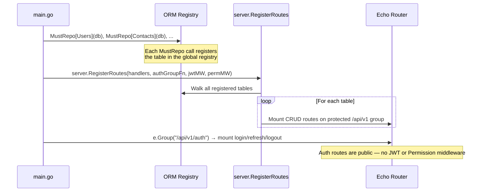
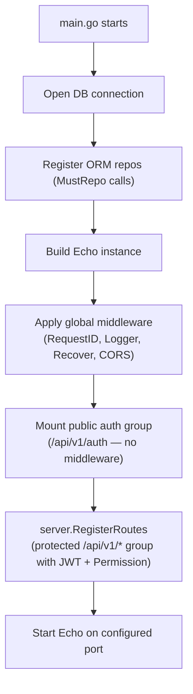
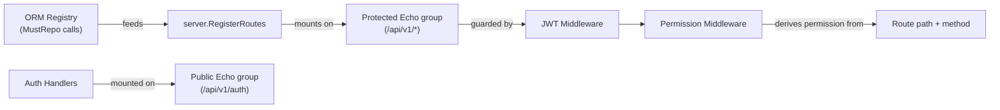

# Automatic Router

## Purpose

EERP routes cannot be hardcoded in the core — the set of tables (and therefore endpoints) is determined at runtime by which ORM models are registered. The automatic router solves this by generating CRUD routes directly from the ORM registry, so every registered table gets a fully functional HTTP API with zero per-table boilerplate.

---

## Responsibilities

- Generate standard CRUD routes for every table in the ORM registry
- Namespace routes under `/api/v1/{route_prefix}`
- Apply authentication and permission middleware to all generated routes
- Mount auth endpoints as a separate public group
- Provide an override mechanism for the default route prefix

---

## Route Generation

Every table registered in the ORM registry gets the following routes under `/api/v1/{route_prefix}`:

| Method | Path | Purpose |
|---|---|---|
| `GET` | `/{prefix}` | List all records (with soft-delete filter if applicable) |
| `GET` | `/{prefix}/:id` | Get a single record by ID |
| `POST` | `/{prefix}` | Create a new record |
| `PUT` | `/{prefix}/:id` | Update a record |
| `DELETE` | `/{prefix}/:id` | Delete a record (soft if `deleted_at` present, hard otherwise) |
| `POST` | `/{prefix}/:id/restore` | Restore a soft-deleted record (only if model has soft-delete) |

The restore route is only generated for models that include `BaseModel` with the `deleted_at` soft-delete field.

---

## Route Prefix

The `route_prefix` defaults to the table name. It can be overridden per-table in `api.yaml`:

```yaml
tables:
  contacts:
    route_prefix: crm/contacts
```

With the override above, the list endpoint becomes `GET /api/v1/crm/contacts` instead of `GET /api/v1/contacts`.

---

## Registration Flow



After startup the route table is frozen. New routes cannot be registered without a restart.

---

## Permission Derivation from Routes

The permission middleware automatically derives the required permission from the URL path generated by the router. This means no per-route permission annotation is needed.

| Generated route | HTTP method | Derived permission |
|---|---|---|
| `/api/v1/crm/contacts` | `GET` | `crm:contacts:read` |
| `/api/v1/crm/contacts` | `POST` | `crm:contacts:write` |
| `/api/v1/crm/contacts/:id` | `PUT` | `crm:contacts:write` |
| `/api/v1/crm/contacts/:id` | `DELETE` | `crm:contacts:delete` |
| `/api/v1/contacts` | `GET` | `contacts:contacts:read` |

For single-segment prefixes (e.g. `contacts`), the module and resource parts of the permission code are both set to the table name. For two-segment prefixes (e.g. `crm/contacts`), the first segment is the module and the second is the resource. See [Permissions](permissions.md#automatic-route-to-permission-derivation) for the full derivation rules.

---

## Auth Routes (Public Group)

Auth routes are mounted manually in `main.go` on a separate Echo group **before** the protected group, with no JWT or Permission middleware:

```go
authGroup := srv.Echo().Group("/api/v1/auth")
authGroup.POST("/login",   authHandler.Login)
authGroup.POST("/refresh", authHandler.Refresh)
authGroup.POST("/logout",  authHandler.Logout)
```

This ensures login and refresh requests are never blocked by the auth middleware they are bootstrapping.

---

## Startup Sequence



---

## Interactions



See also: [HTTP Pipeline](http-pipeline.md), [Permissions](permissions.md), [Authentication](authentication.md).

---

## Extension Points

| Extension | How |
|---|---|
| Custom route prefix | Set `tables.{table}.route_prefix` in `api.yaml` |
| Additional routes per table | Register extra handlers on the Echo group after `RegisterRoutes` returns |
| OpenAPI generation | Walk the Echo route tree post-startup and emit an OpenAPI 3 spec |
| Per-table middleware | Wrap specific handlers with additional Echo middleware before mounting |
