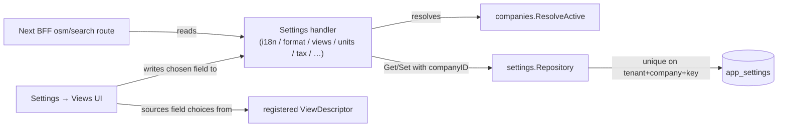

# Settings & Workspace Configuration

`core/internal/settings` is a tenant- (and, since [ADR-013](../adrs/013-multi-company.md),
company-) scoped key/value store for workspace preferences that don't belong on any one business
entity: default locale, number formatting, which field backs a Kanban's status column or a
Calendar's date, a Graph mode's tile layout, the OpenStreetMap connector configuration, and the
tax pricing mode. It sits deliberately off the generic CRUD surface — each key has its own
narrow, purpose-built `GET`/`PUT` pair rather than a free-form `app_settings` CRUD endpoint,
because most of these values need validation the generic column-whitelist handler doesn't do
(e.g. a Graph tile's shape, or the closed `tax_excluded`/`tax_included` enum).

---

## Why not generic CRUD

`app_settings` is a single JSON blob per `(tenant_id, company_id, key)`. Exposing it generically
would mean any writable key could be created ad hoc from the frontend with no server-side shape
validation. Instead, each setting has a dedicated handler that validates its own JSON shape before
persisting it — the same "off generic CRUD because this needs a rule the column-whitelist chain
can't express" posture `internal/chatter`/`internal/notebook`/`internal/savedfilter` take for
different reasons. See [Record-Anchored Services](record-anchored-services.md) for that family.

## Storage shape

```go
// core/internal/settings — table: app_settings
type AppSetting struct {
    model.BaseModel
    CompanyID uuid.UUID `db:"company_id"`
    Key       string    `db:"key"`
    Value     []byte    `db:"value"` // opaque JSON, shape owned by the key's own handler
}
```

Unique index on `(tenant_id, company_id, key)`. `Repository.Get`/`Set` take `companyID` as a
parameter — every handler below resolves the caller's **active** company
(`companies.ResolveActive`) once per request and threads it through, so the same key can hold a
different value per company within one tenant.

## Settings keys and their endpoints

Most keys are **per company** (the caller's active company). A few describe the whole tenant and
live in the tenant-wide slot (`company_id = uuid.Nil`) — marked *tenant* below. Every
`/api/v1/settings/...` permission is derived from the route (`settings:<area>:read|write`).

| Key | Endpoint | Scope | Shape |
|---|---|---|---|
| `i18n.default_locale` | `PUT /settings/i18n` | company | workspace default language |
| `format.number` | `PUT /settings/format` | company | decimal / thousands separators |
| `units.system` | `GET\|PUT /settings/units` | company | `{system: "metric" \| "imperial"}`, absent = metric (`ResolveUnitSystem`) |
| `tax.price_mode` | `GET\|PUT /settings/tax` | company | `{price_mode: "tax_excluded" \| "tax_included"}` (`ResolveTaxIncluded`) |
| `accounts.username_at_format` | `GET\|PUT /settings/accounts` | company | `{username_at_format: bool}` — display usernames as `@handle` |
| `views.<entity>.fields` | `GET\|PUT /settings/views/:entity/fields` | company | Kanban status field, Calendar date field, `enable_graphs` ([ADR-007](../adrs/007-runtime-view-fields.md)) |
| `views.<entity>.graph` | `GET\|PUT /settings/views/:entity/graph` | company | Graph-mode tile layout (shape validated, `config` opaque) |
| `views.<entity>.chatter` | `GET\|PUT /settings/views/:entity/chatter` | company | `{enabled: bool \| null}` — override the form chatter panel; null = the descriptor's `showChatter` |
| `widgets.picture_size`, `apps.<module>.widgets.picture_size` | `GET\|PUT /settings/apps/:module/picture-size` (`base` = workspace default) | company | `{width, height}` 16–2000 px; a module's value overrides the base one |
| `reports.layout` | `GET\|PUT /settings/reports/layout` | company | `{footer, address}` letterhead stamped on every PDF ([Reports](reports.md)) |
| `integrations.osm` | `GET\|PUT /settings/integrations/osm` | company | `{enabled, base_url, user_agent}` OpenStreetMap/Nominatim connector |
| `integrations.stripe` | `GET\|PUT /settings/integrations/stripe` | tenant | Stripe keys, write-only ([Payments](payments.md)) |
| `auth.methods` | `GET\|PUT /settings/auth`, `POST /settings/auth/test` | tenant | LDAP / OIDC sign-in ([External Sign-In](external-auth.md)) |
| `events.settings` | `GET\|PUT /settings/events` | tenant | `{reminder_hours, waitlist_claim_hours}` ([Events](events.md)) |
| `website.routing` | `GET\|PUT /settings/website/routing` | tenant | path or host mode ([Website](website.md#routing-path-or-host-mode)) |
| `website.public.<table>` | `GET /settings/website/public`, `PUT …/:table` | tenant | published fields + forced filter ([Website](website.md#public-read-scope)) |
| `website.legal`, `website.security`, `website.robots` | `GET\|PUT /settings/website/{legal,security,robots}` | tenant | site files ([Website](website.md#site-files)) |
| mail templates (own table `mail_template`) | `GET /settings/mail_templates`, `PUT\|DELETE …/:key/:locale` | tenant | email overrides ([Mail](mail.md)) |
| `dev.seed.full.<group>` | written by `POST /dev_seed` | tenant | full-seed markers ([Demo Data](demo-data.md)) |

Plus one self-service, JWT-scoped endpoint outside the tenant-admin set: `GET/PUT
/api/v1/me/preferences` — the caller's own `preferred_locale` and `active_company_id`; its GET
also returns the resolved workspace values the UI mirrors (number format, active company and its
currency, unit system).

Every `GET` on an unconfigured key reads as its documented zero value (an empty canvas for
`views.<entity>.graph`, `tax_excluded` for `tax.price_mode`, a disabled connector for
`integrations.osm`) — **not a 404**. An unconfigured setting is a normal state a fresh workspace
starts in, not an error condition.

!!! warning "Tenant-wide keys in a multi-tenant database"
    Tenant-wide keys are written under the admin's tenant. The website reads the **site tenant**
    — publish and configure the site while signed in to it.

## Tax pricing mode

`tax.price_mode` decides how a `SaleTax`'s percentage/fixed amount interacts with a line's base
price, resolved server-side via the exported `ResolveTaxIncluded` helper so `sale` and
`propertymanagement`'s own tax computation can use the same effective value without an HTTP
round-trip:

- **`tax_excluded`** (the default): tax is computed *on top of* the base price. `12€ + 20% tax =
  14.40€`.
- **`tax_included`**: the base price is treated as already tax-inclusive, and the pre-tax subtotal
  is back-derived. `12€ including 20% tax stays 12€ total, of which 10€ is pre-tax`.

Each billing/sale line persists its own tax-excluded `Subtotal` alongside `Total`, computed once at
write time, so invoice/receipt rollups can sum it directly rather than re-deriving it from
`UnitPrice` — which no longer safely stands in for the tax-excluded figure once prices can be
tax-inclusive.

## OpenStreetMap connector

The workspace's OSM/Nominatim configuration is proxied through a Next.js BFF route
(`apps/shell/app/api/integrations/osm/search/route.ts`), never called from the browser directly —
so the connector's base URL, user agent, and any future API key never reach client JavaScript. The
[Address field widget](../frontend/views-and-components/address-widget.md) is the sole consumer.

## Multi-Company Scoping

Every key above became company-scoped in one mechanical pass ([ADR-013](../adrs/013-multi-company.md)):
`Repository.Get`/`Set` gained a `companyID` parameter, threaded through each handler by resolving
`companies.ResolveActive` once per request. Pre-existing single-tenant rows were backfilled once at
boot, before the unique index moved from `(tenant_id, key)` to `(tenant_id, company_id, key)`, so a
tenant upgrading from before multi-company shipped sees its existing settings become its new
default company's settings — nothing resets. Creating a second company is a one-time deep copy
(`POST /api/v1/company/:id/clone-settings`) of every settings row, not an ongoing inheritance chain
— a later edit to either company never affects the other.

## Interactions



## Related

- [ADR-007: Runtime-Configurable View Fields](../adrs/007-runtime-view-fields.md)
- [ADR-013: Multi-Company](../adrs/013-multi-company.md)
- [Authentication → Multi-Company](authentication.md#multi-company-within-a-tenant)
- [View Engine → Runtime view settings](../frontend/view-engine.md#runtime-view-settings-kanbancalendargraph)
