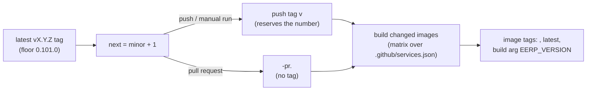

# Versioning & Service Versions

Every image CI publishes carries a version, and the running stack can tell you which version of
each service it runs (Settings dashboard, bottom). Versions are **computed by CI only** — never
locally, never committed. Outside CI everything reads `dev`.

## How CI numbers builds



- One **minor** bump per publishing build: `0.101.0`, `0.102.0`, … (`.github/scripts/next-version.sh`).
  Older tags such as `v0.0.3` predate the scheme and are ignored by the floor.
- The tag is pushed **before** any image builds, so two concurrent runs can't publish the same
  number. A run that builds no image consumes no version; a failed build after the tag push does.
- Only images whose `paths` changed are rebuilt; an unchanged service keeps its previous version,
  so services can legitimately report different versions.
- **Releases are declared by hand**: push a tag such as `v1.0.0`, and later builds continue from
  it (`1.1.0`, …).

Each service stamps `EERP_VERSION` into itself: `core` via `-X core/internal/version.Version`
(logged at boot), `pdf-service` via `-X main.version`, `core-front` as an env variable.

## Seeing versions at runtime

`GET /api/v1/versions` (any signed-in staff user, no permission) →

```json
{ "services": [
  { "name": "core", "label": "Core", "version": "0.142.0" },
  { "name": "pdf-service", "label": "PDF service", "version": null }
] }
```

Core is listed first, then every registered service, probed in parallel with a 2 s timeout each
(`null` = no answer, shown as "unavailable"). The Settings dashboard prepends the frontend's own
version.

## Adding a custom service

1. An entry in **`.github/services.json`** (`name`, `image`, `dockerfile`, `paths`) — that alone
   adds it to the CI build matrix (`build-image.yml`).
2. A Dockerfile taking `ARG EERP_VERSION` and stamping it into the binary.
3. One of two answers:
    - HTTP `GET <base>/version` → `{"version": "…"}` (`version.HTTPProbe`), or
    - a NATS request on `eerp.version.<name>` → the bare version (`version.NATSProbe`, preferred
      when `nats_url` is set; any replica may answer).
4. Register it in `internal/app`:

    ```go
    versions.Register(version.Service{Name: "my-service", Label: "My service", Probe: probe})
    ```

    and add the label to the shell's `.po` files.

## Related

- [Deployment](../developer-guide/deployment.md) — upgrading with `EERP_IMAGE_TAG`
