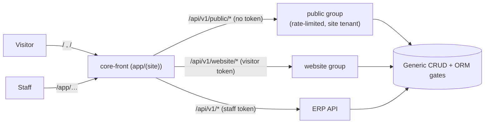

# Website & Public Access

EERP serves a **public website** next to the ERP, from the same stack. Pages are built in the
ERP's Website app, data comes from the same tables the ERP manages, and visitors can sign up
and book events — without any anonymous request ever reaching the authenticated API.



Design records: [ADR-025](../adrs/025-public-access-and-website-identities.md) (public
access and visitor identities) and [ADR-026](../adrs/026-website-routing-and-erp-base-path.md)
(routing and the `/app` base path).

## Public read scope

A table is readable anonymously only when two things say so:

1. **The module declares a ceiling** — the fields that *may* be public:

    ```go
    orm.Register[Product](orm.WithPublicFields("name", "description", "price", "picture"))
    // orm.AllPublicFields ("*") = every API column except the PK, tenant_id,
    // deleted_at and group-gated ones
    ```

2. **An admin publishes a subset** of that ceiling, with an optional forced row filter
   (`{"published": true}`), stored in `app_settings` `website.public.<table>` and edited at
   `PUT /api/v1/settings/website/public/:table` (`settings:website:write`; listed by
   `GET /api/v1/settings/website/public`).

`/api/v1/public/{table}[/:id]` then reuses the **generic list/get handlers** with an
`access.PublicScope` on the context. The same choke points that enforce
[field group gating](permissions.md) enforce it:

| Request | Answer |
|---|---|
| table not published (or its module deactivated) | 404 |
| a non-public column in any param (`filter`, `search`, `order`, `distinct`…) | 400 |
| `?aggregate=`, `page_size > 100`, `inside[]` | 400 |
| a read | only published columns, forced filter always applied |

A many2one is returned as its raw id only if that column is published; labels are the
consumer's job. Pictures are read through `GET /api/v1/public/<table>/<id>/picture/<field>`,
under the same published-scope gate (mounted only with `s3_*`).

!!! warning "Publish from the site tenant"
    Settings are written under the admin's tenant, while the site reads the **site tenant**
    (`website_tenant_id`, else the database's only tenant; resolved at boot). In a
    multi-tenant database, publish while signed in to the site tenant.

## Website visitors

Visitors are users too, but a different **kind**: `users.kind = 'website'`, tokens with
`aud: ["website"]`. Every route group refuses the wrong audience (403), so a visitor token can
never be used as an ERP session and vice versa.

| Route | Purpose |
|---|---|
| `POST /api/v1/website/auth/{signup,login,refresh,logout}` | visitor session (no JWT, auth rate limit) |
| `GET\|PUT /api/v1/website/me` | the visitor's own profile |
| `POST /api/v1/website/me/verify` (+ `/resend`) | email verification; attaches earlier anonymous bookings |
| `GET /api/v1/website_admin/users`, `PUT …/:id` | staff side: list visitors, edit profile, disable/enable |

- Roles `website_user` / `website_admin` are seeded per tenant.
- A signup also creates the visitor's **contact** (`website = true`) in the same transaction —
  through a hook (`UserRepository.OnWebsiteSignup`), so `auth` never imports a business module.
- Disabling a visitor soft-deletes it and revokes its refresh tokens; `/website/me` 404s at once,
  an already-issued access token lives until its TTL.
- Emails are unique among live users across tenants and kinds (`idx_users_email_live`); collisions answer 409.

The frontend keeps the visitor session in its own cookies (`eerp_site_access` /
`eerp_site_refresh`), never the ERP's — staff can be signed in to both at once
([Frontend authentication](../frontend/authentication.md)).

## Pages

`core/modules/website` owns `website_page`: a `slug` (unique per tenant among live rows, `""`
= home), `title`, `seo_description`, `published`, `in_menu` / `menu_sequence`, a JSONB
`layout` and a background picture (`background`, `background_parallax`). It rides the generic
CRUD surface, so the ERP Website app is descriptors only, and declares public fields so a
published page is readable at `/api/v1/public/website_page`.

A validation middleware on create/update checks:

- the slug: lowercase-dash, not a **reserved slug** (`app`, `api`, `print`, `login`,
  `settings`, `legal-notice`…) nor a module name;
- the layout: a **36-column grid** of blocks with unique ids and non-negative geometry, and a
  closed block-type set — `text`, `image`, `hero`, `section`, `record_list`, `record_detail`,
  `record_carousel`, `image_carousel`, `event_booking`, `appointment_booking`, `event_list`.
  A block's `config` is opaque to Go. The set is kept equal to the frontend's `BLOCK_TYPES` by a test.

A page with a null `layout` is simply empty. The page editor and the block catalog are
described in [Website Builder](../frontend/website-builder.md).

## Routing: path or host mode

The site owns `/`; the ERP lives under **`/app`** (`erpPath()` in the frontend adds the base
when a link is emitted; old bare ERP paths 307 to `/app/…`).

| Mode (`website.routing`) | Behaviour |
|---|---|
| `path` (default) | site and ERP share one host: `/…` is the site, `/app/…` the ERP |
| `host` | `site_host` serves the site, `erp_host` the ERP; each redirects the other's paths there |

`PUT /api/v1/settings/website/routing` is refused in host mode unless the request came through
`erp_host`, so an admin can't lock themselves out; any other host (IP, localhost) keeps path
mode, and `EERP_SITE_ROUTING=path` in the frontend env forces it. The setting is readable
anonymously in `GET /api/v1/public/site`.

## Site files

| Setting (`settings:website:*`) | Served anonymously at | Notes |
|---|---|---|
| `/settings/website/legal` | `/api/v1/public/legal` → `/legal-notice` | publisher/host fields + plain free text (never HTML); 404 until set |
| `/settings/website/security` | `/public/security.txt` → `/security.txt`, `/.well-known/security.txt` | RFC 9116; contacts `mailto:`/`tel:`/`https://`; `expires` required, ≤ 1 year; not served once expired |
| `/settings/website/robots` | `/public/robots.txt?host=` → `/robots.txt` | built-in disallows for `/app/`, `/api/`, `/print/`, `/database/` and visitor pages, then your lines; `Disallow: /` on the ERP host in host mode |

## Configuration

| Key | Purpose |
|---|---|
| `website_tenant_id` | the site tenant; empty = the single tenant (ambiguous → public group not mounted) |
| `site_url` | public origin used in emails (booking, verification); without it links are relative |
| `public_rate_limit_per_minute` | per-IP limit on `/api/v1/public` and `/api/v1/website` (default 300) |

!!! warning "Rate limits behind a proxy"
    Limits key on the client IP. Behind a reverse proxy, the gateway must receive the real
    client IP, or every visitor shares one bucket — see
    [Deployment → reverse proxy](../developer-guide/deployment.md).

## Related

- [Events & Booking](events.md) — the main consumer of visitor accounts
- [Website Builder (frontend)](../frontend/website-builder.md) · [Permissions](permissions.md)
