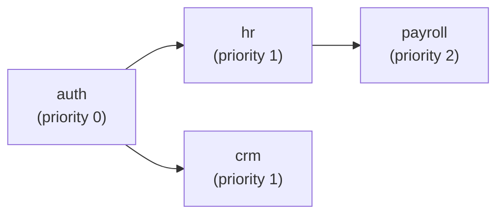

# Creating a Go Module (Monolith Path)

!!! info "Two paths available"
    EERP supports two module implementation strategies:

    - **Go monolith** (this guide) — schema derived automatically by the ORM, all logic compiled directly into the core binary. This is the path every shipped module uses (CRM, contact, sale, propertymanagement, warehouse, cron, …).
    - **WASM / WASI** ([Creating a WASM/WASI Module](creating-a-module.md)) — the module's own Go source is cross-compiled to WASI; the core calls `migrate()` at startup for sandboxed schema declaration. Implemented and functional, but currently unused by any shipped module — reach for it only when you need schema isolation without a core rebuild.

This guide walks you through building a Go module from scratch. We'll build a `hr` (Human Resources) module as a running example, mirroring the pattern used by the `contact` module (`core/modules/contact/`) and the CRM module (`core/modules/crm/internal/crm.go`).

!!! tip "Faster start: scaffold it"
    `go run ./tools/eerp-init-module -p core/modules/hr -t go` generates the `module.json`,
    `module.go`, a starter entity, frontend view files, and wires the blank import into
    `core/modules/all/all.go` automatically. See [Building a Module From
    Scratch](module-from-scratch.md) for the full walkthrough using the tool. This guide explains
    each piece by hand so you understand what the generator produces.

---

## Before You Start

You need:

- Go 1.26+ with generics support
- A running PostgreSQL instance (see `compose.yml`)
- The EERP core repository checked out

No additional toolchain is required — Go modules compile directly into the core binary.

---

## Step 1: Create the Module Directory

```bash
mkdir -p core/modules/hr/internal
```

Your module lives under `core/modules/` alongside the existing CRM module:

```
core/modules/
├── crm/
│   └── internal/
│       └── crm.go      # Reference implementation
└── hr/
    ├── module.json     # Metadata (required by detector)
    └── internal/
        ├── employee.go # Entity definition
        └── service.go  # Business logic
```

---

## Step 2: Write module.json

The detector scans `module_root` directories for `module.json` files. Even for Go-only modules, this file is required for dependency resolution and priority assignment.

```json
{
    "active": true,
    "name": "hr",
    "display_name": "Human Resources",
    "version": "0.1.0",
    "author": "Your Name",
    "description": "Employee and contract management",
    "depends": [],
    "priority": 0,
    "static_files": {},
    "is_service": true,
    "auto_install": true
}
```

**Field reference:**

| Field | Type | Description |
|---|---|---|
| `active` | bool | Whether the module loads on startup |
| `name` | string | Unique identifier — used in `depends` arrays |
| `display_name` | string | Human-readable label |
| `version` | semver | Module version |
| `depends` | []string | Names of modules that must load before this one |
| `is_service` | bool | Whether the module registers HTTP handlers |
| `auto_install` | bool | Whether to apply migrations automatically on load |

!!! note "No wasm_path needed"
    For a pure Go module, omit `wasm_path`. The detector auto-discovers `.wasm` files; if none is found, the WASM migration step is skipped and the Go service handles everything.

**Checklist:**

- [ ] `name` is unique across all modules in `module_root`
- [ ] `depends` lists the `name` values of prerequisite modules
- [ ] `active: true` to enable on startup

---

## Step 3: Define the Entity

Entities embed `model.BaseModel`, which provides `id` (UUID), `created_at`, `updated_at`, and `deleted_at` (soft-delete) automatically.

**`internal/employee.go`:**

```go
package hr

import (
    "eerp/core/orm/model"
    "time"
)

// Employee represents a person hired by the business.
// The ORM derives the table name from TableName() below.
type Employee struct {
    model.BaseModel
    Department  string    `db:"department"`
    StartDate   time.Time `db:"start_date"`
    SalaryCents int64     `db:"salary_cents"` // stored in cents to avoid float precision issues
    Status      string    `db:"status"`       // "active" | "on_leave" | "terminated"
}

func (Employee) TableName() string { return "employees" }
```

**Rules:**

- Embed `model.BaseModel` — never define `id`, `created_at`, `updated_at`, or `deleted_at` yourself.
- Use `db:"column_name"` struct tags for non-snake-case field names.
- Implement `TableName() string` to override the default (struct name lowercased).
- Store money as integer cents, not `float64`.

**`model.BaseModel` fields (for reference):**

```go
// core/orm/model/base.go
type BaseModel struct {
    ID        uuid.UUID  `db:"id"`
    CreatedAt time.Time  `db:"created_at"`
    UpdatedAt time.Time  `db:"updated_at"`
    DeletedAt *time.Time `db:"deleted_at"` // nil = active
}
```

---

## Step 4: Self-register with `module.go`

The schema is **not** hand-written as a migration struct or a SQL file — it is derived
automatically from the entity struct. Every Go module implements the small `GoModule` interface
(`core/internal/module/go_module.go`) and enlists itself from `init()`:

```go
// core/internal/module/go_module.go
type GoModule interface {
    Name() string
    Register() error // orm.Register[T]() for new tables, orm.ExtendSchema() for others'
}
```

**`module.go`** — mirror of `core/modules/contact/module.go`:

```go
package hr

import (
    "core/internal/module"
    "core/modules/hr/internal"
    "core/orm"
)

func init() {
    module.RegisterGoModule(&hrModule{})
}

type hrModule struct{}

func (m *hrModule) Name() string { return "hr" }

func (m *hrModule) Register() error {
    return orm.Register[internal.Employee]()
}
```

That's the whole integration contract — `orm.Register[T]` builds an API descriptor from the struct
(column list, table name, route prefix, soft-delete support) and, at startup,
`module.LoadGoModules` snapshots the schema registry before and after this call to derive the DDL
diff. **You never write a migration file.** New tables get `CREATE TABLE IF NOT EXISTS`
(`BaseModel` columns included); new columns on an already-registered table get `ADD COLUMN IF NOT
EXISTS`. See [Server Integration → Startup migration flow](../development/server-integration.md#startup-migration-flow)
for the exact sequence.

### Registration options

```go
orm.Register[internal.Employee](
    orm.WithTableName("employees"),                          // override the derived table name
    orm.WithReadOnlyFields("tenant_id"),                      // accepted from DB, rejected on write
    orm.WithExcludeFields("salary_cents"),                    // removed from the API surface entirely
    orm.WithFieldGroups(map[string][]string{"salary_cents": {"hr_manager"}}), // visible only to callers in this group — see ADR-014
)

// Register with the ORM but expose NO HTTP routes (internal-only table):
orm.Register[internal.AuditLog](orm.WithExcluded())
```

!!! warning "Security-critical exclusions belong in code, not api.yaml"
    `api.yaml` (`api_config_path` in the config) carries only cosmetic API-surface overrides.
    Fields that must never cross the wire are excluded in code via `WithExcludeFields` /
    `WithExcluded` / `WithFieldGroups` — code-level options are fail-closed.

### DDL the auto-migration can't derive

If you need DDL beyond `CREATE TABLE`/`ADD COLUMN`/indexes — join tables with composite primary
keys, unique constraints (struct tags have no `unique` modifier), custom foreign keys — implement
the optional `Migrator` interface on the same struct; it runs after the auto-migration:

```go
func (m *hrModule) Migrate(ctx context.Context, db *orm.DB) error {
    _, err := db.Exec(ctx, `
        CREATE TABLE IF NOT EXISTS employee_teams (
            employee_id UUID NOT NULL REFERENCES employee(id),
            team_id     UUID NOT NULL,
            PRIMARY KEY (employee_id, team_id)
        )`)
    return err
}
```

---

## Step 5: Implement Business Logic

The service wraps one or more `orm.Repository[T]` instances and exposes business operations.

**`internal/service.go`:**

```go
package hr

import (
    "context"
    "errors"

    "core/orm"

    "github.com/google/uuid"
)

var ErrEmployeeNotFound = errors.New("employee not found")

// Service holds the HR business logic, wired to the database at startup.
type Service struct {
    employees *orm.Repository[Employee]
    db        *orm.DB
}

// New wires the HR service to the database.
// Call once at startup — panics if Employee struct tags are invalid.
func New(db *orm.DB) *Service {
    return &Service{
        employees: orm.MustRepo[Employee](db),
        db:        db,
    }
}

// Hire creates a new active employee record.
func (s *Service) Hire(ctx context.Context, e Employee) (Employee, error) {
    e.Status = "active"
    return s.employees.Create(ctx, e)
}

// GetByID returns a single employee by UUID.
// Returns ErrEmployeeNotFound if the record does not exist or is soft-deleted.
func (s *Service) GetByID(ctx context.Context, id uuid.UUID) (Employee, error) {
    emp, err := s.employees.FindByID(ctx, id)
    if errors.Is(err, orm.ErrNotFound) {
        return Employee{}, ErrEmployeeNotFound
    }
    return emp, err
}

// ListAll returns all active (non-soft-deleted) employees.
func (s *Service) ListAll(ctx context.Context) ([]Employee, error) {
    return s.employees.FindAll(ctx)
}

// ListByDepartment returns active employees in the given department, ordered by start date.
func (s *Service) ListByDepartment(ctx context.Context, dept string) ([]Employee, error) {
    return s.employees.Query().
        Where(orm.Cond("department = $1", dept)).
        Where(orm.Cond("deleted_at IS NULL")). // Query() has no implicit soft-delete filter
        OrderBy("start_date ASC").
        All(ctx, s.db)
}

// Terminate atomically sets an employee's status to "terminated".
// Uses a transaction so the read-modify-write is atomic under concurrent updates.
func (s *Service) Terminate(ctx context.Context, id uuid.UUID) (Employee, error) {
    var result Employee
    err := orm.Transact(ctx, s.db, func(tx *orm.Tx) error {
        txEmp := s.employees.WithTx(tx)
        emp, err := txEmp.FindByID(ctx, id)
        if errors.Is(err, orm.ErrNotFound) {
            return ErrEmployeeNotFound
        }
        if err != nil {
            return err
        }
        emp.Status = "terminated"
        result, err = txEmp.Update(ctx, emp, id)
        return err
    })
    return result, err
}

// PlaceOnLeave sets status to "on_leave" atomically.
func (s *Service) PlaceOnLeave(ctx context.Context, id uuid.UUID) (Employee, error) {
    var result Employee
    err := orm.Transact(ctx, s.db, func(tx *orm.Tx) error {
        txEmp := s.employees.WithTx(tx)
        emp, err := txEmp.FindByID(ctx, id)
        if errors.Is(err, orm.ErrNotFound) {
            return ErrEmployeeNotFound
        }
        if err != nil {
            return err
        }
        emp.Status = "on_leave"
        result, err = txEmp.Update(ctx, emp, id)
        return err
    })
    return result, err
}

// UpdateSalary changes the salary for an employee (in cents).
func (s *Service) UpdateSalary(ctx context.Context, id uuid.UUID, newSalaryCents int64) (Employee, error) {
    var result Employee
    err := orm.Transact(ctx, s.db, func(tx *orm.Tx) error {
        txEmp := s.employees.WithTx(tx)
        emp, err := txEmp.FindByID(ctx, id)
        if errors.Is(err, orm.ErrNotFound) {
            return ErrEmployeeNotFound
        }
        if err != nil {
            return err
        }
        emp.SalaryCents = newSalaryCents
        result, err = txEmp.Update(ctx, emp, id)
        return err
    })
    return result, err
}

// Delete soft-deletes an employee (sets deleted_at = now).
// The record is excluded from all future queries but can be Restored.
func (s *Service) Delete(ctx context.Context, id uuid.UUID) (int64, error) {
    return s.employees.Delete(ctx, id)
}

// Restore clears deleted_at for a previously soft-deleted employee.
func (s *Service) Restore(ctx context.Context, id uuid.UUID) error {
    return s.employees.Restore(ctx, id)
}
```

---

## Step 6: ORM Patterns Reference

### Simple CRUD

```go
// Create
emp, err := s.employees.Create(ctx, Employee{Department: "Engineering", ...})

// Read by ID (respects soft-delete)
emp, err := s.employees.FindByID(ctx, id)

// Read all (respects soft-delete)
emps, err := s.employees.FindAll(ctx)

// Read with conditions (respects soft-delete)
emps, err := s.employees.FindAll(ctx, orm.Cond("status = $1", "active"))

// Update (all writable fields, updated_at auto-set)
emp, err := s.employees.Update(ctx, emp, id)

// Soft-delete (sets deleted_at)
n, err := s.employees.Delete(ctx, id)

// Restore (clears deleted_at)
err := s.employees.Restore(ctx, id)
```

### Query Builder

Use `Query()` when `FindAll`'s condition list isn't expressive enough — multiple conditions, custom ordering, or when you need to bypass the implicit soft-delete filter:

```go
emps, err := s.employees.Query().
    Where(orm.Cond("department = $1", dept)).
    Where(orm.Cond("deleted_at IS NULL")).  // explicit soft-delete filter required
    OrderBy("start_date DESC").
    All(ctx, s.db)
```

!!! warning "`Query()` has no implicit soft-delete filter"
    `FindAll()` and `FindByID()` automatically add `WHERE deleted_at IS NULL`. `Query()` does not — you must add the condition manually if needed.

### Transactions

Use `orm.Transact` for any operation that reads then writes (read-modify-write, multi-table updates):

```go
err := orm.Transact(ctx, s.db, func(tx *orm.Tx) error {
    txRepo := s.employees.WithTx(tx)  // scoped to this transaction
    emp, err := txRepo.FindByID(ctx, id)
    if err != nil { return err }
    emp.Status = "terminated"
    _, err = txRepo.Update(ctx, emp, id)
    return err
})
```

The callback rolls back on any non-nil return. Never use `s.employees` directly inside a transaction callback — always use the `WithTx` version.

---

## Step 7: Register with the Core

`cmd/app/main.go` never references individual modules — it blank-imports the aggregator package
`core/modules/all`, whose only job is to trigger every module's `init()`:

```go
// core/modules/all/all.go
//go:build !wasip1

package all

import (
    _ "core/modules/auth"
    _ "core/modules/contact"
    _ "core/modules/crm"
    _ "core/modules/hr" // ← your new module
)
```

Adding that one line is the entire server-side integration. When the binary starts, Go runs
`hr.init()`, which calls `module.RegisterGoModule(&hrModule{})` from Step 4 — the module is now
enlisted, its schema derives and migrates automatically, and generic CRUD routes mount at
`/api/v1/employee` behind JWT + permission middleware. See [Server
Integration](../development/server-integration.md) for the full startup sequence and the routes
you get for free.

If your service needs endpoints *beyond* generic CRUD, mount a custom group on the underlying Echo
instance the way `cron`'s module does:

```go
grp := srv.Echo().Group("/api/v1/hr", jwtMw, permMw)
grp.POST("/employees/:id/terminate", hrHandler.Terminate)
```

---

## Step 8: Verify Module Loading

Run the backend:

```bash
make run-back
```

Every mounted route is logged at startup — the quickest way to confirm your module is live:

```
INFO   route  {"method": "GET",    "path": "/api/v1/employee"}
INFO   route  {"method": "GET",    "path": "/api/v1/employee/:id"}
INFO   route  {"method": "POST",   "path": "/api/v1/employee"}
INFO   route  {"method": "PUT",    "path": "/api/v1/employee/:id"}
INFO   route  {"method": "DELETE", "path": "/api/v1/employee/:id"}
INFO   route  {"method": "POST",   "path": "/api/v1/employee/:id/restore"}
```

A module load failure appears as `❌ Error loading Go module` naming the module and the failing
step (`register`, `ensure table`, `ensure columns`, `migrate`) — see [Server Integration →
Troubleshooting](../development/server-integration.md#troubleshooting).

---

## Dependency Ordering

If your module depends on another (e.g., `hr` needs `auth` to be loaded first):

```json
{
    "name": "hr",
    "depends": ["auth"]
}
```

The detector assigns `hr` a higher priority than `auth`, ensuring `auth` loads and migrates first. Modules at the same priority level load concurrently.



---

## Comparison: Go vs WASM/WASI Module

| Aspect | Go monolith (`"type": "go"`) | WASM/WASI (`"type": "wasm"`) |
|---|---|---|
| Schema declaration | Derived automatically — `orm.Register[T]` diffing | `migrate()` exported from a `//go:build wasip1` file, read via WASM linear memory |
| Business logic | Go service compiled into core | Go service compiled into core (same) |
| Isolation | None for business logic — a panic crashes the process | Wasmtime sandbox around the schema step only — panic there doesn't crash core |
| Build toolchain | Go only | Go only, plus a `GOOS=wasip1 GOARCH=wasm` cross-compile step |
| Startup overhead | Negligible | Wasmtime instantiation per module |
| Use case | **Standard — every shipped module uses this** | Reach for it only when schema declaration must be sandboxed/decoupled from a core rebuild |

---

## Module Checklist

- [ ] `module.json` present with unique `name` and `"type": "go"`
- [ ] Entity struct embeds `model.BaseModel`
- [ ] Entity struct has correct `db` struct tags
- [ ] `TableName()` method defined on entity (or the default snake_case name is correct)
- [ ] `module.go`: `init()` calls `module.RegisterGoModule`, `Register()` calls `orm.Register[T]`
- [ ] Sensitive fields excluded via `WithExcludeFields` / `WithExcluded` / gated via `WithFieldGroups` (in code, not `api.yaml`)
- [ ] `Service.New(db)` constructor wires repositories with `orm.MustRepo[T]` for any logic beyond generic CRUD
- [ ] Blank import added to `core/modules/all/all.go`
- [ ] Transactions used for all read-modify-write operations
- [ ] `Query()` conditions include explicit `deleted_at IS NULL` when needed
- [ ] Module appears in the startup route log without errors

**Next:** wire the module into the server in more detail — [Server
Integration](../development/server-integration.md) — or follow the end-to-end tutorial,
[Building a Module From Scratch](module-from-scratch.md).
