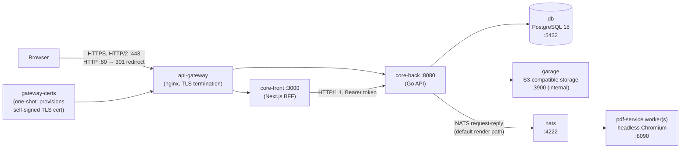
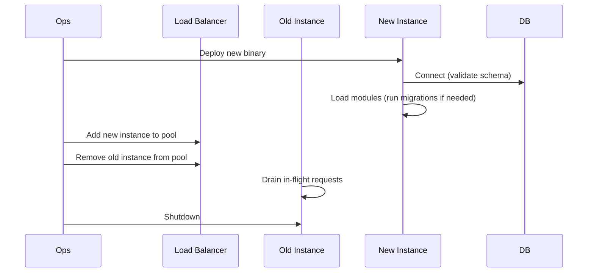

# Deployment

This page covers deploying EERP to a production environment.

---

## Overview

A production EERP deployment consists of three components:

| Component | Artifact | Typical host |
|---|---|---|
| Core backend | Go binary | VM, container, or bare metal |
| WASM modules | `.wasm` files + `module.json` | Same host as backend |
| Frontend | Next.js front server (Node.js) | VM, container, or Node host |
| Database | PostgreSQL 18 | Managed service or dedicated VM |

The frontend and backend are deployed independently. The frontend is **no longer a static bundle** — it runs as a long-lived Node.js process (the Next.js front server) that owns the session cookie and proxies requests to the Go core (see [ADR-004](../adrs/004-csr-frontend.md)). Plan for a Node runtime, a process manager, and health checks alongside the Go backend.

---

## Docker Compose (recommended)

The repository ships a `compose.yml` at its root that runs the entire stack — this is the
recommended way to run EERP anywhere beyond a single developer's laptop, including production,
until a Kubernetes/orchestrator path is documented. The sections below (systemd, PgBouncer,
manual builds) remain useful for a bare-metal or non-Compose deployment, but Compose is the
default path.

### Topology



`core-back` talks to `pdf-service` exclusively through `nats` by default (`eerp-config.docker.json`'s
`nats_url`) — not a direct HTTP call. `pdf-service` still runs an HTTP server too (used for its own
healthcheck, and available as a fallback transport if `nats_url` is ever cleared), but a fresh
`docker compose up` never calls it directly. This is what makes scaling `pdf-service` to N replicas
(`docker compose up -d --build --scale pdf-service=N`) a zero-code-change operation — each replica
is just another competing consumer on the same NATS queue group. See
[ADR-011](../adrs/011-pdf-report-generation.md#amendment-nats-promoted-to-default-2026-09) and
[Reports & PDF Generation](../core/reports.md).

### Services

| Service | Image / build | Purpose | Exposed to host? |
|---|---|---|---|
| `api-gateway` | nginx, `infra/nginx/` | TLS + HTTP/2 termination, routes to `core-front`/`core-back` — see [ADR-018](../adrs/018-http2-edge-rest-batching.md) | Yes — `:80`, `:443` |
| `gateway-certs` | one-shot, `infra/nginx/gen-certs.sh` | Provisions a self-signed dev cert into a shared volume before nginx starts (idempotent) | No |
| `core-back` | build: `core/Dockerfile` | The Go API server | No — reached only via the gateway |
| `core-front` | build: `core-front/Dockerfile` | Next.js BFF (session cookie, server-side rendering) | No — reached only via the gateway |
| `db` | `postgres:18` | Primary database | `:5432` (dev convenience; consider removing in production) |
| `garage` | `dxflrs/garage:v2.3.0` | S3-compatible object storage for pictures/signatures/attachments/reports — see [Object Storage](../core/object-storage.md) | No — internal `:3900` only |
| `pdf-service` | build: `tools/pdf-service/Dockerfile` | Headless-Chromium PDF rendering worker(s), reached via `nats` — see [Reports & PDF Generation](../core/reports.md) | No |
| `nats` | `nats:2.10-alpine` | Message bus `core-back` uses by default to reach `pdf-service` (request-reply); also what makes horizontal `pdf-service` scaling a zero-code-change operation | No |

Bootstrap `garage` once after first bringing the stack up (see [Getting Started → Object
Storage](../getting-started.md#object-storage-optional)):

```bash
make garage-init
```

### Running it

```bash
make run          # docker compose up, backend, and frontend together
# or, equivalently for a pure-Compose deployment:
docker compose up -d
```

Swap the self-signed certificate `gateway-certs` generates for a real one before exposing this
past a trusted network — see [HTTP Pipeline → TLS/HTTP2 Edge Gateway](../core/http-pipeline.md#tlshttp2-edge-gateway).

### The compose file

```yaml
# compose.yml — paste the project's actual manifest here.
# Reproduced service-by-service in the table above; the literal file is intentionally
# not duplicated in this page to avoid drifting from the source of truth in the repository root.
```

!!! note "Filling in the manifest above"
    The service topology, ports, and purposes documented on this page are accurate to the current
    `compose.yml` at the repository root. Paste the file's actual contents into the block above (or
    link to it directly) when finalizing this page for publication, so the wiki carries the literal,
    copy-pasteable manifest alongside its explanation.

---

## Building the Backend

```bash
cd core
go build -o eerp-server ./cmd/app/...
```

For a minimal production binary with debug info stripped:

```bash
go build -ldflags="-s -w" -o eerp-server ./cmd/app/...
```

---

## Building WASM Modules (only for modules with `"type": "wasm"`)

WASM modules are the module's own **Go** source, cross-compiled to WASI — not Rust. Every module
shipped today has `"type": "go"` and skips this step entirely (see
[ADR-002](../adrs/002-wasm-modules.md)).

```bash
# From repo root — builds every "type": "wasm" module
make build

# Or directly for a specific module
cd core/modules/hr
GOOS=wasip1 GOARCH=wasm go build -o build/hr.wasm .
```

The `.wasm` binaries need to be present in a directory listed in `module_root` in the config file, alongside their `module.json` files.

---

## Building the Frontend

```bash
cd core-front
npm install
npm run build
```

This produces an optimized Next.js production build in `core-front/.next/`. Start the front server with:

```bash
npm run start   # next start — serves on :3000 by default
```

The front server needs the URL of the Go core API (e.g. `CORE_API_URL`) so it can proxy authenticated requests; the Go core itself should sit on a private network and not be exposed directly to the browser. Run the process under a supervisor (systemd, PM2) or as a container, behind the same reverse proxy that fronts the rest of the stack.

---

## Configuration

Create the config file in a secure location (e.g., `/etc/eerp/eerp-config.json`):

```json
{
    "module_root": ["/opt/eerp/modules"],
    "master_key": "GENERATE_WITH_openssl_rand_-hex_32",
    "db_name": "eerp_prod",
    "db_port": 5432,
    "db_host": "db.internal",
    "db_user": "eerp",
    "db_password": "STRONG_RANDOM_PASSWORD",
    "max_connection": 25,
    "min_connection": 5,
    "max_conn_idle_time": 1800,
    "max_conn_life_time": 3600,
    "health_check_period": 60,
    "connect_timeout": 10
}
```

File permissions:

```bash
chown eerp:eerp /etc/eerp/eerp-config.json
chmod 600 /etc/eerp/eerp-config.json
```

### Object storage (optional)

Add the five `s3_*` fields to enable picture/signature fields (see [Object Storage](../core/object-storage.md)):

```json
{
    "s3_endpoint": "https://s3.your-provider.example",
    "s3_region": "us-east-1",
    "s3_bucket": "eerp-prod",
    "s3_access_key": "GENERATE_A_SCOPED_KEY",
    "s3_secret_key": "GENERATE_A_SCOPED_SECRET"
}
```

Any S3-compatible store works — a managed bucket (AWS S3, MinIO, Backblaze B2) or a self-hosted [Garage](https://garagehq.deuxfleurs.fr/) cluster, the same software used for local dev. Omitting all five fields is a valid production configuration; the `/api/v1/pictures` routes simply don't mount.

---

## Running the Server

```bash
/opt/eerp/eerp-server -config="/etc/eerp/eerp-config.json"
```

### systemd Unit

```ini
[Unit]
Description=EERP Application Server
After=network.target postgresql.service

[Service]
Type=simple
User=eerp
Group=eerp
WorkingDirectory=/opt/eerp
ExecStart=/opt/eerp/eerp-server -config=/etc/eerp/eerp-config.json
Restart=on-failure
RestartSec=5s
StandardOutput=journal
StandardError=journal

# Security hardening
NoNewPrivileges=yes
ProtectSystem=strict
ProtectHome=yes
ReadWritePaths=/opt/eerp/cache

[Install]
WantedBy=multi-user.target
```

```bash
systemctl enable --now eerp
```

---

## Docker (building images directly, outside Compose)

Prefer [Docker Compose](#docker-compose-recommended) above for a full deployment — it already
wires together the real, current `core/Dockerfile` (multi-stage: cross-compiles any `"type":
"wasm"` module to WASI, then builds the backend binary with CGO on for `wasmtime-go`) and
`core-front/Dockerfile` (a 4-stage pnpm/Next.js build) with the database, object storage, PDF
service, and gateway. Build either image standalone only if you're integrating EERP into your own
orchestration rather than using Compose directly:

```bash
docker build -t eerp-core -f core/Dockerfile .
docker build -t eerp-front -f core-front/Dockerfile .
```

Mount the config file as a volume or Kubernetes Secret, matching the field reference above.

---

## Database Setup

### Create the database and user

```sql
CREATE USER eerp WITH PASSWORD 'strong_password';
CREATE DATABASE eerp_prod OWNER eerp;
GRANT ALL PRIVILEGES ON DATABASE eerp_prod TO eerp;
```

### Connection pooling

For high-traffic deployments, place [PgBouncer](https://www.pgbouncer.org/) between EERP and PostgreSQL. Use transaction-mode pooling:

```ini
# pgbouncer.ini
[databases]
eerp_prod = host=db port=5432 dbname=eerp_prod

[pgbouncer]
pool_mode = transaction
max_client_conn = 1000
default_pool_size = 25
```

Adjust EERP's `max_connection` to match PgBouncer's `default_pool_size`.

---

## Health Checks

Once the HTTP server is running, use the health endpoints:

| Endpoint | Description |
|---|---|
| `GET /health` | Liveness: server is running |
| `GET /ready` | Readiness: DB connection is alive |

```bash
curl http://localhost:8080/health   # → 200 OK
curl http://localhost:8080/ready    # → 200 OK (or 503 if DB is down)
```

---

## Deploying a New Module

For the standard `"type": "go"` path (every shipped module today), a new module ships **inside the
core binary** — there's nothing separate to copy; rebuild and redeploy the backend binary as usual.

For a `"type": "wasm"` module specifically:

1. Cross-compile it:
   ```bash
   GOOS=wasip1 GOARCH=wasm go build -o build/<name>.wasm .
   ```

2. Copy the `.wasm` binary and `module.json` to the `module_root` directory on the server.

3. Restart the EERP server:
   ```bash
   systemctl restart eerp
   ```

The module loader will detect the new module, run its migrations, and load it.

!!! note "Zero-downtime module deployment"
    Hot-loading of modules without restart is planned for a future version. Currently, a restart is required when adding or updating a module.

---

## Upgrading the Core



Because schema migrations are applied by the module loader (not by a separate migration tool), the new instance must be able to run migrations before receiving traffic. In blue/green deployments, bring the new instance up, let it migrate, then switch traffic.

---

## Observability

| Signal | Source | Destination |
|---|---|---|
| Application logs | `app.log` (JSON) | Log aggregator (Loki, Datadog, etc.) |
| Access logs | stdout (JSON) | Log aggregator |
| Metrics | Planned: `/metrics` (Prometheus format) | Prometheus + Grafana |
| Traces | Planned: OpenTelemetry | Tempo or Jaeger |

Structured logs are emitted as JSON in production mode (`Debug: false`). Forward `app.log` to your log aggregator using a sidecar or log shipper.

---

## Security Checklist

- [ ] `master_key` is a cryptographically random 32-byte hex string
- [ ] Config file is `0600`, owned by the process user
- [ ] Database password is strong and not the default
- [ ] TLS terminated at the load balancer or reverse proxy (nginx, Caddy)
- [ ] EERP backend not exposed directly to the internet
- [ ] PostgreSQL not exposed to the internet
- [ ] Module directory is read-only for the EERP process
- [ ] `active: false` for any modules not in use
