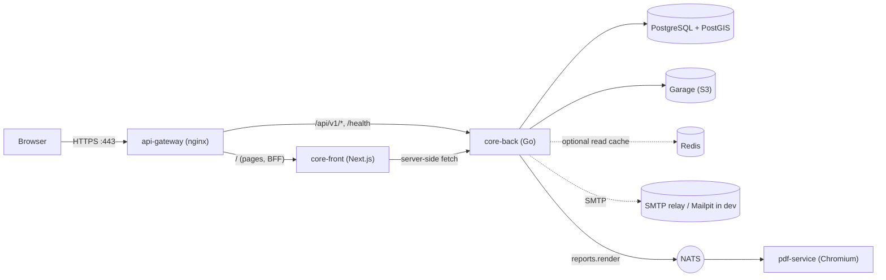
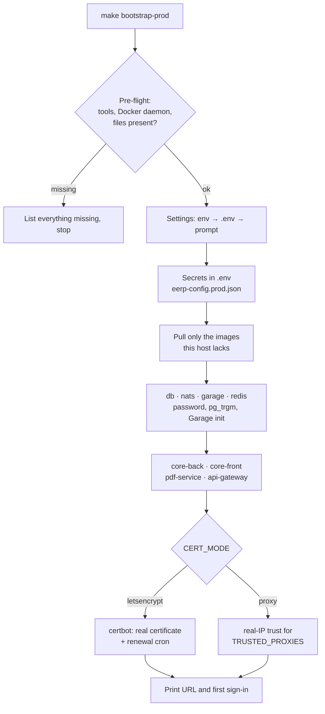
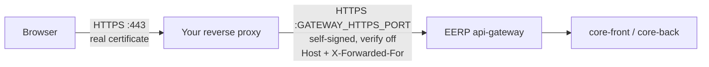

# Deployment & Bootstrap

Two commands set up a complete EERP stack, so nobody copies secrets between files or runs
`docker compose up` several times in the right order:

| Command | Script | Use it for |
|---|---|---|
| `make bootstrap` | `infra/bootstrap.sh` | a **development** machine: the whole Docker stack, built from the checkout |
| `make bootstrap-prod` | `infra/bootstrap-prod.sh` | a **production** server: the CI-built images, real HTTPS, renewal |

Both are **idempotent**: run them again at any time. Secrets that already exist are kept,
data volumes survive, and a re-run only does what's missing or changed. They never share
secrets — `make bootstrap` doesn't touch `eerp-config.prod.json`.

!!! warning "One stack per host"
    The development and production stacks use the same container names (`db`, `backend`,
    `api-gateway`…). Never run both on one machine.

---

## The deployed stack



| Service | Image | Role |
|---|---|---|
| `api-gateway` | `nginx` | the only ingress: TLS + HTTP/2, routing, rate limits, real-IP handling |
| `core-front` | `ghcr.io/<owner>/eerp-core-front` | Next.js pages and the BFF (holds the session cookie) |
| `core-back` | `ghcr.io/<owner>/eerp-core` | the Go core, every module compiled in |
| `pdf-service` | `ghcr.io/<owner>/eerp-pdf-service` | renders reports to PDF (NATS worker pool) |
| `db` | `postgis/postgis:18-3.6` | PostgreSQL 18 with PostGIS; `pg_trgm` installed by the bootstraps |
| `garage` | `dxflrs/garage` | S3-compatible storage for pictures and attachments |
| `redis` | `redis` | optional read cache ([ADR-023](../adrs/023-optional-redis-query-cache.md)) |
| `nats` | `nats` | message bus for PDF rendering and version probes |
| `mailpit` | `axllent/mailpit` | **dev only**: catches every outgoing email |

In production, nothing but the gateway is published to the host — the databases, Garage,
Redis and NATS are reachable only inside the Compose network (`compose.prod.yml`).

## Why secrets are generated, not committed

`eerp-config.json`, `eerp-config.docker.json`, `eerp-config.prod.json` and `.env` hold real
credentials — the JWT signing key (`master_key`), the database password, the S3 key pair,
Garage's RPC secret. They are gitignored: a past incident committed working defaults that
had to be rotated, and the backend refuses to boot on an empty, default or known-leaked
`master_key`. The bootstraps generate each secret once (random hex) into `.env`, then write
it everywhere it's needed.

---

## Use case 1 — Local development

```bash
git clone git@github.com:noiia/EERP.git && cd EERP
make bootstrap
```

Then open **https://localhost** (self-signed certificate: accept the browser warning once)
and sign in as `admin@eerp.local` / `admin`.

What it does, in order:

1. **Secrets** — generates any missing `POSTGRES_PASSWORD`, `EERP_MASTER_KEY`,
   `EERP_S3_ACCESS_KEY` / `EERP_S3_SECRET_KEY` and `GARAGE_RPC_SECRET` into `.env`.
2. **Configs** — creates `eerp-config.json` (host-native `go run` / `go test`) and
   `eerp-config.docker.json` (the `core-back` container) from their `*.example.json`
   templates and fills `master_key`, `db_password` and `s3_*`.
3. **Infrastructure** — starts `db`, `nats`, `garage`, `redis`, `mailpit` and waits until
   each is healthy; re-sets the database password (Postgres only applies
   `POSTGRES_PASSWORD` to an empty data directory); installs `pg_trgm` in the app database
   and `template1` (PostGIS comes with the image); creates Garage's layout, key and bucket.
4. **App** — builds and starts `core-back`, `pdf-service`, `core-front` and `api-gateway`
   from the checkout and waits until they're healthy.

| You want to… | Run |
|---|---|
| start everything again after a reboot | `make bootstrap` (or `make run`) |
| pick up code changes in the containers | `make bootstrap` (rebuilds) |
| run every CI check locally | `make test` (see [Testing](testing.md)) |
| regenerate every secret | `ROTATE=1 make bootstrap` — data kept, DB password re-set in place |
| read outgoing emails | Mailpit at http://127.0.0.1:8025 |

---

## Use cases 2–4 — Production

Run on the server, in a checkout of the repository (`git clone`, then `git pull` for newer
scripts). The server needs Docker Engine with the Compose v2 plugin, `ripgrep` (`rg`) and
the usual coreutils; the bootstrap checks all of this first and lists everything missing
before it changes anything.



Every setting is read from the **environment**, else from the `.env` of a previous run,
else asked interactively — then saved in `.env`, so a later run needs no arguments.
Without a terminal (a script), a missing required setting is an error, not a prompt.
Values are read back literally: any character is safe, including in an SMTP password.

The first sign-in is `admin@eerp.local` / `admin`; production forces a password change
before anything else.

### Use case 2 — EERP gets its own certificate (Let's Encrypt)

The server is reachable from the internet on **ports 80 and 443**, and the ERP domain's DNS
points at it.

```bash
ERP_HOST=erp.example.com ACME_EMAIL=ops@example.com make bootstrap-prod
```

- `CERT_MODE=letsencrypt` is the default. The gateway first starts with its self-signed
  certificate, answers Let's Encrypt's HTTP-01 challenge on port 80
  (`/.well-known/acme-challenge/`, served from a shared volume), then switches to the real
  certificate — `ERP_HOST`, plus `SITE_HOST` when set, on one certificate.
- Renewal: `make renew-certs-prod`, added to your crontab twice a day (`INSTALL_CRON=0`
  skips it — then schedule it yourself). It renews only when due and reloads nginx.
- Rehearse first with `ACME_STAGING=1`: Let's Encrypt's staging servers have no rate limits
  but issue an untrusted certificate. Run again without it for the real one.

### Use case 3 — Behind a reverse proxy that holds the certificate

A reverse proxy (Caddy, Traefik, nginx, Nginx Proxy Manager, a CDN…) terminates HTTPS for
the domain and forwards to the EERP gateway **over HTTPS**, to the gateway's self-signed
certificate (upstream verification off).



```bash
CERT_MODE=proxy ERP_HOST=erp.example.com TRUSTED_PROXIES=<proxy IP> make bootstrap-prod
```

| Setting | Meaning |
|---|---|
| `TRUSTED_PROXIES` | **Required.** The proxy's IP(s) or CIDR(s) as EERP sees them, comma-separated. The gateway takes the visitor's address from `X-Forwarded-For` only when the request comes from one of them — without it, every visitor would be the proxy and share one rate-limit bucket. |
| `GATEWAY_HTTPS_PORT` | The port the proxy forwards to (default `443`). |
| `GATEWAY_HTTP_PORT` | Plain HTTP (default `80`). Must be free on the host; nothing outside needs it — keep it closed. |

Pick `TRUSTED_PROXIES` from where the proxy runs:

| The proxy runs… | `TRUSTED_PROXIES` | Gateway ports |
|---|---|---|
| on another machine | that machine's IP, e.g. `192.168.1.10` | defaults are fine |
| on the same server, directly on the host | `127.0.0.1` | move them: the proxy holds 80/443 |
| on the same server, in Docker | `172.16.0.0/12` (Docker's networks) | move them |

Not sure what EERP sees? `docker logs -f api-gateway` while loading a page through the proxy:
the first field of each line is the address to trust.

**Example — Caddy on the same host, gateway on 8081** (the router forwards only 443 → Caddy):

```bash
CERT_MODE=proxy ERP_HOST=erp.example.com TRUSTED_PROXIES=127.0.0.1 \
  GATEWAY_HTTPS_PORT=8081 GATEWAY_HTTP_PORT=8080 make bootstrap-prod
```

```
erp.example.com {
    reverse_proxy https://127.0.0.1:8081 {
        transport http {
            tls_insecure_skip_verify
        }
    }
}
```

Caddy obtains the certificate, passes `Host` and `X-Forwarded-For`, and handles WebSockets
by default. With nginx as the proxy:

```nginx
server {
    listen 443 ssl;
    server_name erp.example.com;
    # ssl_certificate / ssl_certificate_key from your own provider
    client_max_body_size 50m;
    location / {
        proxy_pass https://127.0.0.1:8081;
        proxy_ssl_verify off;
        proxy_http_version 1.1;
        proxy_set_header Host $host;
        proxy_set_header X-Forwarded-For $proxy_add_x_forwarded_for;
        proxy_set_header X-Forwarded-Proto https;
        proxy_set_header Upgrade $http_upgrade;   # live channel
        proxy_set_header Connection "upgrade";
    }
}
```

!!! warning "Proxy pitfalls"
    - Forward to the gateway's **HTTPS** port. Its plain-HTTP port only redirects to HTTPS,
      so a proxy forwarding to it loops.
    - Keep WebSocket upgrades on: the live channel (notifications, presence) needs them.
    - Allow request bodies up to 50 MB (picture/attachment uploads).

### Use case 4 — Internal or test server (no public certificate)

Behind a VPN, on a test VM, or anywhere a browser warning is acceptable: proxy mode with
nothing in front, trusting only the host itself.

```bash
CERT_MODE=proxy ERP_HOST=erp.internal TRUSTED_PROXIES=127.0.0.1 make bootstrap-prod
```

The gateway keeps its self-signed certificate. (`CERT_MODE=self-signed`, this mode's
earlier name, is still accepted and saved as `proxy`.)

### Optional settings (every production case)

| Setting | Default | Meaning |
|---|---|---|
| `SITE_HOST` | none | The public website's own domain, if not the ERP's. Added to the certificate (Let's Encrypt) and used as `site_url` in emails. |
| `EERP_IMAGE_TAG` | `latest` | The CI build to run, e.g. `0.105.0` (see [Versioning](../core/versioning.md)). |
| `SMTP_HOST` | none (no email) | Your mail relay; then `SMTP_PORT` (587), `SMTP_TLS` (`starttls` / `implicit` / `none`), `SMTP_USER`, `SMTP_PASSWORD`, `SMTP_FROM` (`no-reply@<ERP_HOST>`). |
| `PULL` | `0` | `1` re-pulls every image, even present ones. |
| `ROTATE` | `0` | `1` regenerates every secret (the DB password is re-set in place). |
| `INSTALL_CRON` | `1` | `0` skips adding the renewal cron (Let's Encrypt mode). |
| `ACME_STAGING` | `0` | `1` uses Let's Encrypt's staging servers. |

If the images are private on GitHub's registry, sign in once first: `docker login ghcr.io`
(a personal access token with `read:packages`).

---

## Operating a production server

| You want to… | Run |
|---|---|
| upgrade to a newer build | `EERP_IMAGE_TAG=0.106.0 make bootstrap-prod` — a tag the host lacks is pulled |
| refresh `latest` | `PULL=1 make bootstrap-prod` — a plain re-run never moves `latest` silently |
| roll back | `EERP_IMAGE_TAG=<previous build> make bootstrap-prod` |
| switch certificate mode | re-run with the other `CERT_MODE` (and its settings); switching to `letsencrypt` removes the proxy trust and custom ports |
| change a setting (SMTP, ports, proxy IPs) | re-run with the new value, or edit `.env` and re-run |
| renew the certificate now | `make renew-certs-prod` |
| rotate secrets | `ROTATE=1 make bootstrap-prod` |
| back up / restore the database | `/database/management` ([Database management](../core/database-management.md)) |
| see which build each service runs | the bottom of **Settings** ([Versioning](../core/versioning.md)) |

Schema migrations run in `core-back` at boot (under a Postgres advisory lock), so an upgrade
is "start the new image": the bootstrap recreates `core-back`, which migrates, then serves.

### Release deploys from GitHub Actions

`.github/workflows/deploy.yml` runs when a GitHub **Release** is published: it SSHes into the
server (`DEPLOY_HOST`, `DEPLOY_USER`, `DEPLOY_SSH_KEY`, `DEPLOY_PATH` from the `production`
environment) and runs `docker compose pull && docker compose up -d` in `DEPLOY_PATH`.

!!! note
    That command uses the directory's default Compose file. For a server set up with
    `make bootstrap-prod`, set `COMPOSE_FILE=compose.yml:compose.prod.yml` in the server's
    `.env` (Compose reads it), or run `PULL=1 make bootstrap-prod` there instead.

## What the bootstraps write

| File | Written by | Holds |
|---|---|---|
| `.env` | both | secrets; for production also its settings — mode `600` |
| `eerp-config.json`, `eerp-config.docker.json` | `make bootstrap` | dev backend configs |
| `eerp-config.prod.json` | `make bootstrap-prod` | the production backend config — mode `600` |
| `infra/nginx/realip/proxy.conf` | `make bootstrap-prod`, proxy mode | the gateway's trusted proxies (generated, gitignored) |
| crontab line | `make bootstrap-prod`, Let's Encrypt mode | twice-daily `make renew-certs-prod` |

All of them are gitignored. Keep a copy of `.env` somewhere safe: `EERP_MASTER_KEY` signs
every session and encrypts the stored external-authentication secrets — losing it ends every
session and makes those secrets unreadable.

## Health checks

| Endpoint | Served by | Answers |
|---|---|---|
| `GET /healthz` | the gateway (HTTP and HTTPS) | `200 ok` once nginx runs — the Compose healthcheck |
| `GET /health` | `core-back` (also proxied by the gateway) | `200` once it serves **and** its pool pings Postgres within 2 s, else `503` |

## Modules in production

Every shipped module is `"type": "go"`: it is compiled into the `core-back` image, so a new or
updated module ships with a new image build — nothing to copy. Activating or deactivating a
module is live, from **Settings → Apps** ([ADR-010](../adrs/010-live-module-lifecycle.md)).
A `"type": "wasm"` module (`.wasm` + `module.json` under `module_root`) can additionally be
reloaded live from the same page.

## Security checklist

- [ ] Secrets generated by the bootstrap (never the template's `change-me` values); `.env`
      and `eerp-config.prod.json` are `0600`.
- [ ] Only the gateway is reachable from outside; behind a proxy, only its HTTPS port, and
      only from the proxy.
- [ ] `TRUSTED_PROXIES` lists only your proxy (anything listed can claim any client IP).
- [ ] The default admin's password was changed at first sign-in (production forces it).
- [ ] `environment` is `production` (no demo seeding, forced password change).
- [ ] The database manager's master key (`/database/management`) is the same `master_key`:
      treat a leak as a full compromise.
- [ ] Unused modules are deactivated in Settings → Apps.

## Troubleshooting

| Symptom | Cause / fix |
|---|---|
| `can't bootstrap, missing: …` | Install the listed tools, or run from a full checkout; nothing was changed. |
| `port 80 (or 443) is already in use` | Something else holds it — a proxy on the same host: use proxy mode and move `GATEWAY_HTTP_PORT` / `GATEWAY_HTTPS_PORT`. |
| `could not pull …` | Not signed in to `ghcr.io`, or the tag wasn't published by CI. |
| Let's Encrypt fails | DNS doesn't point at the server, or port 80 isn't reachable from the internet. Rehearse with `ACME_STAGING=1`. |
| Behind a proxy: "too many requests", or every visitor has the proxy's IP | `TRUSTED_PROXIES` doesn't match what EERP sees — check `docker logs api-gateway`. |
| Behind a proxy: redirect loop | The proxy forwards to the plain-HTTP port; forward to `GATEWAY_HTTPS_PORT` over `https://`. |
| Notifications/presence never update | WebSocket upgrades blocked by the proxy. |
| Changing the production database volume | Data lives in the `postgis` image's volume; read `compose.prod.yml`'s `db` comment first. |

## Related

- [Getting Started](../getting-started.md) · [Configuration](../core/configuration.md) · [Testing](testing.md)
- [ADR-018: HTTP/2 at the gateway edge](../adrs/018-http2-edge-rest-batching.md) · [ADR-022: database management](../adrs/022-database-management.md)
