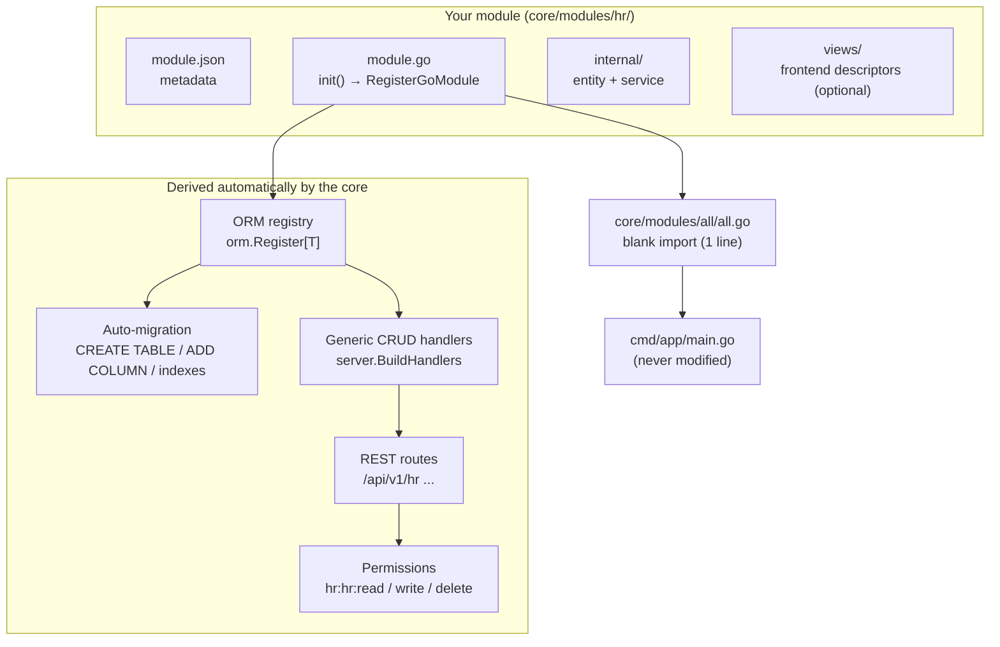

# Development

This section is the practical, end-to-end guide for adding functionality to EERP: how to **develop a new module** and how that module gets **implemented in the server** — from the first Go file to live, authenticated REST routes.

It reflects the current architecture, where modules are **self-registering**: a module declares its schema in Go, enlists itself at `init()` time, and the core derives migrations, repositories, CRUD handlers, HTTP routes and permissions automatically. There is no manual wiring of services or handlers in `main.go`.

---

## The big picture

A module is a directory under `core/modules/<name>/` that owns one or more entities and, optionally, frontend views. Integrating it into the server takes exactly **one line** outside the module itself (a blank import in `core/modules/all/all.go`) — everything else is derived.

## What "developing a module" means

1. Create the directory with a `module.json` (metadata for the module detector).
2. Define entities as Go structs embedding `model.BaseModel`.
3. Write a `module.go` that implements the `GoModule` interface and registers the entities with the ORM.
4. Optionally add a service layer (`internal/`) for business logic beyond generic CRUD.
5. Optionally add frontend view descriptors (`views/`) so the UI renders your entity.

→ Full walkthrough: [Developing a Module](developing-a-module.md)

## What "implementing it in the server" means

1. Add one blank import to `core/modules/all/all.go` so your `init()` fires.
2. At startup, `module.LoadGoModules` runs your `Register()`, diffs the schema registry, and applies idempotent DDL (`CREATE TABLE IF NOT EXISTS`, `ADD COLUMN IF NOT EXISTS`, indexes).
3. `server.BuildHandlers` builds a generic CRUD handler for every registered table; `RegisterRoutes` mounts them under `/api/v1/{table}` behind JWT + permission middleware.
4. You verify the routes in the startup log and grant the derived permissions to a role.

→ Full walkthrough: [Server Integration](server-integration.md)

## Reference implementations in the codebase

| Module | Path | Demonstrates |
|---|---|---|
| `contact` | `core/modules/contact/` | Minimal module: one entity, service layer, frontend views |
| `crm` | `core/modules/crm/` | Same pattern + exported type alias for inheritance |
| `crminheritdemo` | `core/modules/crminheritdemo/` | Extending another module's entity without touching it |
| `auth` | `core/modules/auth/` | A module that ships core infrastructure |

!!! note "Relationship to the Developer Guide section"
    The [Developer Guide](../developer-guide/creating-a-go-module.md) contains earlier, more granular guides (the WASM/WASI path, entity deep-dive, testing, deployment). This Development section is the up-to-date, end-to-end path for the standard case: a pure-Go module with auto-derived migration and routes. For the fastest start using the actual scaffolding tool, see [Building a Module From Scratch](../developer-guide/module-from-scratch.md).
