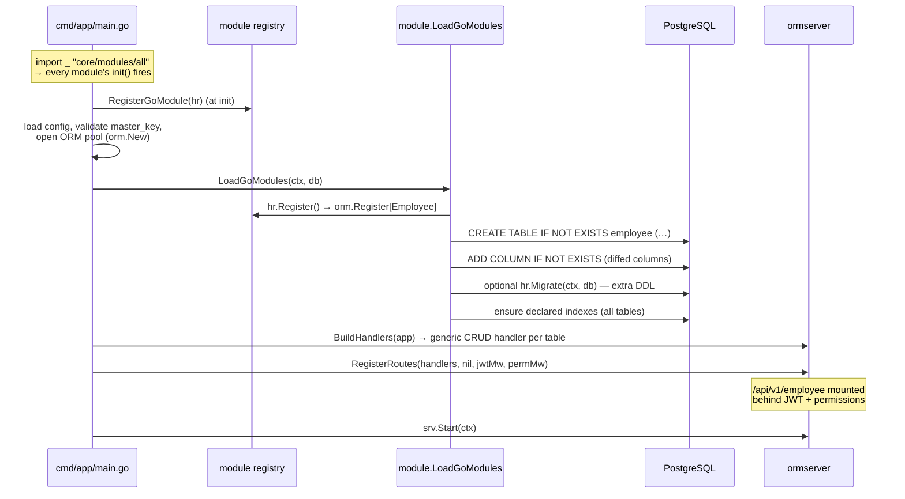

# Server Integration

Once a module is written ([Developing a Module](developing-a-module.md)), plugging it into the server requires **one line of code**. Everything else — migration, handlers, routes, permission enforcement — is derived at startup. This page explains that one line, and then walks through exactly what the server does with your module so you can verify and debug it.

---

## Step 1 — The one line: blank import in `modules/all`

`cmd/app/main.go` never references individual modules. It blank-imports the aggregator package `core/modules/all`, whose only job is to trigger every module's `init()`:

**`core/modules/all/all.go`:**

```go
//go:build !wasip1

// Package all blank-imports every Go module so their init() functions fire
// and they enlist themselves via module.RegisterGoModule.
// This is the only file that needs to change when a new Go module is added.
package all

import (
    _ "core/modules/auth"
    _ "core/modules/contact"
    _ "core/modules/crm"
    _ "core/modules/crminheritdemo"
    _ "core/modules/hr" // ← your new module
)
```

Adding that import is the entire server-side change. When the binary starts, Go runs `hr.init()`, which calls `module.RegisterGoModule(&hrModule{})` — the module is now enlisted.

!!! note "Import order matters only for inheritance"
    Blank imports fire in source order, but an inheriting module (like `crminheritdemo`) already forces its base to initialize first via a **non-blank** import of the base package — so ordering in `all.go` is not something you normally manage.

---

## Step 2 — What happens at startup

`cmd/app/main.go` drives a fixed sequence. Your module participates without any code of its own in `main.go`:



The relevant lines in `cmd/app/main.go`:

```go
import _ "core/modules/all" // fires every module's init()

// After the DB pool is open:
for _, err := range module.LoadGoModules(context.Background(), app.DB) {
    common.Logger.Error("❌ Error loading Go module", zap.Error(err))
}

// After the auth layer is wired:
srv.RegisterRoutes(ormserver.BuildHandlers(app), nil, jwtMw, permMw)
```

### Startup migration flow

`module.LoadGoModules` (`core/internal/module/go_module.go`) makes migration automatic and idempotent:

1. **Snapshot** — before calling your `Register()`, it captures the column set of every registered table.
2. **Register** — your `Register()` runs `orm.Register[T]` / `orm.ExtendSchema`, adding tables or columns to the registry.
3. **Diff & apply** — comparing snapshots reveals what's new:
    - a **new table** → `CREATE TABLE IF NOT EXISTS` with the `BaseModel` columns, then the business columns;
    - **new columns** on an existing table (the inheritance case) → `ADD COLUMN IF NOT EXISTS` for just those columns.
4. **Custom DDL** — if the module implements `Migrator`, its `Migrate(ctx, db)` runs now.
5. **Indexes** — after *all* modules load, declared indexes are ensured for every registered table in one pass.

Errors are collected per module and logged — one broken module does not prevent the others from loading.

!!! info "WASM modules load first"
    `module.LoadModules` (the WASM path) runs just before `LoadGoModules`. It uses the detector to scan the `module_root` directories from the config, reads each `module.json`, and executes any `.wasm` `migrate()` binaries in a Wasmtime sandbox. Pure-Go modules have no `.wasm`, so only their metadata is picked up there.

---

## Step 3 — The routes you get

`ormserver.BuildHandlers(app)` creates a `GenericHandler` for every registered, non-excluded table, and `RegisterRoutes` mounts each under `/api/v1/{route-prefix}` (route prefix = table name):

| Method & path | Handler | Notes |
|---|---|---|
| `GET /api/v1/employee` | List | soft-deleted rows excluded |
| `GET /api/v1/employee/:id` | GetByID | |
| `POST /api/v1/employee` | Create | server sets `id`, timestamps |
| `PUT /api/v1/employee/:id` | Update | `updated_at` auto-set |
| `DELETE /api/v1/employee/:id` | Delete | **soft** delete (`deleted_at = now()`) |
| `POST /api/v1/employee/:id/restore` | Restore | only for soft-delete tables |

Tables registered with `orm.WithExcluded()` stay ORM-accessible but get **no** routes. Fields removed with `WithExcludeFields` never appear in responses or accepted bodies.

If a module needs endpoints beyond generic CRUD, mount a custom group on the underlying Echo instance the way the auth module does in `main.go`:

```go
grp := srv.Echo().Group("/api/v1/hr", jwtMw, permMw)
grp.POST("/employees/:id/terminate", hrHandler.Terminate)
```

---

## Step 4 — Authentication and permissions

All `/api/v1` module routes are mounted behind two middlewares (see `core/internal/middleware/`):

- **JWT middleware** — validates the access token issued by the auth module ([Authentication](../core/authentication.md)).
- **Permission middleware** — derives the required permission from the matched route pattern and denies with `403 FORBIDDEN` if the user's role lacks it. It **fails closed**: a route whose permission can't be derived is denied.

The permission string is `module:resource:action`, derived from the static route segments and the HTTP method:

| Route pattern | Method | Required permission |
|---|---|---|
| `/api/v1/employee` (+`/:id`) | GET | `employee:employee:read` |
| `/api/v1/employee` (+`/:id`) | POST / PUT / PATCH | `employee:employee:write` |
| `/api/v1/employee/:id` | DELETE | `employee:employee:delete` |
| `/api/v1/employee/:id/restore` | POST | `employee:employee:write` |
| `/api/v1/hr/employees/...` | GET | `hr:employees:read` |

For a flat generic route, the table name doubles as module and resource. Grant these permissions to the appropriate roles before expecting requests to succeed — see [Permissions](../core/permissions.md). Frontend view descriptors reference the same strings (e.g. `permissions: ['hr:hr:read']`), so the UI hides what the API would deny.

---

## Step 5 — Configuration

The server reads a JSON config (`-config` flag; `eerp-config.json` locally, `eerp-config.docker.json` in Compose). The module-relevant keys:

```json
{
    "module_root": ["modules"],
    "api_config_path": "api.yaml"
}
```

- `module_root` — list of directories the detector scans for `module.json` files. Relative paths are resolved against the **config file's directory**, not the process CWD.
- `api_config_path` — optional cosmetic API-surface overrides. If set, the file must load cleanly or the server refuses to start (fail closed). Security exclusions belong in code, not here.

See [Configuration](../core/configuration.md) for the full reference.

---

## Step 6 — Run and verify

```bash
make run-back        # starts PostgreSQL + the core backend via docker compose
make logs            # follow container logs
```

On startup, every mounted route is logged — this is the quickest way to confirm your module is live:

```
INFO   route  {"method": "GET",    "path": "/api/v1/employee"}
INFO   route  {"method": "GET",    "path": "/api/v1/employee/:id"}
INFO   route  {"method": "POST",   "path": "/api/v1/employee"}
INFO   route  {"method": "PUT",    "path": "/api/v1/employee/:id"}
INFO   route  {"method": "DELETE", "path": "/api/v1/employee/:id"}
INFO   route  {"method": "POST",   "path": "/api/v1/employee/:id/restore"}
```

Any module load failure appears as `❌ Error loading Go module` with the module name and the failing step (`register`, `ensure table`, `ensure columns`, `migrate`).

Then exercise the API (with `seed_dev_admin: true` in a dev config, a default admin exists to log in with):

```bash
# 1. Login (rate-limited, public route)
curl -s -X POST http://localhost:8080/api/v1/auth/login \
     -H 'Content-Type: application/json' \
     -d '{"email": "<dev-admin-email>", "password": "<dev-admin-password>"}'

# 2. Call your module's routes with the access token
curl -s http://localhost:8080/api/v1/employee \
     -H "Authorization: Bearer $ACCESS_TOKEN"
```

A `403 FORBIDDEN` at this point means the JWT is valid but the role lacks the derived permission (e.g. `employee:employee:read`) — grant it and retry.

---

## Troubleshooting

| Symptom | Likely cause |
|---|---|
| No routes for the table in the startup log | Missing blank import in `core/modules/all/all.go`, or registered with `WithExcluded()` |
| `module X: register:` error at startup | `orm.Register[T]` failed — invalid struct tags or duplicate table registration |
| `module X: ensure columns:` error | Column type couldn't be derived or conflicts with an existing column |
| `403 FORBIDDEN` with a valid token | Role lacks the `module:resource:action` permission the middleware derived |
| New inherited columns missing from API responses | Inheriting module's `Register()` didn't use `orm.WithTableName("<base table>")` |
| Module works locally but not in Docker | `module_root` in `eerp-config.docker.json` — paths resolve relative to the config file |
