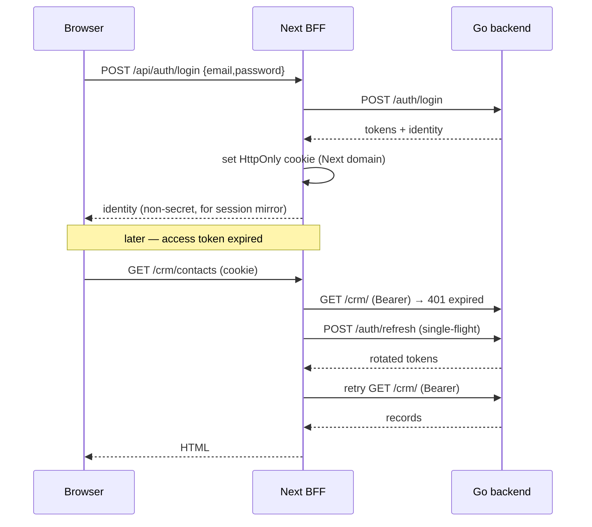

# Authentication (BFF)

Authentication on the frontend is owned entirely by the **Next.js server**. Credentials are exchanged server-side, the token lives in an `HttpOnly` cookie on the Next domain, and identity is resolved on the server. **The token never reaches browser JavaScript.** This is the frontend half of the model in [ADR-005](../adrs/005-jwt-auth.md); the backend's token issuance and validation are documented in [Authentication (core)](../core/authentication.md).

---

## Why the BFF owns the session

The refresh token is kept in an `HttpOnly` cookie precisely so client scripts cannot read it. Only a server can honor that end-to-end. The Next server therefore:

- exchanges credentials with Go and sets the cookie itself,
- resolves identity from the cookie on every server render (`next/headers` `cookies()`),
- attaches `Authorization: Bearer …` to outbound Go calls,
- and hands the browser only a **non-secret session mirror** (identity + permissions) for UI gating.

The browser holds no token and talks to no origin but Next.

---

## Identity

```ts
interface Identity {
  userId: string
  tenantId: string
  roles: string[]
  permissions: string[]
}
```

The server resolves `Identity` from the cookie in `apps/shell/src/lib/session.ts` for RSC and guards. On first render the client `useSessionStore` is hydrated from that server-resolved identity; its `permissions` feed `<Can>` and `usePermission` (UI gating only — the server re-authorizes every request). See [View Engine → Permission gate](view-engine.md#permission-gate).

---

## Token lifetimes

| Token | TTL | Rule |
|---|---|---|
| Access | **6 hours** in every shipped config (1 h if unset) | attached to Go calls by the server; the cookie's `maxAge` follows Go's `expires_in` |
| Refresh | **7 days** | **single-use** (rotation) |

A refresh token is spent the moment it is used; reusing a spent refresh is treated as **theft**: Go kills the session, Next clears the cookie, and the user is redirected to `/login`. These TTLs come from `eerp-config.json` (`access_ttl_seconds`, `refresh_ttl_seconds`).

---

## BFF route handlers

The handlers live under `apps/shell/app/api/auth/`. The browser calls these; they proxy to Go.

| Route | Does |
|---|---|
| `POST /api/auth/login` `{email, password}` | calls Go `POST /auth/login`; on success sets an `HttpOnly; Secure; SameSite` session cookie on the Next domain and returns the non-secret identity for the client mirror |
| `POST /api/auth/logout` | clears the cookie; best-effort Go logout |
| `POST /api/auth/refresh` | server-side single-use rotation; a reused/spent refresh clears the cookie |



Refresh happens in two layers, because Next forbids writing cookies during a Server Component
render and Go's refresh token is single-use (a refresh that can't persist its rotated cookie would
silently spend the token):

1. **`apps/shell/proxy.ts`** (Next's middleware file) runs before every request and rotates the
   session proactively whenever the access cookie is absent — this keeps a session alive for the
   refresh token's full lifetime.
2. **`fetchWithRefresh`** in the `ApiClient` is the reactive fallback for Route Handlers and Server
   Actions: on a 401 it refreshes once and retries once. A 401 reaching it from an RSC read fails
   closed instead of attempting a refresh it couldn't persist.

Cookies are cleared only on Go's 401 — a 429, 5xx or outage keeps the session. The reactive refresh is driven by the engine's `ApiClient`: a single in-flight refresh promise serializes concurrent `401`s so the single-use refresh token is never spent twice. On refresh failure the client clears the cookie and signals session-expired; callers redirect to `/login`. See [View Engine → ApiClient](view-engine.md#apiclient-the-bff-data-client).

---

## Route guarding

`requireAuth(path)` is a **server** check: an anonymous request to a protected route is redirected
to `/app/login` before any page code runs; the catch-all module route additionally runs the
per-route **permission** guard. A Go `403 PASSWORD_CHANGE_REQUIRED` sends the user to
`/app/force-password-change` instead.

## Sign-in methods

`/app/login` reads Go's `GET /auth/methods`: the default method on top, enabled alternatives below;
`?method=local` always shows the local form, and a failure falls back to local.

| BFF route | Does |
|---|---|
| `POST /api/auth/login` | local password |
| `POST /api/auth/ldap` | LDAP username + password |
| `GET /api/auth/oidc/[provider]/start` | redirects to the IdP; state, nonce and PKCE verifier in a 10-minute httpOnly cookie |
| `GET /api/auth/oidc/[provider]/callback` | checks state, exchanges the code through Go, sets the session; `next` is kept inside the ERP |

The OIDC redirect URI is built from the configured `erp_url`, never from the `Host` header. See
[External Sign-In](../core/external-auth.md). Settings → Authentication edits the configuration;
secrets are write-only inputs, and a load failure disables Save (an empty save would wipe it).

## Website visitor session

A website visitor's login is a **second, independent session**: cookies `eerp_site_access` /
`eerp_site_refresh` (never the ERP's), set by the BFF routes `/api/site-auth/*` that proxy Go's
`/api/v1/website/auth/*`. Keeping them apart means a visitor token (`aud: website`) can never be
presented as an ERP session, and staff can be signed in to both at once — Go refuses the wrong
audience on both sides anyway. `proxy.ts` rotates it like the ERP session and forwards the client
IP to Go explicitly. Visitor pages: `/login`, `/signup`, `/account`. See
[Website & Public Access](../core/website.md#website-visitors).

---

## Configuration

Server-side environment only — never exposed to the browser:

| Var | Meaning |
|---|---|
| `API_BASE` | Go backend origin |
| `API_VERSION` | API version (default `1`) → `{API_BASE}/api/v{API_VERSION}` |

Because the browser only ever talks to Next, the Go backend can sit on a private network reachable solely by the frontend service.

---

## Declarative permission gating: `<Can>`

`<Can permission="crm:contacts:write">...</Can>` (`auth/Can.tsx`) is the declarative counterpart to
the `usePermission` hook mentioned in [View Engine → Permission
gate](view-engine.md#permission-gate) — it renders its children only when the session mirror's
effective permissions satisfy the check, and nothing otherwise. Like `usePermission`, it is UI
gating only: the server re-authorizes every request regardless of what the client renders.

A second, narrower gate exists at the **field** level, independent of route permissions:
`FieldDescriptor.groups` mirrors a server-side field-group gate (see [ORM → Field-Level Group
Gating](../core/orm.md#field-level-group-gating) and
[ADR-014](../adrs/014-field-level-group-gating.md)). The server already omits a gated field from
the response entirely — the client-side check only avoids rendering an empty slot for a field the
caller was never sent, decoded from the JWT's `groups` claim into
`useSessionStore`'s `Identity.groups`.

## Related

- [ADR-005: JWT Authentication](../adrs/005-jwt-auth.md) — the token + cookie decision.
- [ADR-013: Multi-Company](../adrs/013-multi-company.md) — the per-user active-company preference alongside identity.
- [ADR-014: Field-Level Group Gating](../adrs/014-field-level-group-gating.md) — the `groups` claim and `<Can>`'s field-level sibling.
- [Authentication (core)](../core/authentication.md) — backend issuance and validation.
- [Permissions (core)](../core/permissions.md) — the permission model the DSL maps onto.
- [View Engine](view-engine.md) · [Frontend Overview](index.md).
