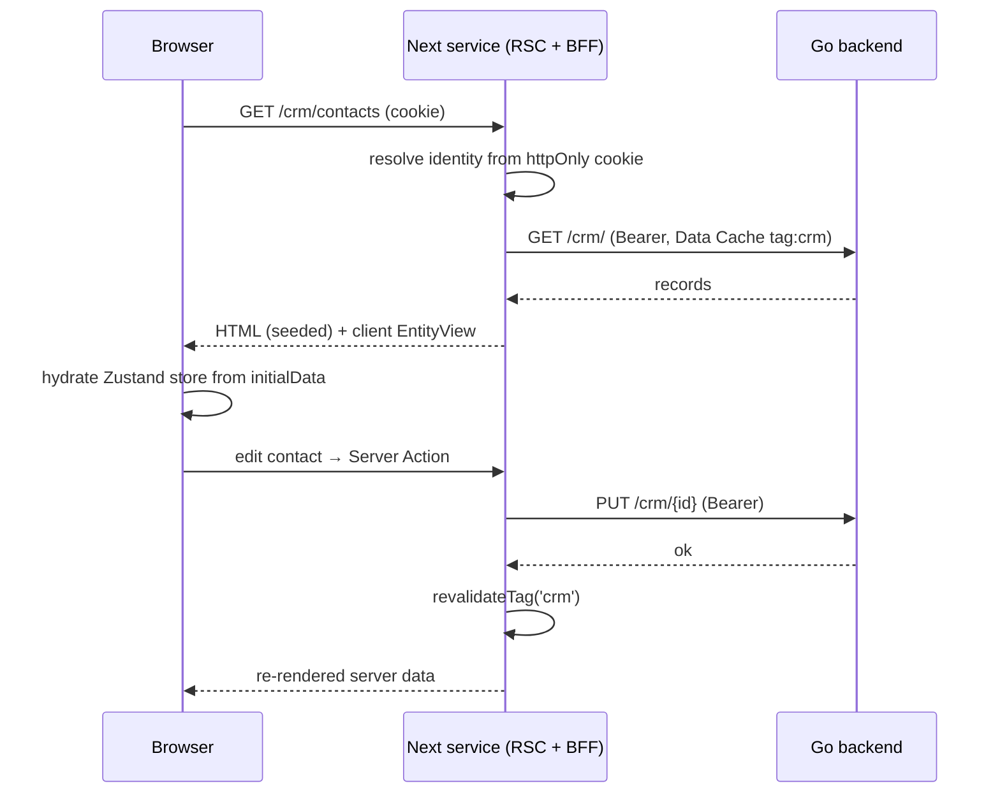

# Frontend Overview

The EERP frontend is a **standalone Next.js service** (App Router, React 19, TypeScript) that lives in `core-front/`. It runs as its own process — its own port, its own `Dockerfile`, its own deploy lifecycle — and talks to the Go backend **only over HTTP**. It may share the monorepo and even the host machine with the backend, but "independent service" is a *runtime* property: the browser never reaches the Go core directly, and the frontend never touches the backend's filesystem or process at runtime.

This page explains the shape of that service and the boundaries it enforces. The design decision behind it (why a server tier, why Zustand) is recorded in [ADR-004](../adrs/004-csr-frontend.md).

---

## Why a frontend service at all

A pure client-side SPA leaves two problems unsolved, both of which a server tier fixes:

- **Session ownership.** The refresh token lives in an `HttpOnly` cookie ([ADR-005](../adrs/005-jwt-auth.md)) precisely so browser JavaScript cannot read it. Only a server can honor that end-to-end: read the cookie, refresh against Go, and attach short-lived access tokens to outbound calls. The browser never holds a token.
- **API exposure.** With a server tier the browser talks to **one origin** — the Next.js service — which proxies to Go. The Go core can sit on a private network; CORS surface shrinks to nothing.

So the frontend is a **Backend-for-Frontend (BFF)**: the browser talks only to Next, Next holds the session and calls Go.

---

## Three pillars

The whole frontend rests on three ideas. Internalize these and the rest of the section follows.

1. **The server does the work.** Route data is fetched and rendered on the server (React Server Components), cached in Next's Data Cache, and shipped as HTML. The browser hydrates and ships less JS. The server owns *data*, *caching*, *session*, and *authorization*.

2. **Zustand owns client state.** The client owns only *interaction state* — per-view stores (records seeded from the server, selection, draft, dirty, expanded) plus cross-cutting UI (theme, sidebar, last route) and a non-secret **session mirror** (identity + permissions) used purely for UI gating. There is **no** `useSyncExternalStore` controller layer; Zustand is the state manager. See [ADR-004](../adrs/004-csr-frontend.md#why-zustand-the-performance-argument) for the performance rationale.

3. **Modules are self-contained folders that can live anywhere on disk.** A module owns its frontend views, declared in its own `module.json`. At **build time** the frontend reads the shared `eerp-config.json` at the repo root (the same file the Go backend uses), scans its `module_root` paths, and compiles each module's views into the Next app. See [Module Discovery](module-discovery.md).

---

## The frontend mirrors the backend's module model

The backend splits a module into a sandboxed WASM schema declaration and a compiled Go service. The frontend mirrors this split — with two **deliberate departures**, flagged on purpose:

| Backend | Frontend equivalent |
|---|---|
| Go service compiled into the monolith | **v1: build-time aggregation** — the build scans module roots and compiles their views into the Next service |
| WASM module loaded at runtime | **v2: runtime discovery** (deferred) — the running service fetches module bundles and `import()`s them |

**Departure 1 — modules import a shared package.** The backend forbids modules importing core (the ABI boundary for the WASM sandbox + language-agnosticism). The frontend has neither sandbox nor multiple languages — it is one React tree, all TypeScript. So its contract is a shared typed package, **`@eerp/core-front`**, which exports the descriptors, store factories, renderers, server loaders, `ApiClient`, and the registry. **That package *is* the frontend ABI.**

**Departure 2 — frontend modules are trusted code, not sandboxed plugins.** A view rendering in the React tree has full reach. "Portable module" here means *your own modules, relocatable and developed in isolation* — not untrusted third-party plugins.

---

## Repository layout

`core-front/` is a **pnpm workspace** holding the engine package and the Next.js host app. Business modules live **outside** the frontend, under the roots listed in the repo-root `eerp-config.json`.

```
<repo>/eerp-config.json              # shared backend+frontend config: module_root (paths)
core-front/                          # frontend SERVICE (Next.js) — own process, own Dockerfile
├── package.json                     # pnpm workspace root
├── pnpm-workspace.yaml
├── Dockerfile                       # builds the workspace, runs `next start` as a service
├── packages/
│   └── core-front/                  # @eerp/core-front — the engine (the frontend ABI)
│       ├── src/
│       │   ├── api/                 # server ApiClient (BFF), errors, session cookies
│       │   ├── views/               # descriptors, Zustand store factories, renderers, server loader
│       │   ├── auth/                # permission primitives (hasPermission, <Can>, guards) + session store
│       │   └── registry/            # FrontModule contract + ModuleRegistry (build-time)
│       ├── index.ts                 # public CLIENT barrel (the ABI)
│       ├── server.ts                # public SERVER-ONLY barrel ('server-only'): ApiClient, loaders, guards
│       └── CONVENTIONS.md           # the source-of-truth contracts
└── apps/shell/                      # the Next.js App Router service (host)
    ├── next.config.mjs              # discovery codegen + resolve/transpile external module dirs
    ├── app/
    │   ├── layout.tsx               # RootLayout: MUI cache + ThemeProvider + providers
    │   ├── page.tsx + Menu.tsx      # landing menu: requireAuth, then permission-filtered apps + views
    │   ├── (auth)/login/page.tsx    # login page (BFF)
    │   ├── api/auth/                # BFF route handlers: login / logout / refresh
    │   └── [...module]/page.tsx     # catch-all: registry → server-fetch → client renderer
    ├── src/
    │   ├── lib/                     # server session (cookies → identity), server ApiClient factory
    │   └── generated/               # generated-modules.ts — GITIGNORED, regenerated at build
    └── scripts/generate-modules.mjs # build-time module discovery codegen

<repo>/core/modules/crm/             # a business module — discovered via module_root, relocatable
├── module.json                      # static_files.views: ["CrmViews.ts"]
├── module.go · internal/crm.go      # Go service
└── views/CrmViews.ts                # default-exports a FrontModule (descriptors only)
```

The two barrels are the only legal entry points into the engine:

- `@eerp/core-front` — the **client** barrel: descriptors, Zustand stores, renderers, `<Can>`, the registry.
- `@eerp/core-front/server` — the **server-only** barrel (marked `server-only`, so importing it from a Client Component is a build error): the `ApiClient`, RSC data loaders, and permission guards.

Reaching into `packages/core-front/src/*` directly from outside the package is forbidden.

---

## Server vs client: who owns what

| Concern | Owner |
|---|---|
| Data fetching, Next Data Cache | **Server** (RSC via the `ApiClient`) |
| Session (httpOnly cookie → identity) | **Server** (`next/headers` `cookies()`) |
| Authorization (route/RSC guard) | **Server** |
| Per-view interaction state (records, selection, draft, dirty, expanded) | **Client** (Zustand, seeded from server `initialData`) |
| Cross-cutting UI (theme, sidebar, last route) | **Client** (Zustand `persist`) |
| Session mirror (identity + permissions, for UI gating only) | **Client** (Zustand `persist`) |
| Mutations | **Server Actions** → Go → `revalidateTag(entity)` → server re-render |

The client never calls Go. Reads come from the server through the Data Cache; writes go through Server Actions that call Go and then revalidate the affected cache tag.

---

## Data flow



---

## Conventions (the contracts)

These are the stable contracts every part of the frontend honors. The source of truth is `core-front/packages/core-front/CONVENTIONS.md`.

| Concern | Contract |
|---|---|
| Backend base URL | `{API_BASE}/api/v{API_VERSION}` — **server-side env only** (`API_BASE`, `API_VERSION`, default `1`). Never exposed to the browser. |
| Module routes (Go) | `/{module}/` (list, create) + `/{module}/{id}` (get, update, delete). CRM contacts → `/crm/` + `/crm/{id}` |
| Core routes (Go) | `GET /health`, `GET /ready`, `GET /modules` |
| Auth (Go) | `POST /auth/login {email, password}`; `POST /auth/refresh` |
| Token TTLs | access **1h**, refresh **7d**, refresh **single-use** (rotation). See [Authentication](authentication.md). |
| Error envelope (Go) | `{ "error": { "code": "UPPER_SNAKE", "message": "...", "request_id": "01J..." } }` |
| Status map | 400 validation · 401 unauthenticated · 403 forbidden · 404 not found · 409 conflict · 500 `INTERNAL_ERROR` |
| Permissions | DSL `module:resource:action` with segment wildcards. **Server** authorizes; **client** `<Can>` gates UI. See [View Engine](view-engine.md#permission-gate). |
| Delete | Soft-delete by default ([ADR-003](../adrs/003-soft-delete.md)). |
| View types (v1) | `form`, `tree`, `dashboard`. |
| Module FE contract | `module.json.static_files.views` lists `.ts` files that default-export a `FrontModule`. See [Module Discovery](module-discovery.md). |

---

## Where to go next

- [View Engine](view-engine.md) — how descriptors become server-rendered, Zustand-backed views with zero per-entity UI code.
- [Module Discovery](module-discovery.md) — how external module folders compile into the service at build time.
- [Authentication (BFF)](authentication.md) — the login/session/refresh lifecycle across the BFF boundary.
- [Creating a Frontend Module](../developer-guide/creating-a-frontend-module.md) — add a view to a module in practice.
