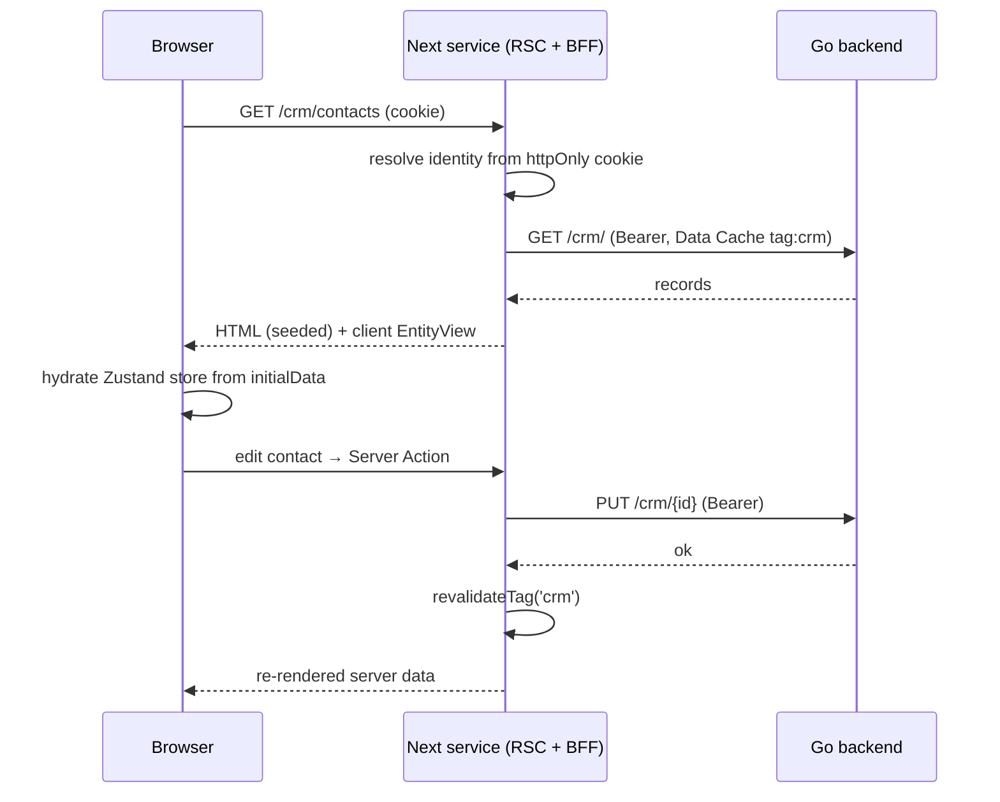

# Frontend Overview

The EERP frontend is a **standalone Next.js service** (Next.js 16 App Router, React 19, MUI 9, TypeScript 7) that lives in `core-front/`. It runs as its own process — its own port, its own `Dockerfile`, its own deploy lifecycle — and talks to the Go backend **only over HTTP**. It may share the monorepo and even the host machine with the backend, but "independent service" is a *runtime* property: the browser never reaches the Go core directly, and the frontend never touches the backend's filesystem or process at runtime.

This page explains the shape of that service and the boundaries it enforces. The design decision behind it (why a server tier, why Zustand) is recorded in [ADR-004](../adrs/004-csr-frontend.md).

---

## Why a frontend service at all

A pure client-side SPA leaves two problems unsolved, both of which a server tier fixes:

- **Session ownership.** The refresh token lives in an `HttpOnly` cookie ([ADR-005](../adrs/005-jwt-auth.md)) precisely so browser JavaScript cannot read it. Only a server can honor that end-to-end: read the cookie, refresh against Go, and attach short-lived access tokens to outbound calls. The browser never holds a token.
- **API exposure.** With a server tier the browser talks to **one origin** — the Next.js service — which proxies to Go. The Go core can sit on a private network; CORS surface shrinks to nothing.

So the frontend is a **Backend-for-Frontend (BFF)**: the browser talks only to Next, Next holds the session and calls Go.

---

## Three pillars

The whole frontend rests on three ideas. Internalize these and the rest of the section follows.

1. **The server does the work.** Route data is fetched and rendered on the server (React Server Components), cached in Next's Data Cache, and shipped as HTML. The browser hydrates and ships less JS. The server owns *data*, *caching*, *session*, and *authorization*.

2. **Zustand owns client state.** The client owns only *interaction state* — per-view stores (records seeded from the server, selection, draft, dirty, expanded) plus cross-cutting UI (theme, sidebar, last route) and a non-secret **session mirror** (identity + permissions) used purely for UI gating. There is **no** `useSyncExternalStore` controller layer; Zustand is the state manager. See [ADR-004](../adrs/004-csr-frontend.md#why-zustand-the-performance-argument) for the performance rationale.

3. **Modules are self-contained folders that can live anywhere on disk.** A module owns its frontend views, declared in its own `module.json`. At **build time** the frontend reads the shared `eerp-config.json` at the repo root (the same file the Go backend uses), scans its `module_root` paths, and compiles each module's views into the Next app. See [Module Discovery](module-discovery.md).

---

## The frontend mirrors the backend's module model

The backend splits a module into a sandboxed WASM schema declaration and a compiled Go service. The frontend mirrors this split — with two **deliberate departures**, flagged on purpose:

| Backend | Frontend equivalent |
|---|---|
| Go service compiled into the monolith | **v1: build-time aggregation** — the build scans module roots and compiles their views into the Next service |
| WASM module loaded at runtime | **v2: runtime discovery** (deferred) — the running service fetches module bundles and `import()`s them |

**Departure 1 — modules import a shared package.** The backend forbids modules importing core (the ABI boundary for the WASM sandbox + language-agnosticism). The frontend has neither sandbox nor multiple languages — it is one React tree, all TypeScript. So its contract is a shared typed package, **`@eerp/core-front`**, which exports the descriptors, store factories, renderers, server loaders, `ApiClient`, and the registry. **That package *is* the frontend ABI.**

**Departure 2 — frontend modules are trusted code, not sandboxed plugins.** A view rendering in the React tree has full reach. "Portable module" here means *your own modules, relocatable and developed in isolation* — not untrusted third-party plugins.

---

## Repository layout

`core-front/` is a **pnpm workspace** holding the engine package and the Next.js host app. Business modules live **outside** the frontend, under the roots listed in the repo-root `eerp-config.json`.

```
<repo>/eerp-config.json              # shared backend+frontend config: module_root (paths)
core-front/                          # frontend SERVICE (Next.js) — own process, own Dockerfile
├── package.json                     # pnpm workspace root
├── pnpm-workspace.yaml
├── Dockerfile                       # builds the workspace, runs `next start` as a service
├── packages/
│   └── core-front/                  # @eerp/core-front — the engine (the frontend ABI)
│       ├── src/
│       │   ├── api/                 # server ApiClient (BFF), errors, session cookies
│       │   ├── views/               # descriptors, Zustand store factories, renderers, server loader
│       │   ├── auth/                # permission primitives (hasPermission, <Can>, guards) + session store
│       │   └── registry/            # FrontModule contract + ModuleRegistry (build-time)
│       ├── index.ts                 # public CLIENT barrel (the ABI)
│       ├── server.ts                # public SERVER-ONLY barrel ('server-only'): ApiClient, loaders, guards
│       └── CONVENTIONS.md           # the source-of-truth contracts
└── apps/shell/                      # the Next.js App Router service (host)
    ├── next.config.mjs              # discovery codegen + resolve/transpile external module dirs
    ├── app/
    │   ├── layout.tsx               # RootLayout: MUI cache + theme + i18n (shared with the site)
    │   ├── (site)/                  # the public website: [[...slug]] pages, /login, /signup, /account, booking pages
    │   ├── app/                     # the ERP, served under /app
    │   │   ├── layout.tsx           #   ERP chrome: top bar, live channel, app-wide *OpsProviders
    │   │   ├── page.tsx + Menu.tsx  #   landing menu (installed apps, permission-filtered)
    │   │   ├── login/ settings/ appstore/ force-password-change/ website/
    │   │   └── [...module]/page.tsx #   catch-all: registry → server-fetch → client renderer
    │   ├── api/                     # BFF route handlers: auth, site-auth, pictures, attachments, …
    │   ├── print/report/            # pdf-service print targets (no chrome)
    │   └── database/management/     # master-key database manager (no session)
    ├── src/
    │   ├── lib/                     # server session (cookies → identity), server ApiClient factory
    │   └── generated/               # generated-modules(.client).ts + translations — GITIGNORED
    └── scripts/generate-modules.mjs # build-time module discovery codegen

<repo>/core/modules/crm/             # a business module — discovered via module_root, relocatable
├── module.json                      # static_files.views: ["CrmViews.ts"]
├── module.go · internal/crm.go      # Go service
└── views/CrmViews.ts                # default-exports a FrontModule (descriptors only)
```

The two barrels are the only legal entry points into the engine:

- `@eerp/core-front` — the **client** barrel: descriptors, Zustand stores, renderers, `<Can>`, the registry.
- `@eerp/core-front/server` — the **server-only** barrel (marked `server-only`, so importing it from a Client Component is a build error): the `ApiClient`, RSC data loaders, and permission guards.

Reaching into `packages/core-front/src/*` directly from outside the package is forbidden.

---

## Server vs client: who owns what

| Concern | Owner |
|---|---|
| Data fetching, Next Data Cache | **Server** (RSC via the `ApiClient`) |
| Session (httpOnly cookie → identity) | **Server** (`next/headers` `cookies()`) |
| Authorization (route/RSC guard) | **Server** |
| Per-view interaction state (records, selection, draft, dirty, expanded) | **Client** (Zustand, seeded from server `initialData`) |
| Cross-cutting UI (theme, palette, UI style, sidebar, last route) | **Client** (Zustand `persist`; the theme is also mirrored into the `eerp_theme` cookie so the server renders dark mode without a light flash) |
| Live server state (presence, notifications) | **Client** (non-persisted stores fed by the [live channel](../core/live-channel.md)) |
| Session mirror (identity + permissions, for UI gating only) | **Client** (Zustand `persist`) |
| Mutations | **Server Actions** → Go → `revalidateTag(entity)` → server re-render |

The client never calls Go — with one deliberate exception, the [live channel](../core/live-channel.md) WebSocket (and the master-key database manager). Reads come from the server through the Data Cache; writes go through Server Actions that call Go and then revalidate the affected cache tag.

---

## Look and feel

- **Theme**: light/dark mode and a palette (Settings → Global settings → Colors). The default
  palette is indigo on navy with every text color AA on its background; dark mode lightens the
  primary until it reaches 4.5:1. Per device.
- **UI style** (`pretty` | `performance`, per device): *pretty* adds motion — page blocks rise in,
  cards, chips, list rows and graph tiles fade in, shadows and hover transitions; *performance*
  turns every transition, animation, shadow and ripple off. Injected globally by `ErpUiStyle` in
  the ERP layout only (menus and dialogs portal to `<body>`, so a wrapper style wouldn't reach them).
- Transitions use the `motion` tokens (enter 240 ms, exit 160 ms). There is deliberately **no route
  loading screen** (`app/app/loading.tsx` was removed): see [Navigation performance](#navigation-performance).
- **Read-only fields in dark mode** read in `neutral[100]` with `text.secondary` labels; `text.disabled`
  stays for disabled buttons, which must not look clickable.
- **Banners** are the one surface for user-facing messages (errors, warnings, notices): see
  [Banners](#banners) below.

---

## Banners

`views/banner.tsx` shows every error, warning and notice as a banner **above** the view it concerns:
between a form's toolbar and its card, between a list's search row and its content, above a
dashboard's tiles, and at the top of the ERP page for everything else (settings pages, App Store
buttons).

- `Banner` is the visual: `status?: 'info' | 'warning' | 'error'` (default info), an optional `color`
  overriding the background, `title`, `action`, `onClose`. There is no success status: success
  messages are info banners.
- A view opens a `BannerScope` and puts its `BannerSlot` above its content (`FormRenderer`,
  `TreeRenderer`, `DashboardRenderer`, the ERP layout, and every dialog that can raise one: the
  relation wizards, Graph's config dialogs, the App Store logs).
- `ViewBanner` and `ErrorAlert` render **into the nearest slot** through a portal, from wherever they
  are written (a widget deep in a form, a header button, a menu), so the component raising a message
  never needs to know where banners go. Without a scope (the public website) they render in place.
- A plain `Banner` never portals: use it in Server Components and where the message belongs right there.
- Field-level validation (`TextField` `error`/`helperText`) stays on the field.

!!! warning "Pitfall"
    A dialog without its own `BannerScope` sends its banners to the view behind the modal.

---

## Navigation performance

Three deliberate choices keep ERP navigation fast (measured with a headless Chrome on the dev stack):

**No route loading screen.** `/app` has no `loading.tsx`. A Suspense fallback, once shown, makes React
hold the real content back about 300 ms (its fallback-reveal throttle). Client navigations took about
350 ms with the skeleton and 75–100 ms without it. Without it, a navigation keeps the current page on
screen until the next one is ready. The server reads behind a page run in parallel for the same reason:
the ERP layout's preferences, module state and companies (`app/app/layout.tsx`), and
`EntityViewServer`'s record, view settings, chatter visibility, form context and status bar
(`views/loader.tsx`) are each one `Promise.all`.

**Links prefetch on intent.** ERP links render through `IntentLink` (`src/intent-link.tsx`, exported by
`@eerp/core-front`; `component={IntentLink}` on MUI), never a bare `next/link` nor a plain `href`, which
reloads the whole page. Next 16 prefetches every visible link with two requests, each re-running the ERP
layout's backend reads (the landing menu fired 15–18 of them on load). `IntentLink` sets
`prefetch={false}` and calls `router.prefetch` once when the pointer enters the link, it gets focus, or
it is touched.

**Heavy widgets load on their own.** The data grid (`@mui/x-data-grid`), the tree view, the rich-text
editor (Tiptap) and Graph mode (react-grid-layout) each live in their own chunk, so an ERP page ships
about 1.4 MB of JavaScript (430 KB gzip) instead of 2.3 MB. The engine reaches them only through
`views/lazy-widgets.tsx`, built with `lazyComponent()`: unlike `React.lazy`, a component whose chunk is
already loaded renders synchronously, so it never shows a Suspense fallback. `PreloadWidgets` (ERP
layout) loads every chunk once the browser is idle. Icons follow the same rule: only the Font Awesome
icons named in `views/icons.ts` are bundled (the whole `fas` set used to add ~950 KB to every page);
module tile icons (`module.json` `menu_icon`) are resolved on the server.

!!! warning "Pitfalls"
    - Adding a `loading.tsx` (or a `<Suspense>` around a whole page) brings the 300 ms back.
    - A new independent server read belongs in the existing `Promise.all`, not in an `await` of its own.
    - A bare `<Link>` brings viewport prefetching back for that link.
    - One static value import of a heavy library anywhere the client barrel reaches puts it back in
      every page; import it through a `lazyComponent(() => import('…'))` wrapper in `lazy-widgets.tsx`.
    - A new icon is one more named import in `icons.ts`, or a module registers it with `registerIcons(def)`;
      a name missing from the list renders nothing.

---

## TypeScript 7 beside the TypeScript 6 API

`tsc` is TypeScript 7, the native compiler. It ships no JS API, so tools that `import 'typescript'`
(typescript-eslint, Next's build-time type check) still need 6.0. Every workspace `package.json`,
module packages included, declares both:

```json
"@typescript/native": "npm:typescript@^7.0.2",
"typescript": "npm:@typescript/typescript6@^6.0.2"
```

`npx tsc` runs 7.0, `npx tsc6` runs 6.0. A plain `"typescript": "^7"` makes ESLint fail ("typescript-eslint
does not support TS 7.0"), so a new module's `package.json` must copy both lines. TS 7 also gives up
sooner on huge JSX prop unions (TS2590, "too complex to represent"), e.g. `<Box component="table">`: use
`styled('table')` and type such style objects as `SxProps<Theme>`.

---

## Data flow



---

## Conventions (the contracts)

These are the stable contracts every part of the frontend honors. The source of truth is `core-front/packages/core-front/CONVENTIONS.md`.

| Concern | Contract |
|---|---|
| Backend base URL | `{API_BASE}/api/v{API_VERSION}` — **server-side env only** (`API_BASE`, `API_VERSION`, default `1`). Never exposed to the browser. |
| Module routes (Go) | `/{module}/` (list, create) + `/{module}/{id}` (get, update, delete). CRM contacts → `/crm/` + `/crm/{id}` |
| Core routes (Go) | `GET /health` (200 when serving and the database answers), `GET /api/v1/modules` |
| Auth (Go) | `POST /auth/login {email, password}`; `POST /auth/refresh` |
| Token TTLs | access **6h** (shipped configs), refresh **7d**, refresh **single-use** (rotation). See [Authentication](authentication.md). |
| Error envelope (Go) | `{ "error": { "code": "UPPER_SNAKE", "message": "...", "request_id": "01J...", "fields"?: [...] } }` — a Server Action never throws it raw: `settleAction` returns it as a value (a production build would hide the message), and the bound actions rethrow an `ApiError` client-side; it reaches the user as an error [banner](#banners) |
| ERP base path | the ERP lives under `/app`; module paths stay relative and `erpPath()` adds the base when a link is emitted |
| Status map | 400 validation · 401 unauthenticated · 403 forbidden · 404 not found · 409 conflict · 500 `INTERNAL_ERROR` |
| Permissions | DSL `module:resource:action` with segment wildcards. **Server** authorizes; **client** `<Can>` gates UI. See [View Engine](view-engine.md#permission-gate). |
| Delete | Soft-delete by default ([ADR-003](../adrs/003-soft-delete.md)). |
| View types | `form`, `tree` (List / Kanban / Calendar / Graph / Gantt / WBS / PERT / OBS / Risk modes), `dashboard`, `catalog`. |
| Module FE contract | `module.json.static_files.views` lists `.ts` files that default-export a `FrontModule`. See [Module Discovery](module-discovery.md). |

---

## Where to go next

- [View Engine](view-engine.md) — how descriptors become server-rendered, Zustand-backed views with zero per-entity UI code.
- [Module Discovery](module-discovery.md) — how external module folders compile into the service at build time.
- [Authentication (BFF)](authentication.md) — the login/session/refresh lifecycle across the BFF boundary.
- [Creating a Frontend Module](../developer-guide/creating-a-frontend-module.md) — add a view to a module in practice.
- [Website Builder](website-builder.md) — the public site's pages and blocks.
