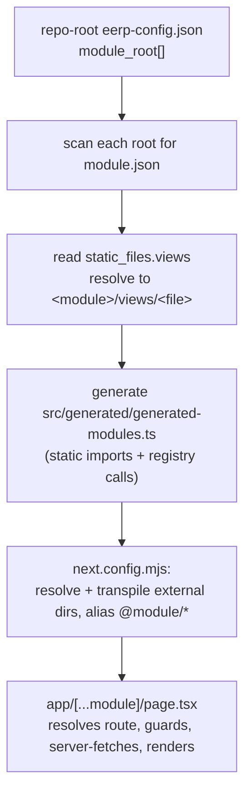

# Module Discovery (build-time)

A frontend module is a **folder that can live anywhere on disk**. It owns its views and declares them in its own `module.json` — exactly the file the Go backend already reads. At build time the Next service discovers those folders, compiles their views in, and wires their routes. This is the portability centerpiece of the frontend: adding a module is adding a folder, not editing the host.

This page explains how that discovery works and the `FrontModule` contract a module must satisfy.

---

## Why build-time (v1)

The backend has two loading models — Go services compiled into the monolith, and WASM modules loaded at runtime. The frontend mirrors this:

| Model | Cost | Status |
|---|---|---|
| **v1 — build-time aggregation** | adding/updating a module needs a frontend rebuild + redeploy | **shipped** |
| **v2 — runtime discovery** | none, but needs federation machinery | deferred |

v1 is the right trade for an internal, authenticated ERP: modules are still authored anywhere, self-describing, and developed/tested standalone — without the complexity of runtime module federation. The `FrontModule` contract is **identical** in both models, so nothing built now is thrown away when v2 arrives. (v2 is sketched at the end.)

---

## Single source of truth: `eerp-config.json`

The frontend reads the **same** `eerp-config.json` at the repo root that the Go backend uses, and walks each path in its `module_root` array:

```json
{
  "module_root": ["core/modules"]
}
```

Reusing the backend config keeps **one** source of truth for where modules live. The read happens **at build time only** — the running frontend service never reads the backend's config or filesystem at runtime, so the BFF boundary still holds. `module_root` paths may point anywhere on disk, so a module folder is relocatable; `core/modules/crm` is just the current default.

---

## The discovery pipeline

A generate script (`apps/shell/scripts/generate-modules.mjs`) runs on `prebuild` **and** on dev start, and re-runs when a `module.json` under the roots changes.



Step by step:

1. **Scan.** For each `module_root`, find every `module.json`, read its `static_files.views` array, and resolve each entry to `<module_dir>/views/<file>`.
2. **Codegen.** Emit `apps/shell/src/generated/generated-modules.ts` — real **static** imports of each resolved view file (via an `@module/<name>/…` alias) plus a call registering each default export with a single `ModuleRegistry` instance. Static imports let the bundler tree-shake normally. **This file is gitignored** and regenerated on every build.
3. **Bundler wiring.** `next.config.mjs` makes the external module directories resolvable *and* transpiled (added to the bundler's resolve roots and included in the TS/SWC transform), and aliases `@module/<name>`. `tsconfig` is extended to include the roots so types resolve across folders.
4. **Routing.** The catch-all `app/[...module]/page.tsx` (a Server Component) looks the pathname up in `buildRegistry()`, runs the server permission guard, server-fetches via `createServerApiClient()` (cached), and renders the client `EntityView` seeded with `initialData`. Mutations go through the engine's Server Actions.

---

## The `FrontModule` contract

Each view file listed in `static_files.views` **default-exports a `FrontModule`**:

```ts
interface FrontModule {
  name: string
  routes: {
    path: string
    descriptor: ViewDescriptor
    permission?: string
  }[]
}
```

A module contributes **descriptors only**. The engine derives the server loader, the Zustand store, and the renderer from each descriptor — there are no module-provided controllers or renderers. The `ModuleRegistry` collects every registered `FrontModule`; `buildRegistry()` produces the `path → { descriptor, permission }` map the catch-all route consumes.

`module.json` ties it together:

```json
{
  "name": "crm",
  "static_files": {
    "views": ["CrmViews.ts"]
  }
}
```

```
core/modules/crm/
├── module.json          # static_files.views: ["CrmViews.ts"]
├── module.go            # Go service (backend)
└── views/
    └── CrmViews.ts      # default-exports a FrontModule (descriptors only)
```

A module is authored **once** and consumed by both sides through its own `module.json`: the backend reads it for schema/loading, the frontend reads it for views.

---

## i18n discovery

A module may ship an optional `i18n/` folder — a gettext `<name>.pot` template plus one
`<locale>.po` file per language, sitting at the same level as `views/` (see
[ADR-019](../adrs/019-per-model-view-files.md)). The same discovery family that generates
`generated-modules.ts` also compiles these catalogs in at build time, and the UI offers them under
Settings → Translations. The Go core owns only *which* language each user sees — the per-user
`preferred_locale` and the workspace default in `app_settings` (see
[Settings](../core/settings.md)) — never the catalog content itself.

## Related backend base URL resolution

The generated module registry doesn't just wire up routes — the same discovery scripts resolve the
backend base URL the server-side `ApiClient` targets, from `backend_host`/`public_address`/
`backend_port`/`backend_version` in the shared config into `{API_BASE}/api/v{API_VERSION}`. If
module routes resolve but every request 404s or times out, check this resolution before assuming a
routing bug.

## Definition of done

A throwaway module folder placed *outside* the frontend and listed in the repo-root `eerp-config.json`'s `module_root` renders its route **server-side** in the running service; editing its view rebuilds. The generated manifest stays gitignored. The CRM module is the worked example — see [Creating a Frontend Module](../developer-guide/creating-a-frontend-module.md).

---

## Future — v2 runtime discovery (deferred)

v2 removes the rebuild-to-add-a-module cost, mirroring WASM runtime loading and the [V2.0.0 architecture](../architecture/index.md#second-version-v200):

- Each module's frontend is **pre-built** into its own bundle that **externalizes** React/MUI/`@eerp/core-front` (shared singletons provided by the host).
- The running Next service fetches a manifest from an extended `GET /modules` (each module's bundle URL + version) and `import()`s each, registering via the **same** `FrontModule` contract.
- Bundles are served from the same registry/bucket as WASM binaries, versioned per module.
- Migration is additive: the build-time path keeps working; runtime discovery is opt-in per deployment. v1 `FrontModule` definitions carry over unchanged.

Pursue v2 only when "add a module without redeploying the service" becomes a real requirement.

---

## Related

- [Frontend Overview](index.md) · [View Engine](view-engine.md)
- [Module System (backend)](../core/module-system.md) — the WASM/Go loader this mirrors.
- [Creating a Frontend Module](../developer-guide/creating-a-frontend-module.md).
