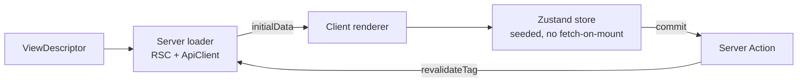

# View Engine (`@eerp/core-front`)

The engine is the reusable, metadata-driven, server-rendered view machinery shared by the Next host and every business module. It is the package `@eerp/core-front` under `core-front/packages/core-front/`. Nothing in it is module-specific.

The contract it offers is deliberately small: **a module contributes descriptors only**. From a descriptor the engine derives the server loader, the Zustand store, and the renderer. If a module ever needs a custom component, that is an *engine gap* to fix in `@eerp/core-front` — not a per-module escape hatch. Keeping it that way is what makes "add an entity = add a descriptor" true.



---

## The two barrels

The engine exposes exactly two public entry points; everything else is internal.

| Import | Marker | Contains |
|---|---|---|
| `@eerp/core-front` | client-safe | descriptors, Zustand store factories, renderers, `<Can>`, `usePermission`, the registry |
| `@eerp/core-front/server` | `server-only` | the `ApiClient`, RSC data loaders, server permission guards |

The `server-only` marker turns any accidental import of the server barrel from a Client Component into a build error — this is what keeps the access token and the session cookie out of browser code.

---

## ApiClient (the BFF data client)

The `ApiClient` runs **server-side only** (RSC, route handlers, Server Actions). It is the single place the frontend talks to Go.

`createServerApiClient()` reads the session cookie via `next/headers`, builds `${API_BASE}/api/v${API_VERSION}`, and attaches `Authorization: Bearer …` to every call. Its methods map straight onto Go routes:

| Method | Go call |
|---|---|
| `list<T>(entity)` | `GET /{entity}/` |
| `get<T>(entity, id)` | `GET /{entity}/{id}` |
| `create<T>(entity, body)` | `POST /{entity}/` |
| `update<T>(entity, id, body)` | `PUT /{entity}/{id}` |
| `remove(entity, id)` | soft-delete (archive) |

Two behaviors matter for correctness:

- **Reads integrate the Next Data Cache.** `GET`s use `fetch(..., { next: { tags: [entity] } })`, so a result is reused across reloads and users. After a successful mutation the client calls `revalidateTag(entity)` so the next render reflects the write.
- **Single-flight refresh on expiry.** A `401`-expired triggers exactly one `POST /auth/refresh`, then retries the original request once. Concurrent `401`s share a single in-flight refresh promise — the refresh token is single-use, so a double refresh would trip theft detection. On refresh failure the client clears the session cookie and signals session-expired (callers redirect to `/login`). It never loops. See [Authentication](authentication.md).

### Error model

Every failure becomes an `ApiError { code, message, requestId, status }`. `parseError(response)` reads the Go error envelope `{ error: { code, message, request_id } }`; if the body is not that shape it synthesizes a code from the status (`500 → INTERNAL_ERROR`). The `requestId` is always surfaced so a UI error can be traced back to a backend log line.

---

## Descriptors

A view is described by data, not code:

```ts
type ViewType = 'form' | 'tree' | 'dashboard'

interface FieldDescriptor {
  name: string
  label: string
  type: 'text' | 'number' | 'date' | 'relation' | 'boolean' | 'selection'
  required?: boolean
  widget?: string            // rendering hint, e.g. 'picture' | 'long'
  states?: Condition         // declarative visible/readOnly/required
}

interface ViewDescriptor<T> {
  entity: string            // maps to the Go route: 'crm' → /crm/
  viewType: ViewType
  fields: FieldDescriptor[]
  layout?: LayoutNode        // optional explicit layout tree — see below
  extends?: ViewExtension    // optional inheritance from another module's view
  permissions?: string[]
}
```

Adding an **entity** is a new descriptor. Adding a **view type** is one store factory + one renderer + one server loader path — and then every entity can use it.

---

## Layout: the default form anatomy

`layout` is optional. When a `form` descriptor declares none, layout normalization synthesizes a richer default than the flat one other view types get: a header row (the first `widget: 'picture'` field, then the first text field rendered large), a two-column group holding every other field, and a notebook whose default "Settings" page collects every `widget: 'long'` field. `tree`, `dashboard`, and any future view type keep the original flat, untitled group. A module that declares an explicit `layout` gets exactly what it declared, at any view type — declaring one opts out of the default.

The synthesized nodes carry stable, well-known ids (`__form_header`, `__form_columns`) so they're addressable by the same extension mechanism as a hand-authored layout. See [ADR-008: Default Form Anatomy](../adrs/008-form-anatomy.md) for the full design, including the notebook node and the container-query column grid.

---

## View inheritance: `extends`

A module can reshape another module's already-registered view without editing its source — the frontend counterpart to the ORM's `orm.WithTableName()` schema extension. `extends` names a target path and a list of serializable `Operation`s (`addField`, `removeField`, `setField`, `move`, `addNode`, `setDescriptor`), applied once at `ModuleRegistry.register()` time — never at render. Renderers always receive one plain, already-merged `ViewDescriptor` and stay unaware inheritance exists.

```ts
const extension: ViewExtension = {
  target: '/crm/:id',
  operations: [
    { op: 'addField', name: 'date', field: { name: 'date', label: 'Date', type: 'date' } },
    { op: 'move', name: 'email', target: 'name', position: 'before' },
  ],
}
```

Operations are data an interpreter walks (the same reasoning that keeps `compute`/`on_change` registered by name rather than passed as closures) — they cross the RSC server/client boundary as plain JSON and are fully unit-testable without a running app. A base module's route path is part of its public contract: renaming it breaks every extension targeting it, loudly, at registration. Extending modules must declare the base module in their own `depends` so topological registration order guarantees the target already exists. See [ADR-006: Frontend View Inheritance](../adrs/006-view-inheritance.md); `core/modules/crminheritdemo` is the worked example end to end.

---

## Runtime view settings (Kanban/Calendar)

Every `tree` view's display mode (`List | Kanban | Calendar | Graph`) is a workspace admin preference, not descriptor data — deliberately, so it can differ per workspace without a rebuild. Kanban's status column and Calendar's date field are stored in tenant-scoped `app_settings` (`views.<entity>.fields`, via `GET|PUT /api/v1/settings/views/:entity/fields`), never on the descriptor. The Settings → Views UI still *sources its choices* from the registered descriptor (only `type: 'selection'` fields are offered for Kanban, only `type: 'date'` fields for Calendar) — the descriptor owns what fields exist, `app_settings` owns which one a workspace picked. An entity with no configured field is a normal state (200 with nulls, not a 404); the mode switcher just disables that button until configured. See [ADR-007: Runtime-Configurable View Fields](../adrs/007-runtime-view-fields.md).

---

## Field Widgets

`FieldDescriptor.widget` picks a rendering variant for a `type`; each type has a default (the first entry) so `widget` is only needed to opt into a non-default one:

| Type | Widgets (first = default) |
|---|---|
| `text` | `simple`, `long`, `phone`, `table` |
| `number` | `float`, `int`, `percent`, `stars`, `phone` |
| `boolean` | `switch`, `picture`, `signature` |
| `date` | `simple` |
| `selection` | `select` |
| `relation` | `search`, `tags`, `list` (one per [relation kind](#relation-widgets), not interchangeable) |

Dispatch is a flat lookup table keyed by `"<type>/<widget>"`, not a switch — adding a widget is one new table entry and one new component, never a branch to extend:

```ts
const WIDGET_COMPONENTS: Record<string, ComponentType<WidgetProps>> = {
  'text/simple': TextSimpleWidget, 'boolean/picture': BooleanPictureWidget, /* … */
}
function fieldWidget(field: FieldDescriptor): ComponentType<WidgetProps> {
  const widget = resolveWidget(field)   // validates + applies the default
  return WIDGET_COMPONENTS[`${field.type}/${widget}`]
}
```

An invalid combination (`widget: 'stars'` on a `text` field) throws at **registration**, naming the field and the bad pairing — the same fail-fast posture as an unresolved view extension. Numeric widgets format exclusively through `useNumberFormat()`, so a workspace's decimal/thousands-separator setting applies everywhere with zero per-widget code.

`boolean/picture` and `boolean/signature` are the two widgets backed by the [object storage service](../core/object-storage.md): the field's boolean value tracks whether an image exists, but the bytes live in S3, addressed by `{table, recordId, field}`. `signature` renders an HTML5 `<canvas>` the user draws on with pointer events; "done" calls `canvas.toBlob()` and uploads the PNG. Both widgets are **service-authoritative** — on mount they resolve the anchor against the picture service and reconcile the draft boolean with what actually exists there, rather than trusting the record's own field value.

`SelectionDescriptor { options: string[] }` (`FieldDescriptor.selection`, required for `type: 'selection'`) declares a closed value list for the one `select` widget — the type exists to express "a fixed set of values," not a presentation choice. Order matters twice: it's the dropdown's display order, and (absent an explicit `default`) the first option seeds the field.

```ts
{ name: 'status', label: 'Status', type: 'selection',
  selection: { options: ['incoming', 'running', 'won', 'lost', 'closed'] } }
```

---

## Computed & Reactive Fields

`compute` and `on_change` on a `FieldDescriptor` are **names**, resolved against a module-populated registry — never functions on the descriptor itself, for the same RSC-serialization reason `extends` operations are data rather than closures (see [View inheritance](#view-inheritance-extends)).

```ts
export function registerFieldFunction(fn: {
  entity: string; name: string; depends: string[]
  handler: (draft: Readonly<DraftRecord>) => unknown
}): void

export function registerOnChange(handler: {
  entity: string; name: string; onChange: string[]
  handler: (draft: Readonly<DraftRecord>) => Partial<DraftRecord> | void
}): void
```

A module registers these at import time, then references them by name on a field:

```ts
registerFieldFunction({
  entity: 'crm', name: 'crm.displayName', depends: ['name', 'company'],
  handler: (draft) => { const n = String(draft.name ?? ''); const c = String(draft.company ?? ''); return c ? `${n} (${c})` : n },
})
registerOnChange({
  entity: 'crm', name: 'crm.scoreFromStatus', onChange: ['status'],
  handler: (draft) => ({ score: STATUS_SCORE[String(draft.status ?? '').toLowerCase()] ?? 0 }),
})

// on the descriptor:
{ name: 'display_name', type: 'text', compute: 'crm.displayName', store: false }
```

`compute` fields recompute whenever a field in `depends` changes and re-run in dependency order; pair one with `store: false` to keep it out of the record's commit payload when it's purely derived for display. `on_change` fields run their handler whenever any field in their own `onChange` list changes, patching the draft with whatever the handler returns. Duplicate registration names throw immediately — the registry is a flat map, not a namespace a module can quietly shadow.

---

## Relation Widgets

A `type: 'relation'` field carries a `relation: RelationDescriptor` describing which entity it points at and how:

```ts
type RelationKind = 'many2one' | 'one2many' | 'many2many'

interface RelationDescriptor {
  entity: string           // the related entity (its Go route/table name)
  kind: RelationKind
  labelField?: string      // default 'name'
  inverseField?: string    // one2many: the FK column on the related entity
  via?: string             // many2many: the junction entity name
  viaFields?: { own: string; related: string }  // default '<own>_id' / '<related>_id'
}
```

Each kind gets exactly one widget in v1 — `RELATION_KIND_WIDGETS = { many2one: 'search', one2many: 'list', many2many: 'tags' }` — validated at registration (an `o2m` without `inverseField`, or an `m2m` without `via`, fails fast naming the field). See [ORM → Relations](../core/orm.md#relations) for how these map to plain FK columns and junction tables on the Go side.

```ts
{ name: 'contact_id', label: 'Contact', type: 'relation',
  relation: { entity: 'contact', kind: 'many2one', labelField: 'name' } },
{ name: 'tags', label: 'Tags', type: 'relation',
  relation: { entity: 'tag', kind: 'many2many', via: 'crm_tag', labelField: 'name' } },
```

Relation fields render on **forms only** — the list DataGrid skips them. `many2one` (`RelationSearchWidget`) is a debounced MUI `Autocomplete`; `many2many` (`RelationTagsWidget`) is a chip picker whose links are junction rows written immediately (not part of the record's own draft); `one2many` (`RelationListWidget`) is a read-only embedded grid of the inverse-side records.

### Create-from-search

The `many2one` search widget appends a synthetic option after its (max 6) search results: picking it opens `RelationCreateWizard`, a real form dialog for the related entity. It reuses that entity's **own registered form descriptor** when one exists (falling back to a bare single-field form for lookup-only entities like `tag`), so seed defaults, `on_change`, `compute`, and permission checks all behave exactly as they would on the entity's real form — Go re-authorizes the create the same as any other write. A `preset` seeds and hides fields the caller already knows (e.g. the inverse FK for an `o2m` context). This is the mechanism behind "add a new contact without leaving the CRM form."

---

## Zustand stores

Each per-view store is **seeded with server-fetched `initialData` and does not fetch on mount** — the server already did the work. Store factories live in the engine:

- `createEntityStore<T>(descriptor, initialData)` → `{ records, selected, error, setSelected }`
- `createFormStore` → `draft`, `dirty`, `edit(record)`, `setField(k, v)`, `commit()`. `commit()` invokes the entity's Server Action (create vs update decided by `id`), updates optimistically, and clears `dirty`; server revalidation then supplies the authoritative data.
- `createTreeStore<T extends {id; parent_id?}>` → `expanded`, `roots`, `children(id)`, `toggle(id)`.
- `createDashboardStore` → `widgets[]`, `refresh()`.

Two cross-cutting stores use Zustand `persist` (localStorage):

- `useSessionStore` — a non-secret **mirror** of identity + effective permissions, used only for UI gating. The server remains the source of truth; the mirror never authorizes anything that matters.
- `useUiStore` — theme, sidebar, last route.

Mutations always reconcile: the client updates optimistically, the Server Action calls Go, `revalidateTag` fires, and the server re-render supplies the real data.

---

## Renderers and the server dispatcher

The split between server and client is explicit:

- **Server** — `loadView(descriptor, serverApi)` fetches cached `initialData`. `EntityViewServer({ descriptor })` is a Server Component that loads the data and hands it to the client view.
- **Client** — `EntityView<T>` (`'use client'`) builds the Zustand store from the descriptor + `initialData`, shows an MUI `Alert` on error (with `requestId` in the caption), and otherwise dispatches on `viewType`:
    - `FormRenderer` — fields → MUI inputs bound to `draft` via `setField`; **Save** calls `commit()` and is disabled unless `dirty`.
    - `TreeRenderer` — MUI X `RichTreeView` from `roots`/`children`/`expanded`, with a flat `@mui/x-data-grid` fallback (columns from fields).
    - `DashboardRenderer` — a responsive MUI grid of widget cards.

All three render server-seeded from a descriptor with **zero entity-specific code**.

The UI is themed through the engine's `theme`/`palette`/`tokens` modules and the host's `AppThemeProvider`, so modules inherit a consistent look without shipping their own theme.

---

## Permission gate

Authorization is enforced on the server; the client only *gates UI*.

The DSL is `module:resource:action` with segment-wise wildcards: `*` matches any segment, so `crm:*:read` grants `crm:contacts:read` and `*:*:read` grants any `:read`.

```ts
hasPermission(effective: string[], required: string): boolean
```

- **Server** — `requirePermission(required)` guards RSC and route handlers (redirect or `403` when missing). This is the real check.
- **Client** — the `<Can permission>` component and `usePermission(required)` hook read the effective set from `useSessionStore` to show or hide UI. Because the mirror is non-secret and the server re-checks every request, a tampered client mirror cannot grant access — it can only mis-paint the UI for the user doing the tampering.

---

## Testing

Every file ships with tests (a non-negotiable rule from the build plan):

- **Unit tests** mock the `ApiClient`/Server Actions — no network. They assert store seeding, create-vs-update routing, the wildcard permission matrix, the single-flight refresh under concurrency, and that mutations call `revalidateTag`.
- **Integration tests** run against MSW or a live backend, are named `*.integration.test.ts`, and are **skipped unless `TEST_API_BASE` is set**.

See [Testing](../developer-guide/testing.md) for the backend equivalent.

---

## Related

- [Frontend Overview](index.md) — the service, the BFF boundary, the three pillars.
- [Module Discovery](module-discovery.md) — how a module's views reach the engine.
- [Authentication (BFF)](authentication.md) — the refresh/session lifecycle the `ApiClient` relies on.
- [ORM → Relations](../core/orm.md#relations) — the Go side of relation fields (FK columns, junction tables).
- [Object Storage](../core/object-storage.md) — the service behind the picture/signature widgets.
- [ADR-004](../adrs/004-csr-frontend.md) — why Next.js + Zustand.
- [ADR-006](../adrs/006-view-inheritance.md) · [ADR-007](../adrs/007-runtime-view-fields.md) · [ADR-008](../adrs/008-form-anatomy.md) — view inheritance, runtime-configurable fields, and default form anatomy.
