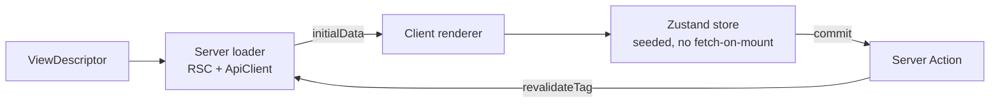

# View Engine (`@eerp/core-front`)

The engine is the reusable, metadata-driven, server-rendered view machinery shared by the Next host and every business module. It is the package `@eerp/core-front` under `core-front/packages/core-front/`. Nothing in it is module-specific.

The contract it offers is deliberately small: **a module contributes descriptors only**. From a descriptor the engine derives the server loader, the Zustand store, and the renderer. If a module ever needs a custom component, that is an *engine gap* to fix in `@eerp/core-front` — not a per-module escape hatch. Keeping it that way is what makes "add an entity = add a descriptor" true.



---

## The two barrels

The engine exposes exactly two public entry points; everything else is internal.

| Import | Marker | Contains |
|---|---|---|
| `@eerp/core-front` | client-safe | descriptors, Zustand store factories, renderers, `<Can>`, `usePermission`, the registry |
| `@eerp/core-front/server` | `server-only` | the `ApiClient`, RSC data loaders, server permission guards |

The `server-only` marker turns any accidental import of the server barrel from a Client Component into a build error — this is what keeps the access token and the session cookie out of browser code.

---

## ApiClient (the BFF data client)

The `ApiClient` runs **server-side only** (RSC, route handlers, Server Actions). It is the single place the frontend talks to Go.

`createServerApiClient()` reads the session cookie via `next/headers`, builds `${API_BASE}/api/v${API_VERSION}`, and attaches `Authorization: Bearer …` to every call. Its methods map straight onto Go routes:

| Method | Go call |
|---|---|
| `list<T>(entity)` | `GET /{entity}/` |
| `get<T>(entity, id)` | `GET /{entity}/{id}` |
| `create<T>(entity, body)` | `POST /{entity}/` |
| `update<T>(entity, id, body)` | `PUT /{entity}/{id}` |
| `remove(entity, id)` | soft-delete (archive) |

Two behaviors matter for correctness:

- **Reads integrate the Next Data Cache.** `GET`s use `fetch(..., { next: { tags: [entity] } })`, so a result is reused across reloads and users. After a successful mutation the client calls `revalidateTag(entity)` so the next render reflects the write.
- **Single-flight refresh on expiry.** A `401`-expired triggers exactly one `POST /auth/refresh`, then retries the original request once. Concurrent `401`s share a single in-flight refresh promise — the refresh token is single-use, so a double refresh would trip theft detection. On refresh failure the client clears the session cookie and signals session-expired (callers redirect to `/login`). It never loops. See [Authentication](authentication.md).

### Error model

Every failure becomes an `ApiError { code, message, requestId, status }`. `parseError(response)` reads the Go error envelope `{ error: { code, message, request_id } }`; if the body is not that shape it synthesizes a code from the status (`500 → INTERNAL_ERROR`). The `requestId` is always surfaced so a UI error can be traced back to a backend log line.

---

## Descriptors

A view is described by data, not code:

```ts
type ViewType = 'form' | 'tree' | 'dashboard'

interface FieldDescriptor {
  name: string
  label: string
  type: 'text' | 'number' | 'date' | 'relation' | 'boolean'
  required?: boolean
}

interface ViewDescriptor<T> {
  entity: string            // maps to the Go route: 'crm' → /crm/
  viewType: ViewType
  fields: FieldDescriptor[]
  permissions?: string[]
}
```

Adding an **entity** is a new descriptor. Adding a **view type** is one store factory + one renderer + one server loader path — and then every entity can use it.

---

## Zustand stores

Each per-view store is **seeded with server-fetched `initialData` and does not fetch on mount** — the server already did the work. Store factories live in the engine:

- `createEntityStore<T>(descriptor, initialData)` → `{ records, selected, error, setSelected }`
- `createFormStore` → `draft`, `dirty`, `edit(record)`, `setField(k, v)`, `commit()`. `commit()` invokes the entity's Server Action (create vs update decided by `id`), updates optimistically, and clears `dirty`; server revalidation then supplies the authoritative data.
- `createTreeStore<T extends {id; parent_id?}>` → `expanded`, `roots`, `children(id)`, `toggle(id)`.
- `createDashboardStore` → `widgets[]`, `refresh()`.

Two cross-cutting stores use Zustand `persist` (localStorage):

- `useSessionStore` — a non-secret **mirror** of identity + effective permissions, used only for UI gating. The server remains the source of truth; the mirror never authorizes anything that matters.
- `useUiStore` — theme, sidebar, last route.

Mutations always reconcile: the client updates optimistically, the Server Action calls Go, `revalidateTag` fires, and the server re-render supplies the real data.

---

## Renderers and the server dispatcher

The split between server and client is explicit:

- **Server** — `loadView(descriptor, serverApi)` fetches cached `initialData`. `EntityViewServer({ descriptor })` is a Server Component that loads the data and hands it to the client view.
- **Client** — `EntityView<T>` (`'use client'`) builds the Zustand store from the descriptor + `initialData`, shows an MUI `Alert` on error (with `requestId` in the caption), and otherwise dispatches on `viewType`:
    - `FormRenderer` — fields → MUI inputs bound to `draft` via `setField`; **Save** calls `commit()` and is disabled unless `dirty`.
    - `TreeRenderer` — MUI X `RichTreeView` from `roots`/`children`/`expanded`, with a flat `@mui/x-data-grid` fallback (columns from fields).
    - `DashboardRenderer` — a responsive MUI grid of widget cards.

All three render server-seeded from a descriptor with **zero entity-specific code**.

The UI is themed through the engine's `theme`/`palette`/`tokens` modules and the host's `AppThemeProvider`, so modules inherit a consistent look without shipping their own theme.

---

## Permission gate

Authorization is enforced on the server; the client only *gates UI*.

The DSL is `module:resource:action` with segment-wise wildcards: `*` matches any segment, so `crm:*:read` grants `crm:contacts:read` and `*:*:read` grants any `:read`.

```ts
hasPermission(effective: string[], required: string): boolean
```

- **Server** — `requirePermission(required)` guards RSC and route handlers (redirect or `403` when missing). This is the real check.
- **Client** — the `<Can permission>` component and `usePermission(required)` hook read the effective set from `useSessionStore` to show or hide UI. Because the mirror is non-secret and the server re-checks every request, a tampered client mirror cannot grant access — it can only mis-paint the UI for the user doing the tampering.

---

## Testing

Every file ships with tests (a non-negotiable rule from the build plan):

- **Unit tests** mock the `ApiClient`/Server Actions — no network. They assert store seeding, create-vs-update routing, the wildcard permission matrix, the single-flight refresh under concurrency, and that mutations call `revalidateTag`.
- **Integration tests** run against MSW or a live backend, are named `*.integration.test.ts`, and are **skipped unless `TEST_API_BASE` is set**.

See [Testing](../developer-guide/testing.md) for the backend equivalent.

---

## Related

- [Frontend Overview](index.md) — the service, the BFF boundary, the three pillars.
- [Module Discovery](module-discovery.md) — how a module's views reach the engine.
- [Authentication (BFF)](authentication.md) — the refresh/session lifecycle the `ApiClient` relies on.
- [ADR-004](../adrs/004-csr-frontend.md) — why Next.js + Zustand.
