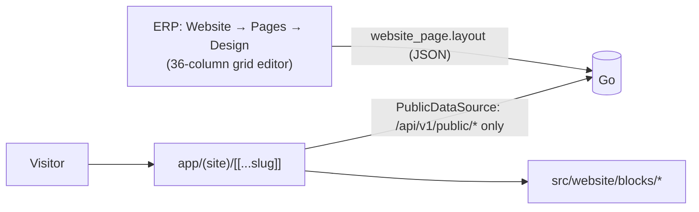

# Website Builder

The public website is server-rendered by the same Next.js service as the ERP, from pages staff
design in the ERP's **Website** app. A page is a grid of **blocks**, each reading only data the site
is allowed to read. For the backend model (publishing, visitor accounts, routing) see
[Website & Public Access](../core/website.md).

## Rendering a page

`app/(site)/[[...slug]]` fetches the published `website_page` for the slug (Next Data Cache),
renders its `layout` with the block components, adds a header from `in_menu` pages and a footer
linking `/legal-notice` once a legal notice is set, plus the visitor's language and currency
pickers. Blocks read data through a `PublicDataSource`
that only ever calls `/api/v1/public/*` — the site can never show something that isn't published.

URL shape `/<slug>/<id>` lets **one** generic detail page serve every record: a `record_detail`,
`event_booking` or `appointment_booking` block with no fixed id reads it from the URL, and list
blocks link to it through their `detail_slug`.

### The site's own theme

The site renders in its **own theme** (`SiteTheme`, [ADR-036](../adrs/036-website-theme.md)), never the
viewer's ERP palette or dark mode: fixed, light, monochrome ink-on-white, a 16px body, viewport-scaled
headings, wrapped in `ScopedCssBaseline` so it never touches the ERP. A visitor may switch to its dark
variant with the header's moon/sun button, kept in the `eerp_site_theme` cookie so the server renders
it without a flash. The editor canvas is always light. A sticky header marks the current page with
`aria-current`.

### Language and currency

The footer's pickers (`SitePrefs.tsx`) resolve the visitor's choice from their website account's
`preferred_locale`/`preferred_currency`, else the `eerp_site_locale`/`eerp_site_currency` cookies, else
the defaults set in Settings → Website → Language & currency. Prices are stored and charged in the
workspace currency; another currency is display-only, converted and prefixed `≈` when a rate exists.
See [ADR-035](../adrs/035-website-language-and-currency.md) and
[Website & Public Access](../core/website.md#language-and-currency).

### How fields show

Every shown field of a record block (cards, the list's table, the detail and its related rows) goes
through one pipeline ([ADR-037](../adrs/037-website-field-display.md)): its kind is read from the
module's ERP descriptor (monetary, phone, percent, stars, duration, datetime, selection, many2one), else
from its column name and value; it is formatted with `Intl` and `libphonenumber-js` (locale numbers and
money, `tel:`/`mailto:` links, dates with their zone, a many2one by its published label) server-side,
and drawn by `FieldValue`. Per-field settings `config.field_display[<col>]` (`hide_label`,
`custom_label`, `format`, `icon` from Font Awesome Free) are edited in the builder's *How each field
shows* dialog with a live preview.

## Blocks

| Block | Shows |
|---|---|
| `text` | plain text |
| `image` | a record's picture filling the block, optional hero title/subtitle/button over it |
| `hero` | title, subtitle, button; `align` / `valign` / `button_size` / `padding` |
| `section` | a background band (color and/or a record's picture, `parallax`, `dim` %); paints under blocks overlapping it |
| `record_list` | up to 100 rows; the visitor toggles grid/table and 10/25/50 per page |
| `record_detail` | one record (fixed or from the URL), optional `related` rows as a picker (e.g. product → variants) |
| `record_carousel` | hand-picked or first records as a scroll-snap row of cards |
| `image_carousel` | a picture carousel (arrows + dots) |
| `event_list` | upcoming events with next session and seats left; option `nearest` sorts by the visitor's position |
| `event_booking` | a session event's sessions + booking form (waiting list, paid sessions, `.ics` link) |
| `appointment_booking` | week-by-week slot picker over computed slots + booking form |
| `form` | a form writing into registered ERP tables (see [Forms](#forms)) |
| `search` | an autocomplete over chosen published tables, with a full results page (see [Search](#search)) |

The block set is closed: Go validates it (`TestBlockTypes_MatchFrontend` keeps both sides equal).
Adding a block means a component in `src/website/blocks/`, its entry in `BLOCK_TYPES`, its editor
panel, and the Go list.

## The editor

`/app/website/pages/:id/design` is a drag-and-drop **36-column** grid (12 px rows, 8 px gaps) with
live previews and a settings panel per block.

- **Table and field pickers** offer every table a module declared public-capable with its declared
  fields. A field the site can't read yet is flagged with a **Publish** button, which publishes it
  (keeping the table's other published fields and filter). Go still enforces the module's ceiling
  and `settings:website:write`.
- The editor is ERP chrome around a recessed pasteboard holding the page as a sheet in `SiteTheme`: a
  toolbar (back, title + `/slug` + save state, Desktop/Phone preview, *Add block*, *View on site*,
  *Save*; Ctrl/Cmd+S saves, Esc closes the block settings) and a settings panel. With nothing
  selected the panel lists every block, so blocks can be selected from the keyboard. The *Add block*
  palette groups block types by purpose, each with an icon and a one-line description.
- **Link destinations** (`LinkPicker`): a button or image link is a *Site page*, *Login*, *Sign up*,
  *My account* or an *External link*, stored as `cta_href`/`href` plus `cta_next`/`href_next` (the
  page Login/Sign up return to). `safeNext` normalises percent-encoded dot segments before judging a
  path.
- **Record pickers** search as staff, so unpublished rows are offered too; picture pickers offer
  only fields that can hold one, and pick records that actually have a picture.
- A page containing a `section` switches to free placement (overlap allowed) so blocks can sit on it.
- The page background (`background`, `background_parallax`) is set in the page form and drawn
  behind the whole page.

!!! note "Previews can lag"
    Previews are keyed on each block's `{type, config}` and read through the Data Cache, so they
    can trail a data change by up to 60 s. Publishing re-runs every preview.

## Forms

A `form` block writes into ERP tables a module registered as form targets
([ADR-034](../adrs/034-website-forms.md); `contact` and `crm` today). Its settings pick the targets,
link a target's `*_id` columns to an earlier target's new record or give them fixed values, add presets
(*User data* and *Address* onto a contact target, *Message* onto a crm target's `notes`) and custom
fields, then set what happens after submit (a message or a page), *Login required*, *After login, go to*
and *Allow account creation*. Go validates the block when the page is saved (400 with its message).

On the site, an anonymous visitor of a login-required form sees a login gate; a signed-in visitor gets
the form prefilled from their contact and account, their email read-only. `SiteForm` posts `{values}`
to the BFF route `POST /api/site-forms/:page/:block`, marks the fields a 422 names, then shows the
message or opens the chosen page. Go reads the form's definition from the stored published page, never
from the request.

## Search

A `search` block (`targets[]` of `{table, title_field, label?, search_fields?, picture_field?,
detail_slug?}`, `placeholder`, `limit` 1–20 per table) is an autocomplete: from 2 characters and a
250 ms pause it calls `GET /api/site-search/:page/:block?q=`. The browser sends only its text; the route
reads the block's tables and columns from the published page and queries Go's public lists with one
`search[<col>]` per column. Results are grouped by table; picking one opens `/<detail_slug>/<id>`.
Enter opens `/search?q=&page=&block=`, every result (up to 100 per table) as one list per table.
`search` is a reserved page slug, and every column a target reads must be published.

## Workflow map

`/app/website/workflows` (the Website dashboard's *Workflows* tile) draws every page, the system pages
(Login, Sign up, My account) and one node per external host, with the links read from every layout:
buttons, card detail pages, form after-submit pages, and login gates as page → Login → next page.
Boxes are laid out left to right from the home page unless moved; with `settings:website:write` boxes
drag, links can be added and removed, and positions are saved for the whole team
(`website.workflow_layout`). It doesn't draw a search block's per-table detail links.

## Booking from the site

Booking blocks post to the BFF route `POST /api/site-booking` (forwarding the visitor's token when
signed in, never the ERP one). Seats-left and slot reads are cached 60 s and expired on every
booking or cancellation; a 409 says "just taken" and refetches. A response carrying `checkout_url`
redirects to the payment page; `/booking/paid` is only the return page — the webhook confirms.

Emailed tokens are spent by a button click, never on GET: `/booking/cancel?token=`,
`/booking/claim?token=` (waiting-list offer), `/account/verify?token=`. `/account` lists the
visitor's bookings with "Add to calendar" links. See [Events & Booking](../core/events.md).

## Safety

- Block links go through `safeHref` (http(s), `mailto:`, relative only); `?next=` through
  `safeNext` (same site, never the ERP, no dot segments).
- The legal notice and the `text` block are plain text — never HTML.
- The host comes from the gateway-set `Host` header, never `X-Forwarded-Host`.

## Related

- [Website & Public Access](../core/website.md) · [Events & Booking](../core/events.md)
- [ADR-025](../adrs/025-public-access-and-website-identities.md) · [ADR-026](../adrs/026-website-routing-and-erp-base-path.md) · [ADR-027](../adrs/027-booking-capacity.md)
- [ADR-034: Forms](../adrs/034-website-forms.md) · [ADR-035: Language & currency](../adrs/035-website-language-and-currency.md) · [ADR-036: Theme](../adrs/036-website-theme.md) · [ADR-037: Field display](../adrs/037-website-field-display.md)
