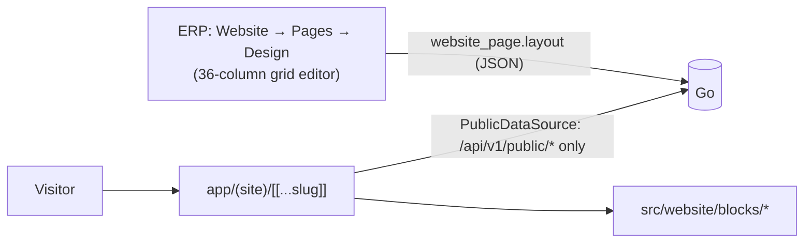

# Website Builder

The public website is server-rendered by the same Next.js service as the ERP, from pages staff
design in the ERP's **Website** app. A page is a grid of **blocks**, each reading only data the site
is allowed to read. For the backend model (publishing, visitor accounts, routing) see
[Website & Public Access](../core/website.md).

## Rendering a page

`app/(site)/[[...slug]]` fetches the published `website_page` for the slug (Next Data Cache),
renders its `layout` with the block components, adds a header from `in_menu` pages and a footer
linking `/legal-notice` once a legal notice is set. Blocks read data through a `PublicDataSource`
that only ever calls `/api/v1/public/*` — the site can never show something that isn't published.

URL shape `/<slug>/<id>` lets **one** generic detail page serve every record: a `record_detail`,
`event_booking` or `appointment_booking` block with no fixed id reads it from the URL, and list
blocks link to it through their `detail_slug`.

## Blocks

| Block | Shows |
|---|---|
| `text` | plain text |
| `image` | a record's picture filling the block, optional hero title/subtitle/button over it |
| `hero` | title, subtitle, button; `align` / `valign` / `button_size` / `padding` |
| `section` | a background band (color and/or a record's picture, `parallax`, `dim` %); paints under blocks overlapping it |
| `record_list` | up to 100 rows; the visitor toggles grid/table and 10/25/50 per page |
| `record_detail` | one record (fixed or from the URL), optional `related` rows as a picker (e.g. product → variants) |
| `record_carousel` | hand-picked or first records as a scroll-snap row of cards |
| `image_carousel` | a picture carousel (arrows + dots) |
| `event_list` | upcoming events with next session and seats left; option `nearest` sorts by the visitor's position |
| `event_booking` | a session event's sessions + booking form (waiting list, paid sessions, `.ics` link) |
| `appointment_booking` | week-by-week slot picker over computed slots + booking form |

The block set is closed: Go validates it (`TestBlockTypes_MatchFrontend` keeps both sides equal).
Adding a block means a component in `src/website/blocks/`, its entry in `BLOCK_TYPES`, its editor
panel, and the Go list.

## The editor

`/app/website/pages/:id/design` is a drag-and-drop **36-column** grid (12 px rows, 8 px gaps) with
live previews and a settings panel per block.

- **Table and field pickers** offer every table a module declared public-capable with its declared
  fields. A field the site can't read yet is flagged with a **Publish** button, which publishes it
  (keeping the table's other published fields and filter). Go still enforces the module's ceiling
  and `settings:website:write`.
- **Record pickers** search as staff, so unpublished rows are offered too; picture pickers offer
  only fields that can hold one, and pick records that actually have a picture.
- A page containing a `section` switches to free placement (overlap allowed) so blocks can sit on it.
- The page background (`background`, `background_parallax`) is set in the page form and drawn
  behind the whole page.

!!! note "Previews can lag"
    Previews are keyed on each block's `{type, config}` and read through the Data Cache, so they
    can trail a data change by up to 60 s. Publishing re-runs every preview.

## Booking from the site

Booking blocks post to the BFF route `POST /api/site-booking` (forwarding the visitor's token when
signed in, never the ERP one). Seats-left and slot reads are cached 60 s and expired on every
booking or cancellation; a 409 says "just taken" and refetches. A response carrying `checkout_url`
redirects to the payment page; `/booking/paid` is only the return page — the webhook confirms.

Emailed tokens are spent by a button click, never on GET: `/booking/cancel?token=`,
`/booking/claim?token=` (waiting-list offer), `/account/verify?token=`. `/account` lists the
visitor's bookings with "Add to calendar" links. See [Events & Booking](../core/events.md).

## Safety

- Block links go through `safeHref` (http(s), `mailto:`, relative only); `?next=` through
  `safeNext` (same site, never the ERP, no dot segments).
- The legal notice and the `text` block are plain text — never HTML.
- The host comes from the gateway-set `Host` header, never `X-Forwarded-Host`.

## Related

- [Website & Public Access](../core/website.md) · [Events & Booking](../core/events.md)
- [ADR-025](../adrs/025-public-access-and-website-identities.md) · [ADR-026](../adrs/026-website-routing-and-erp-base-path.md) · [ADR-027](../adrs/027-booking-capacity.md)
