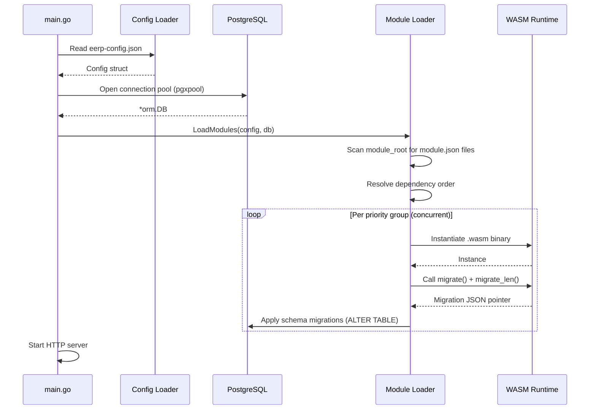

# Getting Started

This guide walks you through running EERP locally and making your first change.

---

## Prerequisites

| Tool | Minimum version | Purpose |
|---|---|---|
| Go | 1.26 | Backend runtime, and module WASM cross-compilation (see note below) |
| Docker / Docker Compose | v2 | PostgreSQL dev database + Garage (object storage) |
| Node.js | 20+ | Next.js front server (dev and prod runtime) |
| Make | any | Developer task runner |

!!! note "No Rust toolchain needed"
    Module WASM binaries are **Go source cross-compiled to WASI** (`GOOS=wasip1 GOARCH=wasm go
    build`), not Rust — see [Module System](core/module-system.md#module-anatomy). You only
    need the Go toolchain already listed above. In practice you won't even need that: every
    module shipped today has `"type": "go"` in its `module.json`, so it compiles straight into
    the core binary and the WASM build step never runs for it.

---

## Clone and Configure

```bash
git clone https://github.com/noiia/EERP.git
cd EERP
```

Copy and adjust the runtime configuration:

```bash
cp eerp-config.json.example eerp-config.json
```

The only fields you typically need to change locally are `module_root` (absolute path to where your compiled modules live) and `master_key` (used for signing tokens). See [Configuration](core/configuration.md) for a full reference.

---

## Start the Database

```bash
docker compose up -d
```

This starts PostgreSQL 18 on `localhost:5432` with:

- Database: `poc`
- User: `postgres`
- Password: `postgres`

---

## Object Storage (optional)

Picture and signature fields need S3-compatible object storage. Locally this is [Garage](https://garagehq.deuxfleurs.fr/), started as part of `docker compose up -d` and bootstrapped once with:

```bash
make garage-init
```

Skip this if you don't need picture/signature widgets — everything else runs without it. See [Object Storage](core/object-storage.md) for the full config reference.

---

## Run Everything

```bash
make run
```

This target starts three processes in sequence:

1. Database (Docker, if not already running)
2. Backend (`go run ./cmd/app/...`)
3. Frontend (`npm run dev` — Next.js front server on `:3000`)

### Run only the backend

```bash
make run-back
```

### Run only the frontend

```bash
make run-front
```

---

## Build WASM Modules (optional)

A module opts into the WASM-loaded path by setting `"type": "wasm"` in its `module.json`; the core
cross-compiles it — Go source, not Rust — to WebAssembly System Interface (WASI) via `GOOS=wasip1
GOARCH=wasm go build`. To build every such module:

```bash
make build
```

The compiled `.wasm` binaries are placed into the module directories, and the module loader
auto-discovers them on startup. **You can skip this step entirely for local development**: every
module shipped in this repository today has `"type": "go"`, compiles straight into the core
binary, and never touches the WASM path. See [Module System → The WASM/WASI
path](core/module-system.md#module-anatomy) for when you'd actually reach for `"type": "wasm"`.

---

## Project Startup Sequence

When you run the backend, the following happens in order:



---

## Seeding Demo Data

Settings → Developer (`/settings/developer`) has a "Seed demo data" button that creates a batch of fake contacts, CRM records, and tags through the ordinary generic entity API — useful for quickly populating a local workspace to click around in. It's a **development-only** tool: the button is disabled outside dev, and the underlying Server Action independently refuses to run when `NODE_ENV=production`, so it can't be reached against a real tenant by any path.

---

## Running Tests

### Unit tests (no database required)

```bash
make run-back-tests BACKTESTPATH=./orm/...
```

### Integration tests (requires Docker database)

```bash
make run-back-tests BACKTESTPATH=./orm/pool/db/...
```

### Single test by name

```bash
make run-back-tests BACKTESTPATH=./orm/... ARGS="-run TestFindOne"
```

---

## Next Steps

- Read [Architecture Overview](architecture/index.md) to understand how the layers relate.
- Read [Building a Module From Scratch](developer-guide/module-from-scratch.md) to scaffold and wire up your first module end to end.
- Read [ORM](core/orm.md) to understand how to work with the database.
