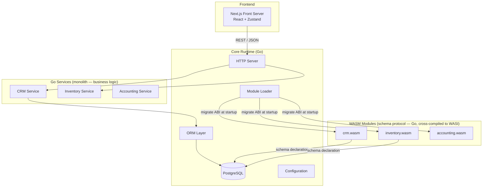

# EERP Developer Documentation

EERP is an open-source, modular ERP framework built around three principles: **type safety without runtime cost**, **modular extensibility via a hybrid WASM/Go model**, and **ERP-domain defaults baked into every layer**.

This documentation is written for developers joining the project. It explains not just what the code does, but _why_ it was built this way.

Our graphify : [graphify-eerp](https://graphify.eerp.elnoia.fr)

---

## What EERP is

EERP is a **framework**, not an application. Its job is to provide a runtime and a set of contracts against which independent ERP modules (inventory, CRM, accounting, HR, etc.) are developed and loaded.

EERP uses a **hybrid module model**:

- **WASM component**: a module's own Go source, optionally cross-compiled to WebAssembly System Interface (WASI) via `GOOS=wasip1 GOARCH=wasm go build` — **not Rust**, despite older documentation and folklore to the contrary. Responsible only for declaring the module's database schema via the `migrate()` ABI, sandboxed inside Wasmtime at startup, when a module opts into this path.
- **Go service** (monolith): implements all business logic, directly compiled into the core binary. Uses the ORM and is wired into the HTTP server.

This split gives you schema isolation and sandboxing at startup, and maximum performance at request time.

> **Current state**: every module shipped today sets `"type": "go"` in its `module.json` — it compiles straight into the core binary via `module.RegisterGoModule`, and its schema is derived automatically by the ORM's own `orm.Register[T]` auto-migration diffing, not the WASM `migrate()` ABI. The WASM/WASI loader is fully implemented and active (`core/internal/module/load.go`) for the `"type": "wasm"` path, but no module currently uses it in production. See [ADR-002](adrs/002-wasm-modules.md).



---

## Stack at a Glance

| Layer | Technology | Why |
|---|---|---|
| Backend | Go 1.26 | Static binaries, excellent concurrency, strong type system |
| ORM | Custom (pgx v5) | Zero reflection at query time, ERP-specific features |
| Module schema (optional) | Go → WASI (Wasmtime) | Sandboxed schema declaration via the `migrate()` ABI, when a module opts in; every shipped module today instead uses `"type": "go"` and the ORM's own auto-migration |
| Module logic | Go (monolith) | Zero IPC overhead, full ORM access, single binary deploy |
| Database | PostgreSQL 18 + PostGIS + `pg_trgm` | Mature, feature-rich; native geographic columns and trigram search indexes |
| Read cache (optional) | Redis | Generation-counter invalidation, fails open — see [Redis Read Cache](core/query-cache.md) |
| Messaging | NATS | Load-balances PDF rendering across `pdf-service` replicas; version probes |
| Live updates | WebSocket (one per tab) | Presence and notifications — see [Live Channel](core/live-channel.md) |
| Object storage | Garage (S3-compatible) | Pictures, signatures, generic attachments, and generated PDF reports |
| PDF reports | Headless Chromium (`pdf-service`) | Real CSS/Tailwind fidelity, reuses the same descriptor model as on-screen views — see [ADR-011](adrs/011-pdf-report-generation.md) |
| Gateway | nginx, TLS + HTTP/2 | Terminates TLS at the edge; HTTP/2 multiplexes the browser's many small relation-fetch requests — see [ADR-018](adrs/018-http2-edge-rest-batching.md) |
| Frontend | React + Next.js (App Router) + TypeScript | Largest ecosystem and talent pool; runs on a dedicated front server (BFF) serving both the public website (`/`) and the ERP (`/app`) |
| Frontend state | Zustand | Selector-based subscriptions avoid React Context re-render cascades; ~1 KB |

---

## Documentation Map

| If you want to… | Start here |
|---|---|
| Run the project for the first time | [Getting Started](getting-started.md) |
| Understand how all the pieces fit | [Architecture Overview](architecture/index.md) |
| Work with the database | [ORM](core/orm.md) · [Database Layer](core/database.md) |
| Build a module (WASM/WASI path, rarely needed) | [Creating a WASM/WASI Module](developer-guide/creating-a-module.md) |
| Build a module (Go monolith path) | [Creating a Go Module](developer-guide/creating-a-go-module.md) |
| Understand the frontend | [Frontend Overview](frontend/index.md) · [View Engine](frontend/view-engine.md) |
| Add a frontend view to a module | [Creating a Frontend Module](developer-guide/creating-a-frontend-module.md) |
| Add a new data entity | [Creating an Entity](developer-guide/creating-an-entity.md) |
| Scaffold a whole new module | [Building a Module From Scratch](developer-guide/module-from-scratch.md) |
| Use a specific view type or widget | [Views & Components](frontend/views-and-components/index.md) |
| Understand workspace settings, locale, tax mode | [Settings & Workspace Configuration](core/settings.md) |
| Add a scheduled background job | [Background Cron Scheduler](core/cron.md) |
| Generate a PDF report | [Reports & PDF Generation](core/reports.md) |
| Run EERP in production (Let's Encrypt, behind a reverse proxy…) | [Deployment & Bootstrap](developer-guide/deployment.md) |
| Publish data and pages on the public website | [Website & Public Access](core/website.md) · [Website Builder](frontend/website-builder.md) |
| Sell event seats or appointments | [Events & Booking](core/events.md) · [Payments](core/payments.md) |
| Send an email | [Mail: Outbox & Templates](core/mail.md) |
| Show progress or notify a user | [Notifications](core/notifications.md) · [Live Channel](core/live-channel.md) |
| Sign staff in with LDAP / OIDC | [External Sign-In](core/external-auth.md) |
| Store locations and zones | [Geographic Fields](core/geo.md) |
| Keep big lists fast | [List Read Performance](core/list-performance.md) · [Redis Read Cache](core/query-cache.md) |
| Manage several databases on one server | [Database Management](core/database-management.md) |
| Know which version is running / add a service | [Versioning](core/versioning.md) |
| Fill a workspace with demo data | [Demo Data](core/demo-data.md) |
| Understand the edge gateway / TLS+HTTP2 | [Architecture → Edge Gateway](architecture/index.md#edge-gateway-api-gateway) |
| Compare how pictures/attachments/reports use S3 | [Object Storage Across Layers](architecture/object-storage-topology.md) |
| Write tests | [Testing](developer-guide/testing.md) |
| Understand a design decision | [ADRs](adrs/index.md) |

---

## Repository Layout

```
EERP/
├── core/                         # Go backend (module "core")
│   ├── cmd/app/main.go           # flags + config loading only
│   ├── internal/
│   │   ├── app/                  # Build (wiring, routes) + Run (background jobs, serve)
│   │   ├── module/               # module detection, loading, live lifecycle, App Store API
│   │   ├── auth/ (+ providers/)  # sessions, users/roles admin, LDAP/OIDC sign-in
│   │   ├── settings/ website/ notify/ presence/ mail/ payment/ …  # core services
│   │   └── testdb/               # the one way tests reach the database
│   ├── orm/                      # custom ORM (public facade: core/orm)
│   └── modules/                  # business modules (crm, contact, sale, event, website, …)
│       └── <name>/               #   module.json, module.go, views/, reports/, i18n/
├── core-front/                   # Next.js service — pnpm workspace
│   ├── packages/core-front/      #   @eerp/core-front: the view engine (the frontend ABI)
│   └── apps/shell/               #   the host app: site (/), ERP (/app), BFF (/api)
├── tools/
│   ├── pdf-service/              # headless-Chromium PDF renderer (own image)
│   └── eerp-init-module/         # module scaffolder
├── infra/                        # bootstrap scripts, nginx, certbot, Garage
├── compose.yml, compose.prod.yml # dev stack / production overrides
├── eerp-config.*.example.json    # config templates (real configs are gitignored)
└── Makefile                      # bootstrap, run, test, …
```
